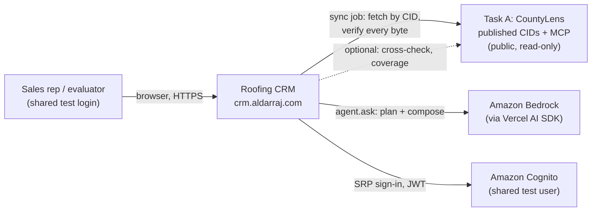
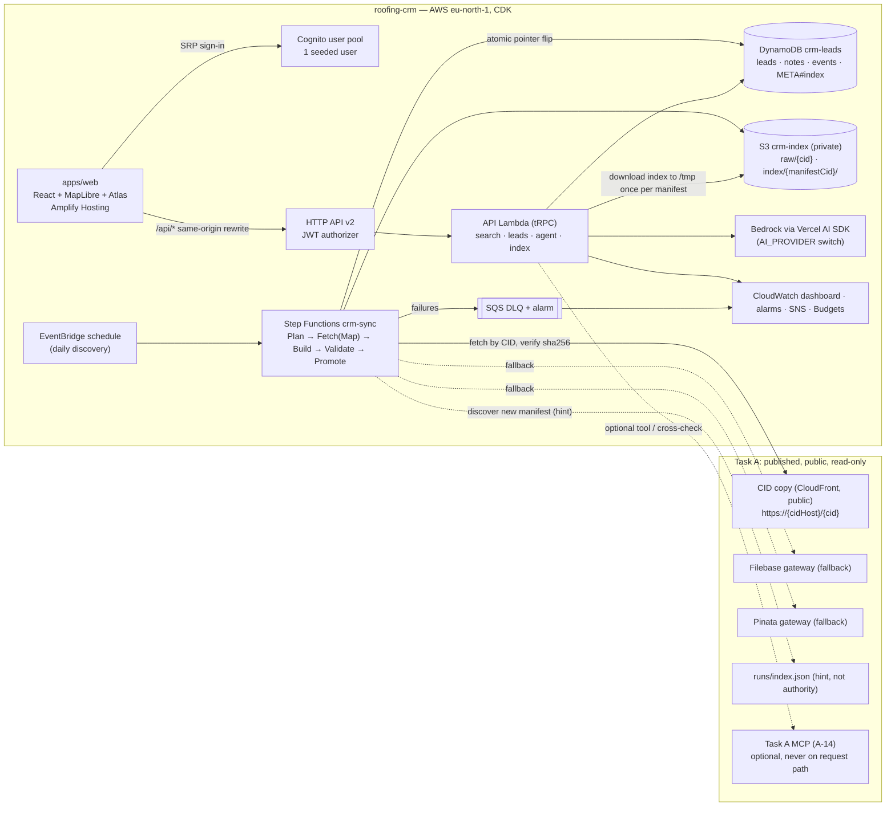

# Architecture Constitution: Roofing CRM

> This is the document that every Spec Kit `plan.md` and every code review is checked against. Project-wide governance (the Soofi Golden Path) lives in `.specify/memory/constitution.md`. This file adds the **component-level** decisions for this repo, drafted from `docs/plan.md` (G2 approved), `docs/feature-list.md` NFRs, `../assessment-guide/reference/B-roofing-crm.md` § 3–4, and the four read-only kit-agent design consults in `docs/decisions/0000-agent-architecture.md` (metagross, alakazam, espeon, mew), reconciled against the PO's decisions on 2026-10-23.

## 1. Architecture style

- **Style:** Modular monolith in a Turborepo, with one event-driven batch pipeline (the sync job) feeding it. No microservices split.
- **Primary stack:** React + Vite + MapLibre GL (web) · tRPC on Lambda behind API Gateway (api) · DuckDB over Parquet in the API Lambda (search) · Step Functions + Lambda (sync) · DynamoDB (leads) · Cognito (auth) · Amplify Hosting · CDK (TypeScript only).
- **Kit guidance:** `apply-engineering-guidelines`, `build-frontend-backends`, `build-rag-systems` (with the recorded deviation in § 13), `build-batch-workflows`, `build-ai-agents`.
- **Source of the design:** `metagross` (monorepo, API, deploy), `alakazam` (search store, agent), `espeon` (sync pipeline mechanics, reconciled onto `metagross`'s store choice), `mew` (lead domain model). See `docs/decisions/0000-agent-architecture.md` for the full read-only consults and the PO's reconciliation below.

---

## 2. Diagrams (C4 levels 1–3)

### 2.1 Context (C4-1)



The CRM is the only system a rep touches. It never reaches Task A's internal stores (Query DB, buckets, SSM), only Task A's published, CID-verified bytes and (optionally, never on the request path) its MCP.

### 2.2 Container (C4-2)



**How to read it:** the browser talks to one origin. Amplify forwards `/api/*` to the HTTP API, so there is no CORS or API subdomain. The sync job is the only component that talks to Task A; it builds the CRM's own verified copy, and the API Lambda never calls Task A at request time.

### 2.3 Component (C4-3): the sync pipeline

```mermaid
stateDiagram-v2
  [*] --> Plan: new manifestCid (pinned SSM, or a hint to verify)
  Plan --> FetchPart: profiles[] digests match the vendored copy
  Plan --> Held: profile drift (digest mismatch)
  FetchPart --> BuildIndex: every part's sha256 = its CID (Map, concurrency 3)
  FetchPart --> DLQ: 5 retries exhausted (backoff + jitter)
  BuildIndex --> Validate: crm_property / crm_permit Parquet written
  Validate --> Promote: counts = manifest coverage; 0 rows without provenance
  Validate --> Held: reconcile diff unexplained, or rejects found
  Promote --> [*]: META#index pointer flipped (atomic)
  Held --> [*]: current run keeps serving; data chip + alarm
  DLQ --> [*]: alarm; current run keeps serving
```



### 2.4 Component (C4-3): a search / agent request

```mermaid
sequenceDiagram
  autonumber
  participant U as Rep (browser)
  participant W as apps/web
  participant L as API Lambda (tRPC)
  participant X as CRM index (DuckDB over S3 Parquet)
  participant M as Bedrock (via AI SDK, agent.ask only)
  U->>W: pin + radius, or a plain-language question
  W->>L: search.properties / search.permits, or agent.ask
  L->>L: read META#index pointer (cached ≤ 60 s)
  alt sandbox has no /tmp/{manifestCid}
    L->>X: download index/{manifestCid}/*.parquet once
  end
  opt agent.ask only
    L->>M: plan → QueryPlan (Zod); compose → claims + citations
  end
  L->>X: bbox + haversine + filters (same query path as the map)
  L-->>W: rows + counts + provenance + manifestCid
```

Diagrams are kept here and copied to `docs/diagrams/` for the PR body.

---

## 3. Key decisions (with options and rationale)

Each row traces to the read-only consults in `docs/decisions/0000-agent-architecture.md` and the PO's decision recorded there on 2026-10-23 (see "Decisions to take at G3").

| ADR | Decision | Options considered | Rationale | Status |
| --- | --- | --- | --- | --- |
| ADR-01 | **Search/retrieval store: DuckDB over Parquet in the API Lambda.** No OpenSearch domain built. | DuckDB over CRM-owned Parquet (metagross D-2, alakazam R-1/R-2) · OpenSearch `t3.small.search` 1 node (espeon) · DuckDB-WASM in the browser (rejected: 15–42 s p95 on Task A's measurement, fails SC-01 by 5–14×) | Task A measured DuckDB in a Lambda in `eu-north-1` at p95 200 ms (radius) / 95 ms (roof age) over 2.38 M rows. `contract/v1` publishes no free text, so OpenSearch's vector search earns nothing yet. OpenSearch costs ~$31/month idle against a $137.85 shared credit. **This is a recorded deviation from the kit's `build-rag-systems` production-store default** — see § 13. | Accepted (PO, 2026-10-23) |
| ADR-02 | **Sync reads Task A's public CloudFront CID copy first, then Filebase, then Pinata.** Never ipfs.io/dweb.link (retired). | CloudFront copy first (metagross, alakazam) · gateways only, IAM Deny on Task A ARNs (espeon) | Confirmed fact: Task A's CloudFront copy is public (OAC to a private bucket, CORS `*`, no signed URLs — espeon's signed-URL objection described a removed spike stack). Every byte is still verified against its CID regardless of source. It is the fastest source and avoids Filebase's measured 429s after ~50–65 rapid requests. | Accepted (PO, 2026-10-23) |
| ADR-03 | **Owner name is never indexed, displayed or sent to the model.** Only `ownerKind`, `tenureYears`, `isLongTenure`, `ownerAreaClass` are indexed (needed for the agent's G4 "owner outside area" query). | Exclude owner name entirely (metagross, alakazam, mew) · index + show on the property page (espeon's `PropertyDoc.owner_name`) | Privacy on a shared login: a roofing lead is actionable without the owner's name. 3 of 4 consults agree. | Accepted (PO, 2026-10-23) |
| ADR-04 | **Lead identity key:** `{fips}:tcad:{request_identifier}` (e.g. `48453:tcad:0208011301`), never `property_cid`. Gapless event-sourced history (`EVT#{sequence}`, never sorted by time); status/assignee are a projection replayed from events; the signals snapshot is a separate immutable record using exact `contract/v1` column names. **Full DynamoDB item shapes (`pk`/`sk`/attributes, GSIs) are specified at story time in `specs/007-leads/agent-design.md` (mew, per constitution Article XIV), not here** — this ADR fixes the key and history model only. | mew's key + event model (chosen) · metagross's `UNIQ#PROP#{tcadId}` + ULID + time-ordered `HIST#{ts}` + inline `signals` · espeon's `tcad:{parcel_identifier}` (rejected: `parcel_identifier` is nullable, which would fall back to a CID — the one thing every consult agrees to avoid) | `request_identifier` (the TCAD account id) is confirmed never empty in `contract/v1` and is the county's own stable account number; a CID changes whenever Task A republishes a changed record (certain once A-04 lands). Gapless sequencing avoids mis-ordering same-millisecond writes; a separate snapshot lets the "Now · Run n" comparison be field-by-field. | Accepted (PO, 2026-10-23) |
| ADR-05 | **Run discovery and promotion:** a pinned manifest CID in SSM (`/roofing-crm/source/manifest-cid`) is the authority. `runs/index.json` and the MCP's `list_runs` only *propose* a CID, which is then independently CID-verified and lineage-checked. `AUTO_PROMOTE` (SSM, default `true`, set `false` during the demo freeze) controls whether a validated newer run flips the pointer automatically. Discovery polls daily. A run is held for operator approval on a lineage fork, an older `finishedAt` than current, or exceeding the cost gate ($1.00 predicted spend, 600,000 documents, or 2 GB to download). | Pinned-CID authority + `AUTO_PROMOTE`, daily (metagross) · hourly polling, no pinned override (espeon) — **merged**: metagross's authority/freeze mechanism + espeon's lineage/cost-gate safety | A pinned CID gives a reliable demo freeze; lineage and cost gates stop a stale, forked, or unexpectedly large run from silently promoting. Daily polling matches Task A's actual publish cadence and the ≤24 h freshness NFR; hourly buys little. | Accepted (PO, 2026-10-23) |
| ADR-06 | **One agent contract**, reconciling metagross's and alakazam's differing quotes of "the same" schema onto alakazam's version: `QueryPlan` / `AgentAnswer` (Zod), radius 0.5–25 mi, ≤ 3 model calls (plan, ≤1 repair, compose), ≤ 25 compact rows to the model / ≤ 1,000 to the UI by `resultSetId`, numeric confidence bands for place resolution (auto ≥ 0.92, clarify 0.80–0.92, refuse < 0.80), a non-writing `proposeLeads` tool (the UI calls `leads.create` only after the rep confirms), and `ConversationEventStore` with a DynamoDB adapter as primary (AgentCore Memory may be added later behind the same port once proven creatable on the free plan). | alakazam's contract (chosen) · metagross's `OpportunityQuery` variant (radius ≤50 mi, ≤2 model calls, AgentCore Memory primary) | alakazam is the RAG/agent specialist; its outcome states map 1:1 to the design's board states. Travis County's diagonal is ~50 mi, so a 50 mi radius adds nothing a 25 mi cap doesn't already cover. AgentCore Memory creation on the free plan is unproven; alakazam itself names DynamoDB as the fallback, so it is the safer default. | Accepted (PO, 2026-10-23) |
| ADR-07 | **Vendor (copy), never re-implement, Task A's `query-core` + `contract` packages**, pinned to a named Task A commit, with a `profiles[].sha256` digest guard that holds the sync on drift. Every vendored file and its source commit/sha256 is recorded in `docs/reuse-log.md` (plan.md RISK-07). The CRM never re-derives `status_class`, `open_days`, roof age or owner rules. | Vendor with digest guard (all 4 consults agree) · re-derive the rules in the CRM (rejected: would let the CRM and Task A disagree on what "open" or "aged" means) | Keeps one meaning of every derived field across both tasks; the digest guard makes drift loud instead of silent. | Accepted (all consults) |
| ADR-08 | **No embeddings or vector field in v1.** `EmbeddingService` is a defined port with no adapter. | No embeddings (all 4 consults agree) · embed permit/contractor text once v1.1 publishes it (documented re-entry path only) | `contract/v1` publishes no permit description, contractor name, or BBB text to embed. Building "semantic search" over nothing would be invented, not RAG. | Accepted (all consults) |

---

## 4. Layer boundaries

> **Note on constitution Article IV:** `packages/domain`, `packages/index-schema`, `packages/oracle-contract` and `packages/oracle-views` together *are* this project's realization of Article IV's `packages/shared` (Zod schemas, lead rules), split by concern — pure business rules, index row shapes, and vendored Task A code are kept apart rather than merged into one package — not a replacement of it. Each type and rule still has exactly one place it is defined, which is the property Article IV protects.

| Layer | Owns | May depend on | Must not depend on |
| --- | --- | --- | --- |
| Entry (`apps/web`, `apps/api` tRPC routers / Lambda handler) | UI screens, URL-state, tRPC routers (parse input, call services, map errors to `cause.code`) | Application services, `packages/api-client`, `packages/domain` types | Domain internals, DuckDB/DynamoDB drivers, AWS SDK calls directly from a component |
| Application (`apps/api/src/services/*`) | Use cases: search, leads, agent orchestration. Services receive `LeadIndex`, `LeadRepo`, `Clock`, `Llm`, `PlaceResolver`, `MetricsSink` as injected ports | Domain (`packages/domain`), index-schema contracts, port interfaces | UI framework, HTTP/Lambda handler details |
| Domain (`packages/domain`) | Pure business rules: `isAgedRoof`, `isLongOpen`, `openDurationLabel`, `distanceMeters`, `bboxFor`, `leadSignalsFrom`, `propertyKey`, URL-state codec, agent ranking (`rankCandidates`) | Domain types only (`packages/index-schema`, `packages/oracle-contract`) | HTTP, AWS SDK, databases, React |
| Data (adapters) | `DuckDbParquet` (search), `CidFetcher` adapters (`CloudFrontCopy`, `Filebase`, `Pinata`), DynamoDB repositories, `OracleMcpClient` | Domain contracts, port interfaces, AWS SDK | UI, application-level decisions |
| External | Task A's published CID copy and gateways, Task A's MCP (optional), Bedrock / AI Gateway via the Vercel AI SDK, Cognito | Integration contracts (ports) | Domain internals |

---

## 5. Business-logic placement

- Handlers (tRPC routers) validate with Zod, map, and delegate only — no business rule lives in a router.
- Shared rules live in `packages/domain`, unit tested there, and are imported by the web app, the API services and the agent's tools, so no threshold or label is ever written twice (SC-06's "the map, the list and the agent never disagree" depends on this).
- UI components never own durable business rules; they render `Provenanced<T>` data and typed states (`cause.code` → exactly one prototype state component, enforced by an exhaustive `switch`/`never`).
- Vendored code (`packages/oracle-contract`, `packages/oracle-views`) is read-only reuse of Task A's semantics, used only by `apps/sync` (index build) and the agent's place resolver — it is never a place for the CRM to add its own rules.

---

## 6. Contracts and validation

- **Request / response:** Zod schemas in `packages/domain` and `packages/index-schema`; used by tRPC routers and by every agent tool. No `any`.
- **Data contract (upstream, read-only):** Task A's `contract/v1` (`oracle-travis-run-manifest.v1` manifest; `v_property`, `v_roofing_permit`, `v_contractor`, `v_run` views; closed enums `status_class`, `bbb_status`, `contractor_resolution`, `roof_age_basis`, `roof_age_confidence`, `coordinate_source`, and the 21 `missing` reasons). The CRM accepts additive top-level manifest keys and additive columns (v1.1), and refuses an unrecognized major contract version (detected by schema fingerprint, since the manifest carries no explicit `contract` field today — see § 13 open item).
- **Data contract (CRM-owned):** the `LeadIndex` port (`searchProperties`, `searchPermits`, `getProperty`, `indexInfo`), the `QueryPlan`/`AgentAnswer` agent contract (ADR-06), and the DynamoDB lead item shapes (ADR-04).
- **Validation boundary:** every tRPC input is Zod-validated with explicit bounds (radius ≤ 25 mi for the agent / ≤ 50 mi for the map, page limit ≤ 100, note ≤ 4,000 chars, question ≤ 500 chars) before any application logic runs. Every tool input is Zod. The sync job Zod-validates the manifest, every document, and the `SyncReport` before promotion.

---

## 7. Data access rules

- Property and permit data comes **only** from Task A's published, CID-verified artifacts (CloudFront copy, then Filebase, then Pinata — ADR-02) or Task A's MCP (cross-check only, never on the request path). No `s3:GetObject` on Task A's buckets, no reading `/countylens/*` SSM parameters, no CloudFormation imports from Task A stacks, no calls to Task A's tRPC API, no Query DB access. Both tasks share one AWS account; the CRM's IAM roles carry an explicit **Deny** on Task A's resource ARNs as a second line of defense (espeon P0-1), in addition to never calling those APIs in code.
- Leads are the CRM's own data, stored in DynamoDB, owned and written only by the CRM (constitution B2). The sync job never edits or deletes a lead; a property absent from a new run puts the lead's "Now" view into a stale/"not in Run n" state, computed at read time.
- Every row, index document, and agent claim carries provenance (`cid`, `source_url` or its missing reason, `captured_at`, `table_cid`, `run_id`, `manifest_cid`, `as_of`). A null field always carries its `missing` reason from Task A's closed list; the CRM never geocodes, guesses, or invents a value.

---

## 8. Async and integration rules

- The sync job is the only queued external boundary: bounded concurrency (2–3 parallel fetches), a per-gateway rate limit (≤ 30 requests/min), exponential backoff with full jitter on 429/5xx, a DLQ, and one self-resolving CloudWatch alarm on that DLQ (constitution VII).
- Synchronous external calls (the agent's model calls, the optional MCP cross-check) have explicit, nested timeouts: the agent aborts server-side at 23 s, the Lambda times out at 28 s, the HTTP API limit is 30 s — so the rep sees a typed "took too long" state, never a 500.
- The sync never re-downloads a byte it already has (content-addressed S3 keys, `If-None-Match` writes); the Step Functions execution name is the manifest CID, so the same run cannot run twice concurrently.
- A newer run is never promoted until `Validate` passes (row counts reconcile against the manifest's `coverage`, 0 rows without provenance) — the pointer flip (`META#index` conditional put) is the only moment users see a different run, and it is atomic.
- Stop on a CID or sha256 mismatch (quarantine the run, alarm, keep serving the current one); no bypass of a failed verification; no CAPTCHA bypass or scraping is in scope (the CRM is a data consumer of Task A's public artifacts only).

---

## 9. Module boundaries

| Module | Owns | Public contracts | Must not |
| --- | --- | --- | --- |
| `apps/web` | Screens: Sign-in, Map, Candidates, Triage, Leads, Lead, Ask, Coming soon, Data panel | Consumes `packages/api-client` only | Import `@trpc/client` or call `fetch('/api...')` directly (ESLint `no-restricted-imports`); own business rules |
| `apps/api` | tRPC `AppRouter` (`health`, `index`, `search`, `properties`, `leads`, `agent`), services, the DuckDB adapter, the agent tool loop, and the `ConversationEventStore` port (ADR-06) with its DynamoDB adapter, living in `apps/api/src/services/agent` | `AppRouter` type, exported only through `packages/api-client` | Call Task A's internal API/buckets/SSM; re-derive Task A's view semantics |
| `apps/sync` | Step Functions handlers: `Plan`, `FetchPart`, `BuildIndex`, `Validate`, `Promote` | Writes `S3 crm-index` + the `META#index` pointer in DynamoDB | Write leads; run outside the queued/idempotent boundary (§ 8) |
| `packages/domain` | Pure rules (§ 5), shared by web, api, sync and the agent | Pure functions, no I/O | Perform I/O, import AWS SDK or React |
| `packages/index-schema` | Zod + TS for `crm_property`, `crm_permit`, `index_meta`, `Provenanced<T>` | Shared reader (api) / writer (sync) schema | Diverge between reader and writer |
| `packages/oracle-contract`, `packages/oracle-views` | Vendored, pinned copies of Task A's `contract` and `query-core` (ADR-07), with a header naming the source commit | Used only by `apps/sync` and the agent's place resolver | Be imported by `apps/web`; be edited to add CRM-specific logic |
| `packages/api-client` | The only tRPC client factory + React Query hooks + `AppRouter` type re-export | Consumed by `apps/web` only | Be bypassed by any other package |
| `packages/ui` | Atlas-token components (`ProvenanceLine`, `MissingValue`, `DataChip`, …) | Design-system components only | Contain business rules or fetch data itself |
| `packages/config` | Zod-parsed runtime config (region, `AI_PROVIDER`, model ids, source hosts, thresholds) | Fails fast at cold start | Hard-code a region, model id, or threshold anywhere else in the codebase |
| `infra` | CDK stacks: `CrmData`, `CrmSync`, `CrmApi`, `CrmWeb`, `CrmDomain`, `CrmOps` | Typed CDK props between stacks | Reference `CountyLens*` stack exports or resources by name string |

---

## 10. Non-functional requirements

Consolidated per ADR (D7): the stricter number wherever the four consults' proposed thresholds differed and a stricter number was safely achievable now; otherwise the number with the stronger measured basis, marked as a projection to re-tighten once B-02 measures it (PO decision, 2026-10-23). The sync-duration row below deliberately keeps espeon's slightly looser number over metagross's — see `docs/decisions/tech-debt.md` TD-1.

| NFR | Threshold | How it is verified |
| --- | --- | --- |
| Search, end to end (pin/GPS + radius + filters) | p95 < 3 s on the hosted URL (plan SC-01) | Playwright timing on the hosted URL, ≥ 20 runs |
| Search, API server time | **warm p95 < 500 ms**. **Cold p95 < 3 s only for a sandbox that already has today's manifest's index in `/tmp`** (a fresh deploy or a config change, not a per-request cold start — the index is downloaded once per sandbox and reused). | Powertools `SearchLatencyMs` metric, segmented by cold/warm |
| Index cold load (first download + open DuckDB, full county, once per manifest per sandbox) | **≤ 3 s** (tightened from the metagross/alakazam/espeon range of <2–6 s projections; measure and re-tighten in B-02). This is a one-time-per-sandbox cost, separate from and not counted inside the "cold p95 < 3 s" search-server-time row above — a request that triggers the index download is tracked under its own metric and is allowed to exceed 3 s until B-02's measurement sets a firm number. | `IndexColdLoadMs` metric |
| Sync duration, A-03-sized run | **≤ 5 min** end to end; a rerun creates 0 new S3 objects | `SyncDurationMs`; compare S3 keys/counts on rerun |
| Sync duration, full county | **≤ 30 min** end to end; build step < 12 min (else switch to Fargate) | `SyncDurationMs` |
| Gateway politeness | **concurrency 2**, ≤ 30 requests/min per gateway, ≤ 5 retries with backoff+jitter before switching gateway | Fault-injection test via the `Fixture` fetcher |
| Index fidelity | Index `properties` = manifest `coverage.parcels_published`; permits = published roofing-permit count; difference 0 or each difference documented; **0** rows without provenance; rejects ≤ 0.1% (0 for A-03) | `Validate` step, `porygon` review, `donphan` MCP cross-check after A-14 |
| Freshness | A validated newer run promoted ≤ 24 h after it appears in `runs/index.json` or `list_runs` (when `AUTO_PROMOTE`) | Daily schedule; `IndexManifestAgeHours` metric |
| Lead integrity | Duplicate create refused 100%, including 20 concurrent creates (exactly 1 winner); 0 lost updates (a write that targets an already-taken `EVT#{sequence}` is refused, per ADR-04's gapless event sequence, not a mutable `version` attribute); created leads survive a reload 100% | Concurrency test on the deployed table |
| Agent | First useful answer p95 < 20 s; server abort 23 s; ≤ 3 model calls per ask; 5 asks/min/user; $3/day cap | Golden-query Vitest ×20 against the deployed endpoint |
| Agent groundedness | 100% of cited CIDs exist in the current index; 0 invented addresses, names or ratings; recall ≥ 80% of top-N against `query-core` SQL | Server-side citation gate + golden replay |
| Cost | Idle cost ≤ $1/month excluding credits-covered requests (search store is DuckDB/S3, ADR-01); budget alerts at **$10 actual / $20 forecast** | AWS Budgets, cost tags `Project=roofing-crm` |
| Security | JWT on every route except `health.ping`; S3 private (Block Public Access, SSE, `enforceSSL`); no secrets in git, logs, or CDK context; owner names never in the index, prompts, or logs (ADR-03) | cdk-nag, log-grep test, review |
| Responsive and accessibility | 390 / 768 / 1440 all pass; WCAG 2.2 AA contrast via Atlas tokens; hit areas 48 px (24 px map markers); disabled sections use `aria-disabled` with a tooltip | `smeargle` suite |
| Observability | Every Lambda emits Powertools Logger/Tracer/Metrics with X-Ray; one self-resolving alarm per DLQ; one dashboard, namespace `RoofingCrm` | CloudWatch; trace ID in each evidence file |

---

## 11. Deployment and rollback strategy

- **Strategy:** Amplify atomic deploys for `apps/web` (branch previews on `0NN-*` branches, all sharing the one deployed API through the `/api/*` rewrite — so every API change must be additive) plus `cdk deploy` for every backend stack, deployed in order: `CrmData` → `CrmSync` → `CrmApi` → `CrmWeb` → `CrmDomain` → `CrmOps`.
- **Rollback (web):** Amplify "redeploy previous build" — the Blue/Green equivalent for the hosted site.
- **Rollback (index):** one DynamoDB write — set `META#index.current` back to `previous`. Because every run gets its own `index/{manifestCid}/` folder, rollback needs no migration and no re-sync.
- **Rollback (infra):** `cdk deploy` from the previous git tag/commit for the affected stack; stacks share values through typed CDK props, never name-string imports, so a partial rollback of one stack cannot silently break another.
- **CI:** `just setup → format → lint → type-check → test → build (vite build + cdk synth --strict with cdk-nag)` on every PR and story-branch push. No automatic deploy from CI — merging to `main` is forbidden, so the `feature/roofing-crm` branch (plus its Amplify preview) is production for this assessment.
- Detailed CDK construct patterns (one construct per concern, L2-first, least-privilege `grant*`, `cdk-nag` per stack) and the test pyramid (unit → contract → lead-transaction concurrency → API → Playwright → `smeargle`) are `apply-engineering-guidelines`'s and each story's `plan.md`'s responsibility, not restated here.

---

## 12. Blocking violations (P0)

1. **Access boundary.** Data comes only from Task A's published CIDs (CloudFront copy or gateway, CID-verified — ADR-02) or its MCP (cross-check only). No IAM access to Task A's resources (enforced by both never calling those APIs and an explicit IAM Deny on Task A's ARNs), no scraping, no ingestion, no Query DB access.
2. **CID integrity.** Every fetched byte is checked against its CID before use. A mismatch fails the part; a run with a failed part is never promoted.
3. **One run per index; atomic promotion.** Every index row and every API response carries the `manifestCid` it came from. The pointer flips only after `Validate` passes. No partial promotion.
4. **Data honesty.** Nothing invented, synthetic, or sample-shaped appears in a deployed index or UI. `contract/v1/sample.parquet` and `pilot-manifest.json` are for tests only. BBB is shown as a rating only when `bbb_status = rated`. A null `improvement_status` permit is "stalled", never "open". Missing data always says why.
5. **Same meaning as Task A.** View semantics come only from vendored `query-core` (ADR-07); the sync holds if `profiles[].sha256` differs from the vendored digest.
6. **Lead identity.** Leads are keyed and de-duplicated by `{fips}:tcad:{request_identifier}` (ADR-04), enforced by a DynamoDB transaction, never by reading first, and never by `property_cid`.
7. **No owner name anywhere** (ADR-03): not indexed, not displayed, not sent to the model, not logged.
8. **TypeScript only, CDK only, region from config.** Only CloudFront, WAF and CloudWatch Logs may use `us-east-1`. No Amplify Gen2 backend, no SAM, no console-created resources.
9. **LLM calls only through the Vercel AI SDK**, provider chosen by `AI_PROVIDER`, Zod tools, no direct provider SDK, no `any` in LLM code. The model never writes SQL, CIDs, coordinates, addresses, contractor names, or ratings — it only words an answer from server-computed rows and counts.
10. **The agent never writes a lead.** `proposeLeads` never writes; a person confirms every create through the same `leads.create` procedure as the map (ADR-06).
11. **Every tRPC input is Zod-validated**, and every non-health procedure sits behind the Cognito JWT authorizer. The test-user password lives only in Secrets Manager and the private PR note.
12. **Queued, idempotent external calls** in the sync (§ 8): bounded concurrency, backoff with jitter, a DLQ, one self-resolving alarm. Synchronous calls (agent model, MCP) have timeouts and typed recovery states.
13. **Powertools Logger, Tracer, Metrics on every Lambda**; every metric name lives in one constants file.
14. **Atlas tokens and components only.** Every data display shows provenance (run, captured at, source link).
15. **Evidence comes only from the hosted URL** (`crm.aldarraj.com` or an Amplify preview), never localhost. Never commit to `main`. Never merge the PR.

---

## 13. Accepted deviations

| Deviation | From | Reason | Mitigation | Approved |
| --- | --- | --- | --- | --- |
| No OpenSearch domain in v1; DuckDB over Parquet instead (ADR-01) | `build-rag-systems` non-negotiable: a production RAG store | `contract/v1` publishes no free text to embed; DuckDB already meets the latency NFRs at ~$0 idle cost against a shared, limited credit | Re-entry trigger (recorded by `alakazam`): revisit if Task A publishes free text **and** a golden query fails on the DuckDB path. The `RetrievalIndex`/`LeadIndex` port makes this an adapter swap, not a redesign. | PO, 2026-10-23 |
| SNS email (+ optional PagerDuty HTTPS subscription via config) instead of PagerDuty paging | Constitution Article IX | No PagerDuty account exists for a personal assessment account | Alarms still fire to SNS; the subscriber is a config value so PagerDuty Events v2 can be added later with no code change | PO, 2026-10-23 |
| A local metric-name constants file instead of org Lexicon/Main Dashboard registration | Golden Path metrics-registration non-negotiable | No org-wide metrics registry is reachable from a personal fork | All metric names live in one file (`packages/observability`), ready to register when access exists | PO, 2026-10-23 |
| The project's own `.github/workflows/ci.yml` instead of the shared `Spring-Oaks-Capital-LLC/github-workflows` callers | `integrate-ci-cd`'s shared-caller pattern | The shared reusable workflows are probably unreachable from a personal fork (Task A made the same call for the same reason) | The six-recipe `justfile` stays exactly as `integrate-ci-cd` defines it; switch to the thin callers if access is ever granted | PO, 2026-10-23 |
| Region locked to `eu-north-1` for this project | Constitution Article III's company default (`us-east-2`) | The demo AWS project is region-locked | Region is read from config everywhere (`CDK_DEFAULT_REGION`/`AWS_REGION`), never hard-coded; CDK checks it against an allowed-region list so it cannot silently drift. Only CloudFront, WAF and CloudWatch Logs may use `us-east-1`. | PO, 2026-10-23; already recorded in CLAUDE.md and Article III |
| Agent ingress is the CRM web UI (tRPC `agent.ask`), not an Asana task | `build-ai-agents`' Asana/Chat SDK ingress pattern | This agent's user is the rep in the CRM, not an Asana workflow | Everything else in `build-ai-agents` (tool loop, telemetry, memory) still applies | Recorded by `alakazam`; accepted as inherent to this product, not a PO decision point |
| LangSmith tracing is conditional on a key, not required | `build-ai-agents` tracing default | No LangSmith key is provisioned for this assessment | X-Ray/OTel via the `TraceSink` facade is always on; LangSmith attaches only if `LANGSMITH_API_KEY` exists in Secrets Manager | Recorded by `alakazam`; accepted as inherent, not a PO decision point |
| B-07's `status`/`assignee` are stored on the `LEAD` item, written only inside the same `TransactWriteItems` call that appends the triggering `EVT#{sequence}` event, rather than always recomputed by replaying the full event log on every read | ADR-04's literal wording, "status/assignee are a projection replayed from events" | `metagross`'s design consult (`specs/007-leads/agent-design.md`) fixes GSI1 (pk=`assignee`) and GSI2 (pk=`status`) for the lead list's "my leads"/status-board queries. DynamoDB cannot build a GSI over a value a reader derives by replaying an item collection — the GSI key must be a stored attribute. Pure read-time replay is correct for a single-key `leads.get` but cannot serve the GSI-backed `leads.list` queries | Writing `status`/`assignee` only inside the event-append transaction (never independently, never via a separate mutable `version` attribute) keeps ADR-04's actual concern — no out-of-band write that can race or go stale against the event log — fully satisfied: both fields are written atomically with their triggering event every time, so they can never diverge from it. Re-entry trigger: if a future story needs GSI-free lookups only, pure replay could replace this without changing the public `leads.get`/`leads.list` contract | PO, 2026-10-24 |

---

## 14. Drift handling

- P1 drift (breaks a P0 rule or an ADR above) → a refactor task in the current story; the story cannot pass G7 until it is fixed.
- P2 drift (a Task A contract change that is additive but untested here, a new `missing` reason code, a profile digest mismatch held by the sync) → logged in `docs/decisions/tech-debt.md`, with the next story expected to absorb it.
- P3 drift (cosmetic, non-blocking) → opportunistic, noted in the story's PR description.
- A vendored-package drift (ADR-07) is never silent: the `profiles[].sha256` digest guard holds the sync and the data chip reports it, which is itself the detection mechanism, not just a process note.

---

## Open items carried forward (not blocking G3, tracked for the owning story)

These were raised by one consult and not settled by the others (`docs/decisions/0000-agent-architecture.md` § "D8"). They do not change any decision above; they are follow-ups:

1. **Does an incremental Task A run (A-11 Run 2/3) publish a full snapshot, or only changed rows?** If delta-only, a full rebuild from one manifest could silently drop older permits. Mitigation already in place regardless: the sync blocks promotion on an unexplained row-count drop > 5%. Ask Task A to state this explicitly in the A-11 spec.
2. **The published manifest carries no explicit contract version field.** The CRM detects contract compatibility by schema fingerprint instead (§ 6). Ask Task A to add a `contract` field to the manifest or to `profiles[]` when FU-A-01 ships.
3. **Account-wide Lambda concurrency may be as low as 10**, shared with Task A's own functions. Check `aws lambda get-account-settings` at B-01; no design change until it is measured.

---

## Gate G3: Architecture Approval

| # | Criterion | Status |
| --- | --- | --- |
| G3-01 | Architecture style and diagrams (C4 1–3) present | ☑ |
| G3-02 | Every key decision recorded with options and rationale | ☑ |
| G3-03 | Layer and module boundaries complete | ☑ |
| G3-04 | Integration points and external dependencies identified | ☑ |
| G3-05 | NFRs have measurable thresholds and a verification method | ☑ |
| G3-06 | Deployment and rollback strategy recorded | ☑ |
| G3-07 | P0 violations listed | ☑ |
| G3-08 | No `[NEEDS CLARIFICATION]` left | ☑ (open items in the section above are follow-ups, not blockers) |
| G3-09 | Kit reviewer (`metagross` or `oracle`) read-only review done; findings resolved | ☑ `metagross` reviewed 2026-10-23, score 80/100 (`docs/reviews/CR-G3-ARD-B.md`); the one required finding (F-1, § 10 cold-load/cold-path contradiction) is fixed in this document; the remaining P2 findings (F-2, F-3, F-5, F-6 fixed in place; TD-1/TD-2/TD-3 logged in `docs/decisions/tech-debt.md`) |
| G3-10 | AI pre-check (`developmentsupport-g3-precheck`): PASS | ☑ 2026-10-23, 9/9 (`docs/gates/G3-ARD-B-precheck.md`) |

**Decision:** ☑ Approved ☐ Returned · HebaGaber · 2026-10-23
