# Agent architecture consults

Read-only consults run 2026-10-22, one after the other, with the same brief (README.md, docs/01-intent.md, docs/plan.md, design/, reference B-roofing-crm.md §3–4, Oracle contract/v1; data only from the Oracle task's published CIDs or MCP) plus an addendum: the CRM reads the same data source as Task A, which is being built in parallel (A-03 published manifest `bafkreiasycmsr2qdlxqcfg3yc2conpn3jxmohz7gs55hkseipplhpqsk5i`; A-04, A-07, A-11, A-14 and FU-A-01 still to come). Each agent's answer is copied word for word under its heading. This version replaces the earlier consults, which assumed no Task A data was published yet. The disagreements are listed at the end.

## soofi-xyz-team-kit:metagross

### soofi-xyz-team-kit:metagross: fullstack monorepo architecture for the Roofing CRM (revised 2026-10-22, with Task A's current state)

Read-only consult, 2026-10-22. I loaded the skills `build-frontend-backends`, `integrate-ci-cd` and `apply-engineering-guidelines`.

**What I read in this repo:** `README.md`, `docs/01-intent.md`, `docs/plan.md`, `design/docs/CRM-HANDOFF.md` (site map, flows, states, E-62 data chip, E-93 partial-data states), the prototype file list under `design/prototype/`, and `.specify/memory/constitution.md` (headings, Task B addendum).

**What I read elsewhere:** `../assessment-guide/reference/B-roofing-crm.md` §3–4. In the Task A repo (`../oracle-property-intelligence-platform-pipeline-travis-tx`), I read:
- `contract/v1/README.md`
- the published manifest `runs/travis-202609-permits-20261021t103516z/manifest.json` and `runs/index.json`
- `docs/decisions/0001-read-path.md` (ADR-0001)
- `docs/decisions/FU-A-01-contract-address-contractor.md`
- `docs/evidence/A-03.md`
- `stories/A-04`, `A-07`, `A-11`, `A-13`, `A-14`
- `packages/query-core` and `packages/contract`
- `infra/src/*` (CID copy, API, web and cert stacks)
- `amplify.yml` and `.github/workflows/ci.yml`

**This section replaces the earlier metagross section in this file.** The changes are:
1. The index technology (Q-03) can now be settled with Task A's measured numbers.
2. Leads must be keyed on the TCAD account id, not on `property_cid`.
3. The agent does not need to wait for A-14.
4. The CRM reads Task A's public CID copy instead of running its own public copy.
5. The CRM's API is reached through an Amplify rewrite on the same origin, not through an `api.` subdomain.

---

### 0. Decisions at a glance

| # | Decision | In plain words |
| --- | --- | --- |
| D-1 | **pnpm + Turborepo monorepo:** `apps/web`, `apps/api`, `apps/sync`, `infra`, and `packages/*` | One repository. Code that two places use lives in a package, so the map, the list and the agent can never disagree. |
| D-2 | **Lead index = Parquet files owned by the CRM, in its private S3 bucket, queried by DuckDB inside the API Lambda** (Q-03 option A). OpenSearch is not built. | Task A has already measured DuckDB in a Lambda in `eu-north-1`. Over 2,380,939 rows, radius search had p95 200 ms and roof-age search p95 95 ms. Our index is smaller and sorted for location search, and it costs about $0 when idle. |
| D-3 | **A sync job (Step Functions + Lambdas) turns one published Task A manifest into one CRM index**, keyed by `manifest_cid`. It fetches every file by CID and checks the bytes match that CID. | We never read Task A's databases. We read only the published files, prove each one is genuine, and record which run we built from. |
| D-4 | **Read Task A's public CloudFront CID copy first, then Filebase. Never through IAM.** | The copy is a public, content-addressed byte copy. Checking every hash makes it as trustworthy as a public IPFS gateway, and it is the fastest source we have. |
| D-5 | **Copy (vendor) Task A's `query-core` + `contract` packages, pinned to a Task A commit, for the sync job only.** A digest check stops a sync when they have drifted from the manifest's `profiles[]`. | "Open", "stalled", roof age and `missing` reasons then mean exactly what Task A means. The search path uses our own small queries over our own index. |
| D-6 | **The lead identity is the TCAD account id (`request_identifier`), not `property_cid`.** | A CID changes whenever a record changes, for example when A-04 adds the address. The TCAD id stays the same across runs, so the "no duplicates" rule keeps holding as Task A grows. |
| D-7 | **Leads are stored in DynamoDB on demand. Duplicates are refused by a transaction on `UNIQ#PROP#<tcadId>`.** | Zero cost when idle. Two leads for one property are impossible, even when two clicks arrive at the same moment. |
| D-8 | **The agent is the CRM's own `agent.ask` procedure:** Vercel AI SDK, structured retrieval over the CRM index, a gazetteer for place names, and server-side citation checks. Task A's MCP is optional (cross-checks and a coverage tool), never required. | B-09 can be built before A-14 lands. When the MCP arrives, it is added as an extra tool, not as a rebuild. |
| D-9 | **Amplify Hosting (L1 `CfnApp`) serves the web app.** An `/api/<*>` rewrite sends API calls to the HTTP API on the same origin (Task A's pattern), and `crm.aldarraj.com` is an Amplify-managed domain. | No CORS, no API subdomain or certificate, and branch previews work. Task A has shown that Amplify works in this account and region. |
| D-10 | **Cognito user pool with in-app SRP sign-in** (Amplify JS auth library only), one seeded user, and a JWT authorizer on the HTTP API. | Meets the credentials gate without hosted-UI redirect lists for every preview URL. No Amplify Gen2 backend. |
| D-11 | **Every resource is in CDK.** Stacks are prefixed `Crm*`, SSM paths start with `/roofing-crm/`, everything carries the tag `Project=roofing-crm`, and the region comes from config. | This AWS account also holds Task A's `CountyLens*` stacks, so names, parameters and budgets must not collide. |
| D-12 | **No embeddings in v1** (agrees with alakazam). | `contract/v1` publishes no permit description, contractor name or BBB text to embed. Calling the search "semantic" would be invented. |

---

### 1. Product shape and monorepo layout

**Product surfaces:**
- one web app with these screens: Sign-in, Map, Candidates, Triage at 390 px, Leads, Lead, Ask, Coming soon, and the Data panel
- one API
- one sync pipeline
- the CDK infrastructure

```
roofing-crm/
├── apps/
│   ├── web/                 React + Vite + MapLibre GL + Atlas tokens → Amplify Hosting
│   ├── api/                 tRPC router, services, Lambda handler (search, leads, agent, index info)
│   └── sync/                Sync-pipeline Lambdas: plan, fetch-part, build-index, validate, promote
├── infra/                   CDK app (one app, several stacks; see §2.3). Region from config.
├── packages/
│   ├── api-client/          tRPC client factory + React Query hooks + AppRouter type re-export (only place that knows /api)
│   ├── domain/              Pure rules: lead signals, "aged"/"long-open" thresholds, open-duration labels,
│   │                        missing-reason → text keys, distance/bbox/haversine, URL-state codec
│   ├── index-schema/        Zod + TS for the CRM index rows (crm_property, crm_permit, index_meta) and the
│   │                        Provenanced<T> type; shared by sync (writer) and api (reader)
│   ├── oracle-contract/     VENDORED from Task A packages/contract (manifest, CID, rawCid, provenance, rows)
│   ├── oracle-views/        VENDORED from Task A packages/query-core + profile + travis-places gazetteer
│   │                        (bindManifest, views.sql, derive); used ONLY by apps/sync and the agent's place resolver
│   ├── sources/             Ports + adapters: CidFetcher (CloudFront copy → Filebase → Pinata), RunSource
│   │                        (pinned SSM / runs-index hint / MCP list_runs), OracleMcpClient
│   ├── ui/                  Atlas-token React components: ProvenanceLine, MissingValue, DataChip, LeadPill…
│   ├── observability/       Powertools Logger/Tracer/Metrics factory, metric-name constants (one list)
│   ├── config/              Zod-parsed runtime config (region, AI_PROVIDER, model ids, hosts, thresholds)
│   ├── eslint-config/
│   └── tsconfig/            base / react / node
├── tests/e2e/               Playwright against the hosted URL (never localhost as evidence)
├── docs/reuse-log.md        Every vendored Task A file: source path, Task A commit, sha256, tests rerun
├── justfile                 setup, format, lint, type-check, test, build, deploy
└── turbo.json, pnpm-workspace.yaml
```

**Why these choices:**
- **Sync and API are separate apps.** The sync job needs the full view SQL, the gazetteer and heavy bulk reading. The API needs only small queries against a small, pre-built index. Keeping them apart keeps the API bundle small, which keeps cold starts short.
- **The vendored code lives in two packages named `oracle-*`.** A reviewer can see at a glance which code came from Task A, and `docs/reuse-log.md` ties each file to a Task A commit (RISK-07 in the plan).
- **`packages/domain` is the single definition of what counts as a lead.** The map, the list, the triage cards and the agent tools all import it, so the same filter gives the same rows everywhere (SC-06).

---

### 2. Components and AWS services

#### 2.1 Component diagram

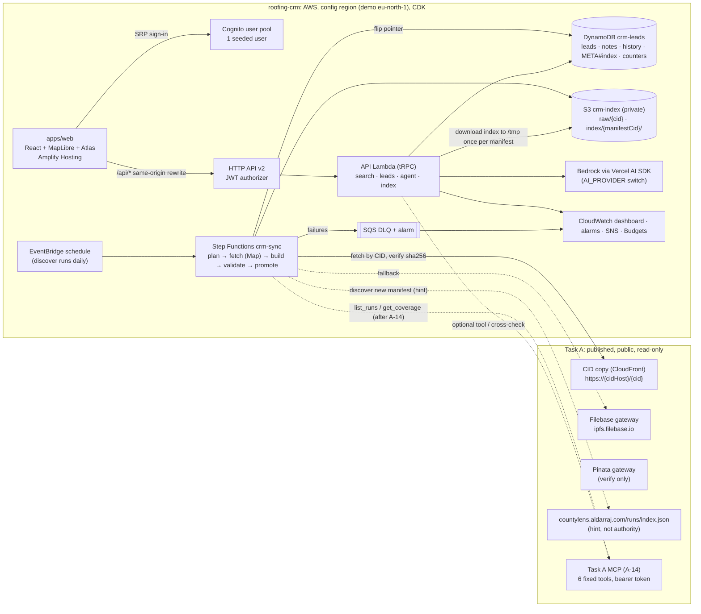

**How to read it:**
- The left-hand box is everything Task A makes public. The CRM only ever reads from it over public HTTPS.
- The sync job makes the CRM's own copy of the data, shaped for fast map searches, and records which Task A run it came from.
- The browser talks to one origin, `crm.aldarraj.com`. Amplify forwards `/api/*` to our API, so no cross-origin setup is needed.

#### 2.2 Services and why

| Need | Choice | Why (and what I rejected) |
| --- | --- | --- |
| Frontend hosting | **Amplify Hosting**, CDK L1 `CfnApp`/`CfnBranch`/`CfnDomain`; `amplify.yml` with `appRoot: apps/web`; auto-branch pattern `0*` for story previews; rewrite `/api/<*>` → HTTP API; SPA fallback; `/build.json` (commit sha) never cached | Same pattern as Task A, which already runs Amplify in this account and region. The GitHub token is a `NoEcho` CloudFormation parameter used on the first deploy only. Rejected: Amplify Gen2 backends (constitution), and S3 + CloudFront for the web app (loses branch previews). |
| Custom domain | `crm.aldarraj.com` as an Amplify domain with an Amplify-managed certificate, in its own `CrmDomain` stack deployed last. The user adds 2 CNAMEs at Namecheap. | A root domain can belong to one Amplify app only, and Task A already uses a sub-domain. The DNS wait can then only hold up this small stack. |
| API | **HTTP API v2 + one Lambda** running tRPC `awsLambdaRequestHandler`: Node 22/24, arm64, **3,008 MB**, timeout **28 s**, ephemeral storage **2 GB** | One function, as in `build-frontend-backends`. 3,008 MB (2 vCPU) is the size at which Task A's DuckDB Lambda met p95 < 3 s; at 1,769 MB it missed (ERR-18). The timeout stays under the 30 s HTTP API limit. |
| Auth | Cognito user pool, no self sign-up, one user in group `admin`. The password is a generated Secrets Manager secret, and the user is seeded by a CDK custom resource. Sign-in is SRP from `aws-amplify/auth` (client library only); the HTTP API has a JWT authorizer. | One shared login (ASM-4). SRP needs no hosted-UI callback URLs for every preview domain. |
| Lead store | DynamoDB on demand, one table `crm-leads` (keys in §6.4), PITR on, `RemovalPolicy.RETAIN` | Pay per request. Transactions give duplicate refusal and optimistic locking. |
| Lead index store | Private S3 bucket `crm-index`: `raw/{cid}.parquet` (verified copies, immutable) and `index/{manifestCid}/crm_property.parquet`, `crm_permit.parquet`, `index_meta.json` | The index is the CRM's own derived data, so we may sort and reshape it. Task A's public files must stay in insertion order (its AD-01); ours need not. |
| Index query engine | `@duckdb/node-api`, native bindings installed in `afterBundling` (copy the approach in Task A's `infra/src/api-stack.ts`). The index files are downloaded to `/tmp/{manifestCid}/` once per sandbox, then queried locally. | Task A measured in-region radius p95 200 ms and roof-age p95 95 ms over 2.38 M rows read remotely. Local reads of a smaller, sorted file should be faster (**projection**, to be measured in B-02). OpenSearch `t3.small.search` is about $28–30/month idle and takes 15–25 min to create, and we do not need vectors (D-12). |
| Sync orchestration | **Step Functions Standard**: `Plan` → `Map(FetchPart, maxConcurrency 3)` → `BuildIndex` → `Validate` → `Promote`. Retries use exponential backoff with full jitter (1 s base, 60 s cap, 5 attempts). `Catch` sends to an SQS DLQ with one alarm. EventBridge runs a daily discovery plus manual starts. | Reading gateways is an external dependency, so it gets a queued, idempotent boundary (constitution VII). Concurrency 3 is the setting that stopped Filebase answering 429 for Task A (ERR-15). Cost is a few cents per run. |
| Build step compute | Lambda arm64, **10,240 MB**, 15 min, 10 GB `/tmp`. Fallback: an ECS Fargate task from the same image, if a full-county build ever exceeds 12 min. | **Projection:** about 30 tables of ≤ 93 MB each (Task A's upper bound) fit in `/tmp`, and binding 493,246 properties in DuckDB takes minutes, not hours. B-02 measures it. |
| Agent / LLM | `ai` (Vercel AI SDK), with `@ai-sdk/amazon-bedrock` or Gateway chosen by `AI_PROVIDER`. Model ids come from config (`eu.` inference profiles). Tools are Zod schemas. | Constitution VI. |
| MCP (optional) | `OracleMcpClient` using the AI SDK MCP client over Streamable HTTP. The bearer token is in Secrets Manager. | Used only for run discovery, count cross-checks and an optional `oracleCoverage` agent tool. Never on the map or list request path. |
| Map tiles | MapLibre GL with an OSM-based keyless style (OpenFreeMap by default), behind a `TILE_STYLE_URL` config value, with OSM attribution | No API key or cost. Switching provider is a config change (RISK-11). The prototype already has `CrmMapTiles390` and `CrmMapFailed390` states. |
| Config | SSM Parameter Store `/roofing-crm/*` (non-secret settings) and Secrets Manager (test-user password, MCP token, Gateway key if used) | No secrets in git or in CDK context. |
| Observability | Powertools Logger/Tracer/Metrics on every Lambda, X-Ray, namespace `RoofingCrm`, one dashboard, alarms to SNS | Golden Path. See §9 for the PagerDuty deviation. |
| Cost guard | AWS Budgets (tag filter `Project=roofing-crm`): alert at $10 actual and $20 forecast. A DynamoDB daily counter caps the agent at $3/day. | $120 of credits. AWS stops access when they run out. |

#### 2.3 Deploy topology and stacks

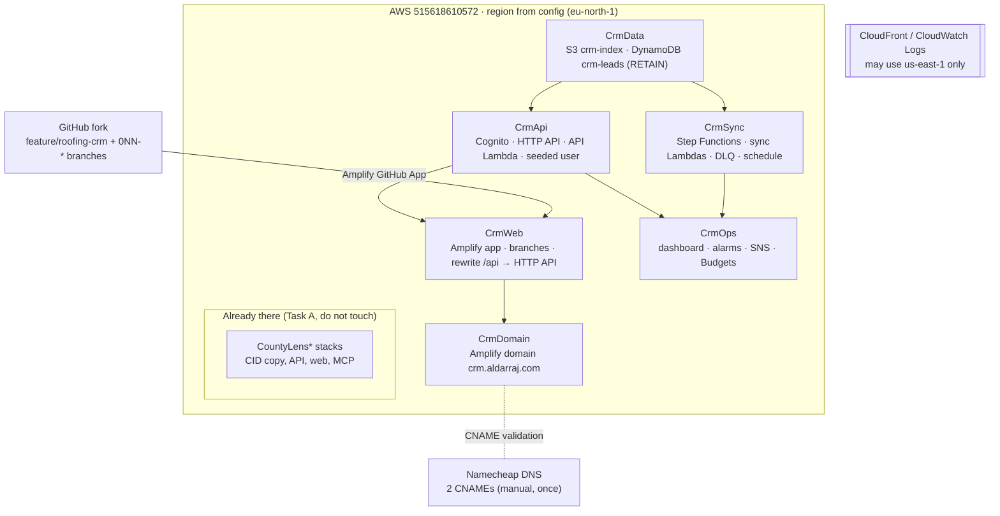

- **Deploy order:** `CrmData` → `CrmSync` → `CrmApi` → `CrmWeb` → `CrmDomain` → `CrmOps`.
- **Stacks share values through typed props in one CDK app**, never through name strings or imports of `CountyLens*` exports.
- The leads table is the only stateful resource that matters, so it is retained if its stack is deleted.

**Branch previews and the API:** Amplify previews for `0NN-*` branches all use the one deployed API through the rewrite. Every API change must therefore be additive: tRPC procedures are added or widened, never renamed. The order for a story is to deploy the API from the story branch (`just deploy`) first, then let the Amplify preview build. This is how Task A works, and it fits a one-person project.

---

### 3. How the CRM depends on Task A in time

#### 3.1 Task A today (2026-10-22, from its repo)

| Fact | Value | Source |
| --- | --- | --- |
| Published run | `travis-202609-permits-20261021t103516z`, manifest `bafkreiasycmsr2qdlxqcfg3yc2conpn3jxmohz7gs55hkseipplhpqsk5i` (11,641 B, schema `oracle-travis-run-manifest.v1`) | `runs/index.json`, `docs/evidence/A-03.md` |
| Content | 35 Austin roofing permits issued 2026-09, linked to **14 parcels** (`parcels_published = 14`); groups `county` and `property_improvement` | manifest `coverage` |
| Contractor | `contractor_unresolved = 35`, `contractor_resolved = 0` ("Comptroller baseline not loaded (A-07)") | manifest `coverage` |
| Owner | `owner_no_dated_sale = 7`, `owner_unparsed = 3` | manifest `coverage` |
| Roof age | Limitation `partial_history`: the estimator saw one month of permits. Most roof ages fall back to the TCAD built year (basis `built_year`, confidence `low`). | manifest `limitations`, contract README |
| Address, contractor name, BBB | Not in v1 (`not_in_export`, `no_lexicon_carrier`); BBB is always `not_checked` | contract README; FU-A-01 |
| Gateways that work | CloudFront CID copy (public, immutable, `https://{host}/{cid}`), Filebase (Range + CORS, about 0.2 s TTFB, 429s after about 50–65 rapid requests), Pinata (works, 3.7–6.7 s TTFB, preflight has no `Range`). ipfs.io and dweb.link were retired on 2026-09-21. | ADR-0001, A-03 evidence |
| Run discovery | **No IPNS** (Task A AD-03). Each new manifest links to the one before through `previousManifestCid`, and `runs/index.json` lists the runs. | A-11 story |

`contract/v1/README.md` still calls the sample CIDs placeholders. That text predates A-03, and the A-03 manifest above is real. The CRM must never sync from `contract/v1/pilot-manifest.json`: it is a local pilot whose CIDs do not resolve. That file is for contract tests only.

#### 3.2 Which CRM capability needs which Task A story

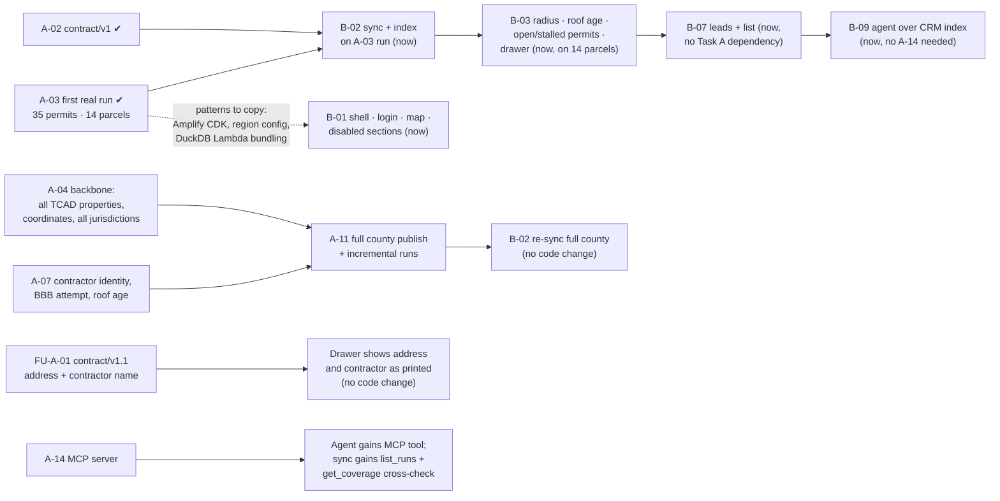

| CRM capability (story) | Needs from Task A | Available today? | What the CRM does until then |
| --- | --- | --- | --- |
| Shell, sign-in, Travis map, disabled sections (B-01) | Nothing at runtime. Copies patterns from A-03 (Amplify L1, region config guard, domain stack). | Yes | — |
| Index sync and data chip (B-02) | A-02 contract (done), a published manifest (A-03 done) | Yes, 35 permits / 14 parcels | The data chip says "Data: CountyLens run travis-202609-…, 14 properties, 35 roofing permits, Austin only, Sept 2026 permits". No padding, no sample rows. |
| Pin/GPS + radius (B-03) | Coordinates on properties: `gis_centroid` today, all parcels after A-04 | Partly: only the 14 parcels that have a permit | Searches work. An empty ring says "No published properties in this ring (Run n covers 14 parcels with Sept 2026 Austin roofing permits)" and links to coverage. |
| Aged roofs ≥ N years (B-03 part B-04) | `roof_age_years` with basis and confidence. County-wide needs A-04 + A-11. Permit-based roof age improves with A-07 track D and the A-06 permit backfill. | Partly: 14 parcels, mostly `built_year` / low confidence | Basis and confidence are shown on every row, so "low · TCAD built year" is never hidden. Changing 15 → 25 still changes the count (SC-02). This must be checked on real rows; if both values return the same count on 14 parcels, the evidence says so. |
| Open / long-open permits (B-03 part B-05) | `status_class`, `open_days`. Long-open cases (> 5 yrs) need the A-06 backfill (part of A-04, published by A-11). | Partly: the Sept 2026 slice is recent, so "open > 5 yrs" is likely 0 | The badge logic ships now. An empty result explains that the run covers permits issued in 2026-09 only. Stalled permits are labelled "Stalled · derived: no status in source" (D-4a), never "open". |
| Contractor + BBB (B-03 part B-06) | Contractor name: FU-A-01 (v1.1) + A-07 identity. BBB: A-07 track B (likely `blocked`). | No | "Contractor not published": `contractor_unresolved` / `no_lexicon_carrier`. "BBB not checked: no rating source in this run." Never a score. |
| Street address on cards, leads, agent | FU-A-01 (`unnormalized_address`, `city_name`, `postal_code` in v1.1, after A-04) | No | Title is "TCAD {request_identifier} · near {gazetteer place}", with the line "Address not published in Run n · lat, lon" (design E-93). Never geocoded or guessed. |
| Leads + list (B-07) | Only a stable identity: `request_identifier`, which is published and never empty | Yes | — |
| Agent (B-09) | The CRM index plus the travis-places gazetteer (vendored with `query-core`; its digest is in the manifest `profiles[]`). A-14 MCP is optional. | Yes, with today's small data | Honest empty answers with the filter that excluded everything and a near miss (stalled permits) when one exists (RISK-06). |
| Run growth, incremental runs (A-11 Runs 2–3) | New manifests linked by `previousManifestCid` | Not yet | Each new run is synced into a new index folder. The pointer flips only after validation (§4). Leads keep their identity (D-6). The lead screen shows "changed since the lead was created" (prototype `CrmLeadChanged390` / `CrmLeadStale390`). |
| MCP cross-check and tool (B-02 review, B-09) | A-14 | No | The count check compares the index with the manifest `coverage` (the authority). `donphan`'s MCP check is added when A-14 is live. |

**What the plan should change:** plan EXT-05 says B-09 needs A-14 "agent frame to copy". I recommend copying A-14's patterns if they land in time, without blocking on them. The CRM agent depends only on the CRM index and the vendored gazetteer.

#### 3.3 Reuse Task A's CID copy and query-core, or keep our own?

| Item | Decision | Reason |
| --- | --- | --- |
| **Task A's CloudFront CID copy** | **Read it, publicly, as the first source.** Do not run a second public CID copy. | It is a public, immutable byte copy of the published files, and the brief allows reading via "gateways/CID copy". Every byte is checked against its CID (raw-leaves CIDv1 sha2-256: recompute and compare), so a wrong byte fails the sync whatever the source. |
| What reading it must NOT mean | No `s3:GetObject` on `CountyLens*` buckets, no reading `/countylens/*` SSM parameters, no CloudFormation imports from Task A stacks, no calls to Task A's tRPC API. `CID_COPY_HOST` is a CRM config value copied by hand. | These are Task A's internal stores. The access boundary (constitution B1) allows only published CIDs, gateways and the MCP. |
| **The CRM's own private verified cache** | Yes: `crm-index/raw/{cid}.parquet`, written once (skipped if it exists) | Re-syncs and rebuilds never fetch the same CID twice, and the CRM keeps working if Task A's copy or Filebase is down. The cache is never public. |
| **`query-core` (views, `bindManifest`, `derive`, status map, gazetteer)** | **Copy it into `packages/oracle-views`, pinned to a Task A commit.** Run Task A's `query-core` tests here. Use it only in `apps/sync` (index build) and the agent's place resolver. | The views define `status_class` (D-4a), `open_days` against `as_of`, the roof-age rules, owner rules and `missing[]`. Writing our own version would let the CRM and Task A disagree, and alakazam's golden recall check compares against `query-core` SQL. |
| Drift guard | `Plan` step: for each manifest `profiles[]` entry (`travis-austin`, `travis-austin-roof-profile`, `travis-places`), compare `sha256` with the digest recorded in `docs/reuse-log.md` for the copied code. On a mismatch the sync **holds**: no flip, the data chip shows "newer run available: CRM update needed (profile travis-austin changed)", and the DLQ alarm fires. | When Task A changes a rule, the CRM never quietly reads new data with old meanings. |
| **`packages/contract`** (manifest Zod, CID helpers, `rawCid`) | Copy it into `packages/oracle-contract` | Same reason: one manifest parser and one CID check. |
| **Task A's request-path DuckDB code** (`apps/api/src/engine/*`, the CDK native-bindings bundling) | Copy the bundling approach. The query code is our own (radius/filters over the CRM index). | The bundling is the hard-won part (ERR-18/19). Our queries are different and simpler. |
| **Task A web components** (provenance, missing pills, Coming soon card) | Copy them when A-13 lands. Until then, build them on Atlas tokens to the CRM design. | Constitution: Atlas only. Design E-66 reuses `Shell390ComingSoon`. |

---

### 4. Data flow: the sync pipeline and how the CRM keeps up as Task A grows

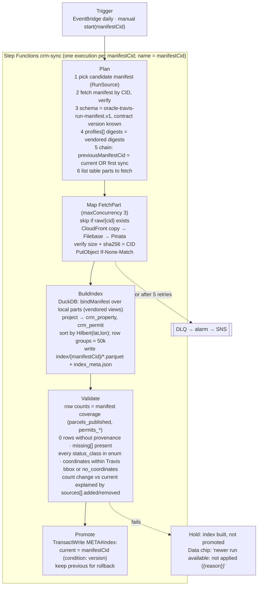

**Which manifest to sync next (the `RunSource` port):**
1. `PinnedManifestSource`: the SSM parameter `/roofing-crm/source/manifest-cid`. This is the authority. An operator sets it, and it is what the demo freezes on.
2. `RunsIndexHint`: reads `https://countylens.aldarraj.com/runs/index.json` (public, but mutable and not a CID) and only **proposes** a newer `manifestCid`. That CID is then fetched and verified by CID like any other.
3. `McpRunsSource` (after A-14): `list_runs` through the MCP. It also only proposes.

`AUTO_PROMOTE` (SSM, default `true`; set `false` during the demo freeze) decides whether a validated newer run flips the pointer by itself or waits for an operator to set the pinned CID.

**Why it holds up as Task A grows:**
- **Same code, bigger data:** A-03's 14 parcels, A-11's 493,246 properties and later incremental runs all go through the same pipeline. Only the part count and the build time change.
- **Additive schema evolution:** fields added in contract v1.1 (address, contractor name) are optional in `index-schema`. The UI already has both states (present, or missing with its reason). A manifest with an unknown major contract version is refused, not guessed.
- **Atomic flip, no half-built index:** the API reads the pointer (cached for 60 s). When it changes, a sandbox downloads the new folder in the background and swaps over. Every response carries the `manifestCid` it was answered from.
- **Rollback is one write:** set `current` back to `previous`.

**Index row shapes** (sizes are a **projection** to measure in B-02: `crm_property` at full county is about 493k rows, under 80 MB compressed; `crm_permit` holds tens of thousands of rows):
- `crm_property`:
  - identity and place: `tcadId`, `propertyCid`, `lat`, `lon`, `hilbert`, `coordinateSource`
  - roof age: `roofAgeYears`, `roofAgeBasis`, `roofAgeConfidence`, `roofDate`
  - property type: `propertyType`, `propertyUsageType`, `builtYear`, `kind` (residential/commercial, derived in `packages/domain` from the lexicon enum)
  - permit summary: `openPermitCount`, `stalledPermitCount`, `maxOpenDays`
  - v1.1 fields, null until published: `addressText?`, `city?`, `postalCode?`
  - gaps and provenance: `missing[]`, then `cid`, `sourceUrl`, `capturedAt`, `table`, `tableCid`, `runId`, `manifestCid`, `asOf`
- `crm_permit`:
  - identity and place: `permitCid`, `permitKey` (`{jurisdiction}:{permitNumber}`, or `cid:{permitCid}` when the number is missing), `tcadId`, `propertyCid`, `lat`, `lon` (copied from the property), `hilbert`
  - permit facts: `jurisdiction`, `permitNumber`, `improvementType`, `improvementAction`, `statusClass`, `isOpen`, `issueDate`, `finalDate`, `openDays`
  - contractor and BBB: `contractorResolution`, `contractorCompanyCid`, `contractorNameRaw?` (v1.1), `bbbStatus`, `bbbStatusReason`
  - gaps and provenance: `missing[]`, then provenance as above
- `index_meta.json`: `manifestCid`, `runId`, `asOf`, `contractVersion`, `profiles[]`, `counts{properties, permits, byStatusClass, byJurisdiction}`, `coveredJurisdictions[]`, `limitations[]`, `builtAt`, `builderCommit`

Owner names are **not** copied into the index. A roofing lead does not need them, and leaving them out removes the risk of exposing `owner_confidential` records on a shared login. `ownerKind` and `tenureYears` may be copied if the agent's G4 query needs them.

---

### 5. Key request sequences

#### 5.1 Pin + 5 mi + roof ≥ 15 years (demo lines 2–3)

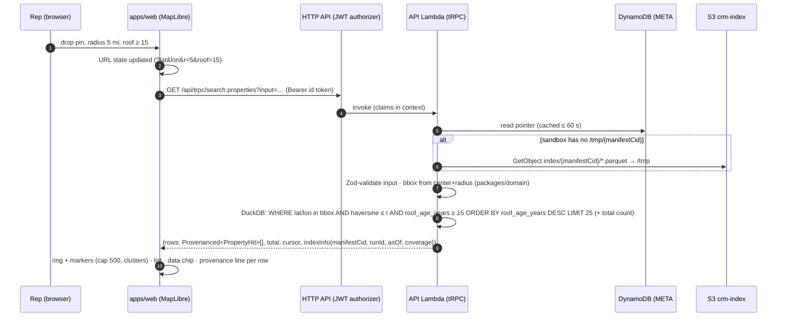

The browser never sees Parquet files or SQL. It sends a typed request and gets back typed rows, each carrying where it came from. If the Lambda has just started, it downloads the index once, which costs about a second (**projection**); after that, searches run against a local file.

#### 5.2 Create a lead (demo line 6)

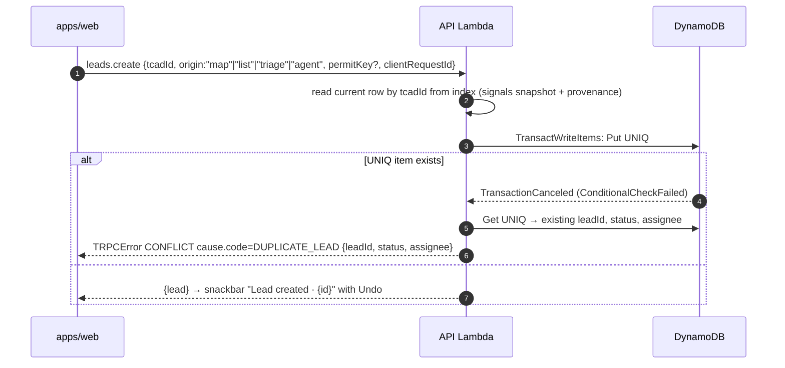

#### 5.3 Ask the agent (demo line 7)

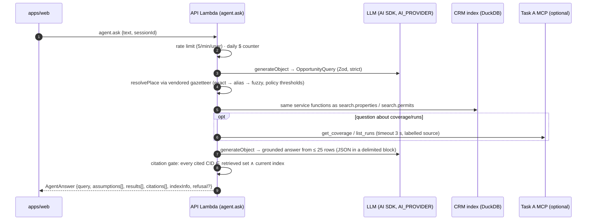

Times: the server aborts at 23 s with `outcome: timed_out`, the Lambda timeout is 28 s, and the HTTP API limit is 30 s. These timeouts are nested on purpose (Task A AD-27), so the rep sees "Took too long" instead of a server error.

---

### 6. Data contracts

#### 6.1 Upstream (read-only): Task A

- **Manifest:** `RunManifestV1` from the vendored `oracle-contract`. The sync accepts only `schema = oracle-travis-run-manifest.v1`, artifacts with `kind ∈ {car, table, directory}`, and parts whose `sha256` and CID both match the downloaded bytes.
- **Views:** `v_property`, `v_roofing_permit`, `v_contractor`, `v_run` exactly as `contract/v1/columns.json` defines them, bound by the vendored `bindManifest`. Column names are frozen. Fields added in v1.1 are optional.
- **Closed enums carried through unchanged:**
  - `status_class ∈ {open, stalled, closed, null}`
  - `bbb_status ∈ {rated, not_found, blocked, not_checked}`
  - `contractor_resolution ∈ {resolved, unresolved}`
  - `roof_age_basis ∈ {permit, new_construction, built_year, unknown}`
  - `roof_age_confidence ∈ {high, medium, low, none}`
  - `coordinate_source ∈ {gis_centroid, permit_point, none}`
  - the 21 `missing` reasons
- **Provenance on every row:** `cid`, `source_url`, `captured_at`, `table`, `table_cid`, `run_id`, `manifest_cid`, `as_of`, `missing[]`. `as_of` is the run's finish time; open duration and roof age are never computed against `now()`.
- **MCP (after A-14):** six fixed tools, at most 1,000 rows each, no SQL tool. The CRM calls only `list_runs`, `get_coverage` and `get_schema`, plus `search_properties` and `list_permits` for reconciliation tests. Anything the MCP returns is labelled "via CountyLens MCP" with its `manifest_cid`.

#### 6.2 Index read interface (`apps/api/src/services/search.ts`, port `LeadIndex`)

```ts
searchProperties(q: { center: LatLon; radiusMeters: number /* ≤ 80_467 */; minRoofAgeYears?: number;
  kind?: 'residential'|'commercial'; hasOpenOrStalledPermit?: boolean; sort: 'roofAgeDesc'|'distanceAsc';
  limit: number /* ≤ 100 */; cursor?: string }): Promise<Page<Provenanced<PropertyHit>>>
searchPermits(q: { center; radiusMeters; statusClass: ('open'|'stalled'|'closed')[]; minOpenDays?: number;
  sort: 'openDaysDesc'|'distanceAsc'; limit; cursor? }): Promise<Page<Provenanced<PermitHit>>>
getProperty(tcadId: string): Promise<Provenanced<PropertyDetail> | NotInCurrentRun>
indexInfo(): Promise<IndexInfo>   // manifestCid, runId, asOf, counts, coveredJurisdictions, limitations, previous
```

`Page` = `{ rows, total, cursor, indexInfo }`. The cursor is opaque and encodes `(manifestCid, sortKey, id)`. A cursor from an older index answers `CURSOR_STALE`, and the UI re-runs the search.

#### 6.3 tRPC `AppRouter` (routers by domain)

| Router | Procedures | Auth |
| --- | --- | --- |
| `health` | `ping` (logs, traces, returns build sha + `manifestCid`) | public |
| `index` | `info` | protected |
| `search` | `properties`, `permits`, `candidates` (combined list for B-08: same filters as the map) | protected |
| `properties` | `get` | protected |
| `leads` | `create`, `createMany` (triage/agent bulk; each item independent), `list` (filters + cursor), `get`, `updateStatus` (expects `version`), `assign`, `addNote`, `undoCreate` (within 10 s, by `clientRequestId`) | protected |
| `agent` | `ask` | protected + rate-limited |

Every input is Zod with bounds: radius ≤ 50 mi, limit ≤ 100, note ≤ 2,000 characters, question ≤ 500 characters. Every output is Zod-typed in `index-schema`. Domain errors map to stable `TRPCError` codes plus `cause.code`, one per prototype state:
`DUPLICATE_LEAD`, `STALE_LEAD`, `OUT_OF_COUNTY`, `INDEX_UNAVAILABLE`, `INDEX_UPDATING`, `CURSOR_STALE`, `AGENT_THROTTLED`, `AGENT_PAUSED`, `AGENT_TIMED_OUT`, `NOT_IN_CURRENT_RUN`.

#### 6.4 Lead store (DynamoDB `crm-leads`, CRM-owned, constitution B2)

| Item | pk | sk | Attributes |
| --- | --- | --- | --- |
| Lead | `LEAD#{ulid}` | `META` | `tenantId="default"`, `tcadId`, `propertyCidAtCreate`, `permitKey?`, `displayName` (address when published, else `TCAD {tcadId}`), `lat`, `lon`, `status ∈ {new, contacted, qualified, won, lost}`, `assignee`, `createdFrom ∈ {map, list, triage, agent}`, `signals` (frozen: roof age + basis + confidence, statusClass, openDays, contractor state, BBB state), `sourceManifestCid`, `sourceCids[]`, `version`, `createdAt`, `updatedAt` |
| Unique guard | `UNIQ#PROP#{tcadId}` | `UNIQ` | `leadId` (written in the same transaction as the lead) |
| Note | `LEAD#{ulid}` | `NOTE#{ts}#{ulid}` | `by`, `text` (append-only) |
| History | `LEAD#{ulid}` | `HIST#{ts}#{ulid}` | `by`, `change` (written in the same transaction as the change) |
| GSI1 | `TENANT#{t}#ASSIGNEE#{a}` | `STATUS#{s}#{updatedAt}` | for the Leads list |
| Index pointer | `META#index` | `CURRENT` | `manifestCid`, `previous`, `promotedAt`, `version` |
| Agent counters | `COUNTER#agent#{yyyy-mm-dd}` | `USD` | `spentMicroUsd` (TTL 3 days) |
| Agent session | `SESSION#{id}` | `LAST_QUERY` | last `OpportunityQuery` (TTL 24 h) |

**Changes from the reference lead model, and why:**
- Uniqueness is on `tcadId`, not `propertyCid`, so it survives new runs (D-6).
- A lead created from a permit is still one lead per property; it also records `permitKey`. This meets both "at least one from a permit" and "the same property cannot be added twice".
- `version` gives optimistic locking (prototype `CrmLeadStale390`).
- Notes and history are separate items, not unbounded lists.

**Lead against the current run:** `leads.get` returns the frozen `signals` and the current index row for the same `tcadId`. It returns `changedSince: Field[]` when they differ, and `NOT_IN_CURRENT_RUN` when the property is no longer published.

#### 6.5 Agent contract

- **Input `OpportunityQuery`:** strict Zod: place `{text}` or `{lat, lon}`, `radiusMiles` (default 5, max 50), `entity`, `minRoofAgeYears?`, `statusClass?[]`, `minOpenDays?`, `sort`, `limit` (max 100), `assumptions[]` (required). It is defined by alakazam; I adopt it unchanged.
- **Output `AgentAnswer`:** `query`, `assumptions[]`, `results[]` (`kind`, `cid`, `tcadId`, `lat`, `lon`, `summary`, `provenance`, `missing`), `citations[]`, `indexInfo`, and `refusal?` from `no_results | out_of_area | invalid_scope | ambiguous_place | throttled | paused | timed_out`.
- **Tools** (closed set, Zod): `resolvePlace`, `searchProperties`, `searchPermits`, `getProperty`, `proposeLeads`. `proposeLeads` returns candidates; the lead is created only when the rep clicks, through `leads.createMany`. Optional after A-14: `oracleCoverage`.

#### 6.6 Config contract (`packages/config`, Zod-parsed at cold start, fails fast)

- AWS settings: `AWS_REGION` (from the runtime, never a literal), `TARGET_ENV`
- AI settings: `AI_PROVIDER ∈ {bedrock, gateway}`, `MODEL_EXTRACT_ID`, `MODEL_ANSWER_ID`
- Source hosts: `CID_COPY_HOST`, `FILEBASE_GATEWAY_HOST`, `PINATA_GATEWAY_HOST`, `RUNS_INDEX_URL`, `MCP_URL?`
- Map: `TILE_STYLE_URL`
- Lead rules: `ROOF_AGE_DEFAULT_YEARS=15`, `LONG_OPEN_DAYS=1826`
- Agent limits: `AGENT_DAILY_USD_CAP=3`, `AGENT_RPM_PER_USER=5`
- Sync: `AUTO_PROMOTE`

In CDK, the region comes from `CDK_DEFAULT_REGION` and is checked against a `roofing-crm:allowedRegions` context list (Task A's `infra/src/config.ts` guard).

---

### 7. Patterns of mine that must be visible in the code

1. **One source of API types.** `AppRouter` is exported from `apps/api` and consumed only through `packages/api-client`. An ESLint `no-restricted-imports` rule blocks `@trpc/client` and `fetch('/api` anywhere else in `apps/web`. The API URL is `/api`, same-origin.
2. **Shared rules live in packages.** `packages/domain` holds `isAgedRoof`, `isLongOpen`, `openDurationLabel`, `distanceMeters`, `bboxFor`, `leadSignalsFrom(row)` and the URL-state codec. The web app, the API services and the agent tools all import them, and no threshold or label is written twice.
3. **Thin routers, injected services.** A router parses input and calls `services/*`. Services receive `LeadIndex`, `LeadRepo`, `Clock`, `Llm`, `PlaceResolver` and `MetricsSink` as arguments, so unit tests need no AWS.
4. **Ports and adapters for every external dependency:**
   - `CidFetcher`: `CloudFrontCopy`, `Filebase`, `Pinata`
   - `RunSource`: `Pinned`, `RunsIndexHint`, `Mcp`
   - `LeadIndex`: `DuckDbParquet`, `Fixture`
   - `Llm`: AI SDK provider chosen by `AI_PROVIDER`
   - `OracleMcp`
   Adapters are chosen by config, and a test runs the whole service on `Fixture` adapters.
5. **Provenance by construction.** `Provenanced<T> = T & { provenance: Provenance; missing: Missing[] }` is built only by `fromIndexRow()`. UI data components take only `Provenanced<…>`. `<MissingValue field reason/>` renders every null; a blank cell does not type-check.
6. **Typed states, not ad hoc branches.** Each `cause.code` (§6.3) maps to exactly one prototype state component. An exhaustive `switch` with `never` fails the build when a code has no screen.
7. **Idempotent, verifiable sync.**
   - Deterministic keys: `raw/{cid}` and `index/{manifestCid}/`.
   - Step Functions execution name = `manifestCid`, so the same run cannot be synced twice at once.
   - Writes use `If-None-Match`.
   - Validation runs before an atomic pointer flip.
   - DLQ plus one self-resolving alarm.
8. **Duplicate refusal by transaction, never by reading first** (§5.2).
9. **CDK shape:**
   - one construct per concern: `LeadTable`, `IndexBucket`, `SyncPipeline`, `ApiFunction`, `CrmUserPool`, `AmplifySite`, `CrmAlarms`, `CrmBudget`
   - L2 first, L1 only for Amplify
   - `NodejsFunction` with esbuild, DuckDB kept external and installed for `linux_arm64`
   - least-privilege `grant*` calls (no `*` resources)
   - tags `Project=roofing-crm`, `CostCenter`, `Environment`
   - `cdk-nag` (AwsSolutions) in `cdk synth --strict`, with each suppression justified in place
   - a snapshot plus fine-grained assertion tests per stack
10. **Observability.** Powertools `injectLambdaContext`, `captureLambdaHandler` and `logMetrics` on every Lambda, with a tRPC middleware for correlation id and procedure name. Metric names live in one constant file: `SearchLatencyMs`, `SearchRequests`, `IndexColdLoadMs`, `LeadsCreated`, `DuplicateLeadRefused`, `StaleLeadRefused`, `AgentAsks`, `AgentRefusals{reason}`, `AgentLlmCalls`, `AgentUsdSpent`, `CitationDropped`, `SyncPartsFetched`, `SyncPartsFailed`, `SyncRowsIndexed`, `SyncDurationMs`, `SyncHeld{reason}`, `GatewayFallbackUsed{gateway}`. Logs never contain prompt text with owner data, tokens or passwords.
11. **Vendored code is visible and tested.** `packages/oracle-*` carry a header comment naming the Task A path and commit. `docs/reuse-log.md` lists the files and their sha256. CI runs Task A's copied `query-core` tests against `contract/v1/sample.parquet` (contract tests only; never loaded into a deployed index).
12. **Test pyramid:**
    - Vitest unit tests for `packages/domain` and the services
    - contract tests that parse every `sample.parquet` row through `index-schema`
    - lead-transaction tests (20 parallel creates, 1 winner) against DynamoDB Local in CI and the deployed table in the story verification
    - API tests against the deployed endpoint
    - Playwright on the hosted URL with `context.setGeolocation`
    - `smeargle` responsive suite at 390 / 768 / 1440

---

### 8. Non-functional requirements (numeric)

| NFR | Threshold | Basis / how verified |
| --- | --- | --- |
| Pin/GPS + radius + filters, end to end | **p95 < 3 s** on the hosted URL (plan SC-01). API share: **warm p95 < 500 ms**, **cold p95 < 3 s** | Task A measured 200 ms p95 radius in-region over 2.38 M remote rows. Verified by Playwright timings plus `SearchLatencyMs` p95 over ≥ 20 runs. |
| Index cold load | Downloading `index/{manifestCid}` and opening DuckDB: **< 2 s** at full county | **Projection** (index < 100 MB, in-region S3). Metric `IndexColdLoadMs`. If breached: split into per-region-block files, or read on demand with DuckDB httpfs plus row-group pruning. |
| API Lambda | arm64, 3,008 MB, 28 s timeout, 2 GB `/tmp`, bundle < 10 MB excluding DuckDB bindings | Sizing Task A proved (ERR-18) |
| Agent | First useful answer **p95 < 20 s**. Server abort **23 s**. **≤ 2 LLM calls** per ask, 1 retry with jitter on throttle. **5 asks/min/user. $3/day cap.** | Bedrock throttle of 10 req/min measured by Task A. Deployed-endpoint Vitest with golden queries G1–G7. |
| Agent groundedness | **100%** of cited CIDs exist in the current index. **0** invented addresses, names or ratings. Recall **≥ 80%** of top-N against the equivalent `query-core` SQL. | Citation gate plus golden replay |
| Sync, A-03 run | **< 3 min** end to end; re-running creates **0** new objects | Run twice and compare S3 keys and counts |
| Sync, full county (A-11) | **< 30 min** end to end; build step **< 12 min** (or switch to Fargate) | `SyncDurationMs` |
| Index fidelity | Index `properties` = manifest `coverage.parcels_published` and permits = the published roofing-permit count, **difference 0**, or each difference documented by reason. **0** rows without provenance. | `Validate` step, then `porygon` review, then `donphan` MCP cross-check after A-14 |
| Freshness | A validated newer run is promoted **≤ 24 h** after it appears in `runs/index.json` or `list_runs` (when `AUTO_PROMOTE`). The data chip always names the run in use. | Daily schedule |
| Lead integrity | Duplicate create refused **100%**, including **20 concurrent** creates (exactly 1 winner). **0** lost updates (stale `version` refused). Created leads survive a reload **100%**. | Concurrency test on the deployed table |
| Pagination and map | Page 25 by default, **100 max**. Map draws **≤ 500 markers**, then clusters with a "zoom in" note; results are never cut off silently. | Playwright |
| Availability and errors | API 5xx **< 1%** over 5 min, else alarm. Sync DLQ depth **> 0**, else alarm. Lambda throttles **> 0** over 5 min, else alarm (the account may have only 10 concurrent executions, shared with Task A). | CloudWatch alarms in CDK |
| Idle cost | **≤ $1/month** idle excluding credits-covered requests. Budget alerts at **$10** actual and **$20** forecast. | AWS Budgets, cost tags |
| Security | JWT on every route except `health.ping`. S3 private (Block Public Access, SSE, `enforceSSL`). No secrets in git, logs or CDK context. Owner names never in the index, prompts or logs. | cdk-nag, log-grep test, review |
| Web performance | Initial JS **< 300 KB gzip** excluding MapLibre (lazy chunk). LCP **< 2.5 s** on the hosted URL (desktop, fast 4G profile). | `vite build` size check in CI; Playwright trace |
| Responsive and accessibility | 390 / 768 / 1440 pass. WCAG 2.2 AA contrast via Atlas tokens. Hit areas **48 px** (24 px for markers, per design E-92). Disabled sections use `aria-disabled` with a tooltip. | `smeargle` suite |

---

### 9. P0 rules (a violation blocks the story)

1. **Access boundary.** Data comes only from Task A's published CIDs (CloudFront copy or gateway, CID-verified) or its MCP. No IAM access to `CountyLens*` resources, no reading `/countylens/*` SSM parameters, no scraping, no ingestion, no Query DB.
2. **CID integrity.** Every fetched byte is checked against its CID before use. A mismatch fails the part, and a run with a failed part is never promoted.
3. **One run per index.** Every index row and every API response carries the `manifestCid` it came from. The pointer flips only after `Validate` passes.
4. **Data honesty.** Nothing is invented, synthetic or sample-shaped in a deployed index or UI. `contract/v1/sample.parquet` and `pilot-manifest.json` are for tests only. Addresses are never geocoded or guessed. BBB is shown as a rating only when `bbb_status = rated`. A null `improvement_status` permit is "stalled", never "open". Missing data always says why (the closed reason list).
5. **Same meaning as Task A.** View semantics come from vendored `query-core`. A sync holds if the manifest's `profiles[].sha256` differs from the vendored digests.
6. **Lead identity is `tcadId`.** Uniqueness is enforced by a DynamoDB transaction, never by reading first.
7. **TypeScript only, CDK only.** Region from config only. Only CloudFront, WAF and CloudWatch Logs may use `us-east-1`. No Amplify Gen2 backend, no SAM, no console-created resources.
8. **LLM calls only through the Vercel AI SDK**, with the provider chosen by `AI_PROVIDER` and Zod tools. No direct provider SDKs, no `any` in LLM code. The model never writes SQL, CIDs, coordinates, addresses, contractor names or ratings.
9. **Every tRPC input is Zod-validated**, and every non-health procedure is behind the Cognito JWT authorizer. The test-user password lives only in Secrets Manager and the private PR note.
10. **External calls in the sync go through a queued boundary:** bounded concurrency (3), backoff with jitter, a DLQ and one self-resolving alarm. Synchronous calls (agent model, MCP) have timeouts and typed recovery states.
11. **Powertools Logger, Tracer and Metrics on every Lambda.** Every metric name is in the one constants file.
12. **Atlas tokens and components only.** Every data display shows provenance (run, captured at, source link).
13. **Evidence comes from the hosted URL** (`crm.aldarraj.com` or an Amplify preview), never localhost. Never commit to `main`. Never merge the PR.

**Deviations from the Golden Path, for the PO to accept at G3:**
- **PagerDuty paging and the org Lexicon/Main Dashboard registration** do not exist for a personal assessment account. Alarms go to SNS with an email subscription and an optional PagerDuty HTTPS subscription driven by config, and the metric list is kept in one file ready to register. Record this as a constitution exception; alarms are not skipped.
- **The shared `Spring-Oaks-Capital-LLC/github-workflows` callers** are probably not reachable from a personal fork, and Task A uses its own `ci.yml` for the same reason. Keep the six-recipe `justfile` exactly as `integrate-ci-cd` defines it, plus our own `.github/workflows/ci.yml`. Switch to the thin callers if access is granted.
- **Region:** the Golden Path default is `us-east-2`, and this project is locked to `eu-north-1`. The value is read from config; CDK accepts only regions on the allowed list.

---

### 10. Deployment and verification plan

**CI (GitHub Actions, on every pull request and story-branch push):** `just setup` → `format` (Prettier check) → `lint` (ESLint, including the import restrictions) → `type-check` (`tsc --noEmit` per package via turbo) → `test` (Vitest, copied Task A tests, contract tests, CDK assertions) → `build` (`vite build` with a size check, then `cdk synth --strict` with cdk-nag). There is **no automatic deploy from CI**: merging to `main` is forbidden, so production is the `feature/roofing-crm` branch.

**Deploy:** the operator runs `just deploy` with the `assess` profile. It runs `cdk deploy --require-approval never` for the changed stacks, in order, with `CDK_BOOTSTRAP_QUALIFIER` taken from SSM `/cdk-bootstrap/*/version` in the config region. Task A has already bootstrapped this account, so reuse that qualifier: if exactly one exists, use it; if several exist, stop and ask. Never bootstrap again blindly. An optional `workflow_dispatch` deploy job with an OIDC role can be added later.

**One-time manual steps** (documented in B-01, each checked by a script):
1. GitHub token for the Amplify GitHub App (CloudFormation `NoEcho` parameter, first deploy only).
2. Two Namecheap CNAMEs for `crm.aldarraj.com` taken from the `CrmDomain` outputs.
3. Record the test-user password from Secrets Manager for the private PR note.
4. Set `/roofing-crm/source/manifest-cid` to the A-03 manifest CID.

**Per-story verification (story loop stage 6):**

| Story | Prove live on the hosted URL |
| --- | --- |
| B-01 | Private window: sign in → map on Travis County; `health.ping` returns the build sha. There is a CloudWatch log line and an X-Ray trace for it. Five disabled sections show `aria-disabled` with a tooltip. `/build.json` sha = the deployed commit. |
| B-02 | Step Functions run on the A-03 manifest succeeds. Run it again: 0 new `raw/` objects. `index.info` shows `manifestCid = bafkreiasycmsr…`, 14 properties, 35 permits, matching the manifest `coverage`. A part with a tampered byte fails and does not promote (fault injection through the `Fixture` fetcher in a test stage). `porygon` reconciles the counts. |
| B-03 | Pin + 5 mi in Playwright: ring and results, < 3 s p95. GPS via `setGeolocation` inside the county, plus an outside-county case that shows its message. 15 → 25 changes the count, or the evidence records that it cannot on today's 14 parcels. Permits sorted by `openDays`, stalled labelled. Drawer shows "Contractor not published" and "BBB not checked" with reasons and a source link. `smeargle` passes on the changed pages. |
| B-07 | 3 leads (at least 1 from a permit), a status change and a note survive a reload. A duplicate is refused. 20 concurrent creates give 1 winner. The combined filter is reproduced from the URL. |
| B-09 | G1–G7 Vitest against the deployed `agent.ask` all pass, including the honest "no results" and the out-of-county refusal. A cited result opens on the map and becomes a lead after the rep confirms. Rate limit, `paused` and timeout states are exercised with a fake model. |
| Full county (when A-11 lands) | Set the pinned CID or let `AUTO_PROMOTE` run. Same checks with the new counts, `SyncDurationMs` < 30 min, and the B-03 latency re-measured at full scale. The data chip changes run with no code change. |

**Release evidence:** each demo line is linked to `docs/evidence/B-0n.md`, with the `manifestCid` the evidence used written next to each screenshot.

---

### 11. Open risks

1. **Thin data until A-04 and A-11.** Today the CRM can show only 14 parcels and 35 recent Austin permits. "Roofs older than 15 years across the county" and "permits open > 5 years" may honestly show 0 or very few. *Mitigation:* honest empty and coverage states, golden tests that assert behaviour rather than counts, and choosing the demo area from real data at release. Re-sync is a config change once A-11 publishes. *Residual risk:* the evaluator may judge the CRM on what Task A has not yet published.
2. **Account-wide Lambda concurrency may be 10** and is shared with Task A's API, MCP and bench functions. A burst of searches plus an agent call could throttle both apps. *Mitigation:* fast handlers, a throttle alarm, no reserved or provisioned concurrency, and a check of `aws lambda get-account-settings` at B-01 (raise the limit only if the free plan allows it).
3. **Lead identity across runs.** If Task A ever changes `request_identifier` formatting, D-6 breaks. *Mitigation:* a `Validate` check that every `tcadId` of an existing lead is still present, or that the change is explained by removals in `sources[]`. Ask Task A to treat `request_identifier` as frozen (contract P0-5 already says "exactly as printed").
4. **Profile drift holds the sync.** A Task A rule change (new jurisdiction in the status map, roof-age profile v2) requires copying the vendored code again before the CRM can promote. *Mitigation:* the hold is visible in the data chip and an alarm. Copying is a small, scripted step (`scripts/vendor-oracle.ts` with the target commit).
5. **No discovery authority.** There is no IPNS, `runs/index.json` is a mutable web file, and the MCP does not exist yet. *Mitigation:* the pinned SSM CID is the authority. Hints only propose, and every proposal is CID-verified and chain-checked through `previousManifestCid`.
6. **Gateway limits at full-county size.** Filebase answers 429 without CORS headers after about 50–65 rapid requests, and its throughput at scale is unmeasured (Task A known gap). Pinata's TTFB is about 5 s. *Mitigation:* CloudFront copy first, concurrency 3, backoff, the private `raw/` cache so each CID is fetched once.
7. **Index cold load at full county** is a projection, not a measurement. *Mitigation:* `IndexColdLoadMs` metric and a B-02 benchmark task; the levers are splitting the files or range reads with row-group pruning on the Hilbert-sorted file. OpenSearch remains a documented fallback behind `LeadIndex`, not built.
8. **"RAG-backed" expectation.** With no text to embed, the agent is structured retrieval plus grounded generation. An evaluator may expect vectors. *Mitigation:* the PR explains why. Answers show assumptions, citations and the run they came from. A vector field can be added when contract v1.x publishes text.
9. **v1.1 timing (FU-A-01).** The address and the contractor as printed may not land before the demo. Demo line 5 then shows "Contractor not published" for every permit. *Mitigation:* make that state look intentional (design E-93), and pick a permit whose drawer is otherwise complete.
10. **Shared API behind all previews.** A story branch that changes the API also changes it for production. *Mitigation:* additive-only tRPC changes, and checking `/build.json` sha before evidence.
11. **Amplify GitHub token and DNS are manual** and can stall B-01. *Mitigation:* do them first, isolate them in `CrmDomain`, and fall back to `*.amplifyapp.com` for evidence while DNS propagates.
12. **Credits and "Access Denied".** *Mitigation:* budgets in CDK, no idle compute, and checking `aws freetier get-account-plan-state` before debugging.
13. **Timeline.** The deadline is today, 2026-10-22. Nothing on the CRM's critical path (B-01 → B-02 on A-03 → B-03 → B-07 → B-09) has to wait for Task A, because every later Task A delivery becomes a re-sync, not a rebuild. This plan relies on that, and the PO should confirm it at G3.

---

### 12. Decisions requested at G3

1. **Q-03:** DuckDB over a Parquet index owned by the CRM, inside the API Lambda (D-2), with the trigger numbers in §8 for revisiting. OpenSearch is not built.
2. **Reuse:** read Task A's CloudFront CID copy publicly and CID-verified (D-4), and copy `query-core` + `contract` with the profile-digest guard (D-5). This replaces "B-09 needs A-14" with "A-14 is optional".
3. **Lead identity:** `tcadId` (D-6), changing the reference model's `property_cid` de-duplication.
4. **`AUTO_PROMOTE` policy:** on by default, off during the demo freeze.
5. **Constitution exceptions:** SNS instead of PagerDuty, a local metric list instead of Lexicon registration, our own CI instead of the org callers, and the `eu-north-1` region lock.
6. **Owner names are not indexed or displayed** (privacy on a shared login).

**Relevant files:**
- `/Users/hebagaber/Github/roofing-crm/docs/plan.md`
- `/Users/hebagaber/Github/roofing-crm/docs/01-intent.md`
- `/Users/hebagaber/Github/roofing-crm/design/docs/CRM-HANDOFF.md`
- `/Users/hebagaber/Github/assessment-guide/reference/B-roofing-crm.md`
- `/Users/hebagaber/Github/oracle-property-intelligence-platform-pipeline-travis-tx/contract/v1/README.md`
- `/Users/hebagaber/Github/oracle-property-intelligence-platform-pipeline-travis-tx/contract/v1/columns.json`
- `/Users/hebagaber/Github/oracle-property-intelligence-platform-pipeline-travis-tx/runs/travis-202609-permits-20261021t103516z/manifest.json`
- `/Users/hebagaber/Github/oracle-property-intelligence-platform-pipeline-travis-tx/runs/index.json`
- `/Users/hebagaber/Github/oracle-property-intelligence-platform-pipeline-travis-tx/docs/decisions/0001-read-path.md`
- `/Users/hebagaber/Github/oracle-property-intelligence-platform-pipeline-travis-tx/docs/decisions/FU-A-01-contract-address-contractor.md`
- `/Users/hebagaber/Github/oracle-property-intelligence-platform-pipeline-travis-tx/docs/evidence/A-03.md`
- `/Users/hebagaber/Github/oracle-property-intelligence-platform-pipeline-travis-tx/packages/query-core/src/bind-manifest.ts`
- `/Users/hebagaber/Github/oracle-property-intelligence-platform-pipeline-travis-tx/packages/contract/src/manifest.ts`
- `/Users/hebagaber/Github/oracle-property-intelligence-platform-pipeline-travis-tx/infra/src/data-stack.ts`
- `/Users/hebagaber/Github/oracle-property-intelligence-platform-pipeline-travis-tx/infra/src/api-stack.ts`
- `/Users/hebagaber/Github/oracle-property-intelligence-platform-pipeline-travis-tx/infra/src/web-stack.ts`
- `/Users/hebagaber/Github/oracle-property-intelligence-platform-pipeline-travis-tx/infra/src/cert-stack.ts`
- `/Users/hebagaber/Github/oracle-property-intelligence-platform-pipeline-travis-tx/stories/A-14-agent-and-mcp.md`


## soofi-xyz-team-kit:alakazam

### soofi-xyz-team-kit:alakazam: search store and agent for the Roofing CRM (2026-10-22, with Task A's current state)

Read-only consult. I loaded the skills `build-rag-systems`, `build-ai-agents` and `apply-engineering-guidelines`. I created, edited and deployed nothing.

**What I read in this repo:**
- `README.md`, `docs/01-intent.md`, `docs/plan.md` (including Q-03/Q-04 and EXT-01…12)
- `.specify/memory/constitution.md` (VI, VII, VIII, XI, roster, B1–B3)
- `design/docs/CRM-HANDOFF.md` §4.7 and the `CrmAsk*` board list
- the metagross section already in `docs/decisions/0000-agent-architecture.md`

**What I read elsewhere:**
- `../assessment-guide/reference/B-roofing-crm.md` §3–4, and `reference/checks.md` §7 (golden queries)
- In Task A: `contract/v1/README.md`, `contract/v1/columns.json` (all four views), `docs/decisions/0001-read-path.md`, `docs/decisions/FU-A-01-contract-address-contractor.md`, `docs/evidence/A-03.md`, `stories/A-07` and `A-14`, the `packages/query-core` export list, and `infra/src/data-stack.ts` (the CID copy is public, CORS, immutable)

**What I checked in AWS** (read-only, `eu-north-1`, 2026-10-22):
- Bedrock lists the inference profiles `eu.anthropic.claude-sonnet-4-6` and `eu.anthropic.claude-haiku-4-5-20251001-v1:0`.
- `bedrock-agentcore-control:ListMemories` answers (0 memories).
- OpenSearch `ListDomainNames` answers (0 domains).

A read-only check cannot prove that the free plan allows *creating* each resource. The first deploy does.

---

### 0. Decisions at a glance

| # | Decision | In plain words |
| --- | --- | --- |
| R-1 | **The CRM has its own search index.** It is built only from published CIDs: Parquet files in the CRM's private S3, queried by DuckDB inside the CRM's API Lambda. It does not query Task A's read path or Task A's MCP at request time. | The map, the list and the agent all ask one fast store that the CRM controls, built from verified public files. If Task A's site or MCP is slow or down, the CRM keeps working. |
| R-2 | **OpenSearch is not built in v1.** This is a recorded deviation from my kit default (build-rag-systems non-negotiable 6), with a re-entry trigger (§3.3). | OpenSearch earns its cost when there is free text to search by meaning. `contract/v1` publishes none: no permit description, no contractor name, no BBB text. A domain would cost about $28–30 a month idle against $120 of credits, to do geo and filter work that DuckDB already does in 95–200 ms (Task A measured it). |
| R-3 | **Retrieval is "structured hybrid", with no vectors in v1.** It combines normalisation, exact aliases, string similarity (place names now, contractor names after v1.1), metadata filters, a geo radius and a deterministic ranking. | "RAG" here means the model only sees real rows fetched by typed tools. It never searches by "similar meaning", because there is no published text for that to work on. |
| R-4 | **The CRM agent uses its own tools** over the CRM index. The tools are shaped like A-14's MCP tools, so Task A's MCP can plug in as a second adapter (cross-check and coverage) when A-14 lands, without a rebuild. | B-09 does not wait for A-14. When the MCP exists, it is used to *double-check* the CRM, never to *replace* it on the request path. |
| R-5 | **The model plans and words the answer. The server runs the queries, picks the rows, computes every number and checks every citation.** | The model cannot invent a property or a count, because every number in the answer is filled in from the query results and every citation is checked against them. |
| R-6 | **The agent never writes a lead.** It *proposes* leads (`proposeLeads`); the UI shows the confirmation card and calls the same `leads.create` procedure as the map. | Permanent "suggest-only" mode. A person confirms every write (design §4.7). |
| R-7 | **Confidence is checked at three points**: place resolution, question interpretation, and data evidence (roof-age confidence, status derivation). Each has numeric bands and its own state on screen (§5). | Below a band, the agent asks or refuses instead of guessing, and every assumption appears as an editable chip. |
| R-8 | **Conversation memory sits behind `ConversationEventStore`**, with an AgentCore Memory adapter (kit default; the API answers in `eu-north-1`) and a DynamoDB fallback adapter. The follow-up "that area" is rebuilt from the last stored **QueryPlan**, not from free-text history. | G2 ("near that area") then works the same way every time, because the follow-up reuses the exact filters from before. |
| R-9 | **Owner names never enter the index or the prompt.** | `owner_confidential` exists in Task A's data, and a roofing lead does not need the name. Leaving it out removes a privacy risk on a shared login. |
| R-10 | **The lead identity is the TCAD account id (`request_identifier`)**; `propertyCid` is a snapshot. I agree with metagross D-6. | A CID changes when Task A republishes a record (for example when the address is added in v1.1). The TCAD id does not, so "no duplicate leads" and citations survive Task A's growth. |

---

### 1. Use-case classification: is this RAG?

| Question | Answer |
| --- | --- |
| Class (skill taxonomy) | **Hybrid search over operational data + grounded generation.** It is not document Q&A, not classification and not mapping. |
| What is retrieved | Records: properties, roofing permits, contractors (later), place points from the gazetteer, and the run's coverage and limitations. |
| What the runtime does with the evidence | It **answers** (a cited summary), **lists** (rows for the map and list) and **proposes** (lead candidates for a human to confirm). Nothing is automated. |
| Why it is RAG | The model's knowledge is never the source. Every fact shown comes from a retrieved record with provenance (`cid`, `source_url`, `captured_at`, `table_cid`, `run_id`, `manifest_cid`, `as_of`). |
| Why it is *not* vector RAG (yet) | The questions are about **place, age, status and duration**. Those are numbers, enums and coordinates, and exact filters answer them better than embeddings. The only fuzzy parts are a place name the user types and, after v1.1, a contractor name as printed. String similarity over a closed list handles both. |

---

### 2. The four questions the brief asks explicitly

#### 2.1 Own index, or query Task A's read path or MCP directly?

**Own index, built from published CIDs.**

| Option | Verdict | Why |
| --- | --- | --- |
| **A. CRM index** (Parquet in the CRM's S3, built by the sync job from verified CIDs, DuckDB in the CRM API Lambda) | **Chosen** | It is inside the access boundary: only published bytes, each checked against its CID. We can **re-sort** our copy for location (Hilbert order), which Task A's public files cannot be (they stay in insertion order, AD-01), so radius queries skip row groups. It costs about $0 when idle. It is the same engine Task A measured in this region: radius p95 200 ms and roof-age p95 95 ms over 2,380,939 rows (A-03 TC-NF-05). The map, the list and the agent read one store, so they can never disagree (SC-06). |
| B. Call Task A's API Lambda / DuckDB read path | **Rejected** | That is Task A's internal API, not a published CID or the MCP, so it is outside the boundary (constitution B1). It also ties our uptime and latency to another team's deploys. |
| C. Task A's MCP as the search backend | **Rejected for map and list; allowed as a cross-check** | A-14 is not built yet. When it is, it caps results at 1,000 rows, allows 5 rps with burst 10, needs a bearer token, and its p95 target is < 3 s *per call*. That is too slow and too coupled for a map that redraws on every pin drag. It is right for "does the CRM's answer match Oracle's?". |
| D. DuckDB-WASM in the browser over the CID copy | **Rejected** | Task A measured browser radius p95 at 15–42 s on the full Austin table (ADR-0001). It fails NFR SC-01 by 5–14×. |

#### 2.2 Should the CRM agent call Task A's MCP tools, or its own?

**Its own tools, with MCP-compatible shapes and an MCP adapter for cross-checks.**

- The tools are `resolvePlace`, `searchProperties`, `searchPermits`, `getProperty`, `getCoverage` and `proposeLeads` (§6.2). Their filter fields use the **contract/v1 column names**, as A-14's MCP tools do (AD-07). The `OracleMcpAdapter` can then translate one-to-one, with no mapping layer.
- After A-14 is live there are two uses of the MCP:
  1. **Shadow cross-check** (offline, in CI and the golden run): run the same QueryPlan through `OracleMcpAdapter.search_properties`, then compare the `request_identifier` sets and the counts with the CRM index for the same `manifest_cid`. Mismatch is a defect: it is either a stale index or vendored `query-core` drift.
  2. **An optional agent tool `oracleCoverage`**, which returns Task A's `get_coverage` for the "what does this run cover?" questions, cited to the MCP.
- **The MCP is never on the request path for rows the user sees.** If the MCP is down, nothing in the CRM breaks.

#### 2.3 How the CRM depends on Task A in time

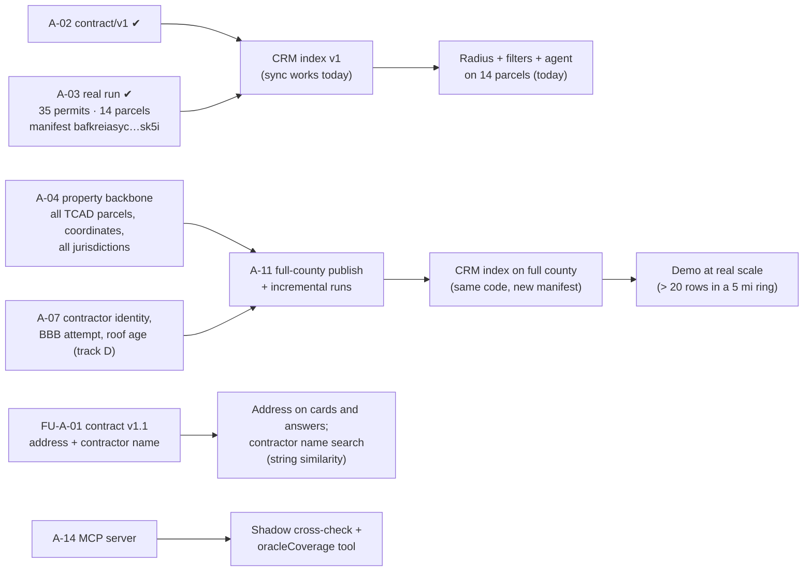

| CRM search / agent capability | Needs from Task A | Today | Becomes real when |
| --- | --- | --- | --- |
| Sync + index + provenance chip | A-02 + a published manifest | **Yes** (A-03 run) | — |
| Radius search (pin, GPS) | `latitude`/`longitude` (`gis_centroid`) | 14 parcels only | **A-04 → A-11** (493,246 TCAD accounts) |
| Aged roofs ≥ N years | `roof_age_years` + basis + confidence | 14 parcels, mostly `built_year` / `low` | A-04 + A-11 (coverage); A-07 track D + permit backfill (permit-based, `high`) |
| Open / long-open permits | `status_class`, `open_days` | 35 permits issued 2026-09, so "open > 5 years" is almost certainly 0 | A-04's permit backfill, published by **A-11** |
| Contractor name in drawer and answers | `contractor_name_raw` (v1.1), `contractor_resolution` | `unresolved` × 35, no name | **FU-A-01** (name as printed) + **A-07** (identity) |
| BBB | `bbb_status` + rating carrier | always `not_checked`; no `bbb_rating` column | A-07 track B, which is likely to stay `blocked` (403) |
| Street address | `unnormalized_address`, `city_name`, `postal_code` (v1.1) | not in export | **FU-A-01** after A-04 |
| "Owner outside the area" (G4) | `owner_area_class` | always `unknown` in v1 (`not_in_export`) | needs the owner mailing ZIP in a later contract version; not scheduled |
| Place names ("near Pflugerville") | the `travis-places@1.0.0` gazetteer (in `query-core`, digest in manifest `profiles[]`) | **Yes** | — |
| MCP cross-check / coverage tool | A-14 | No | A-14 |

**Plan change I recommend:** EXT-05 ("B-09 needs A-14") should become "B-09 *uses* A-14 when available". The agent's only hard dependencies are the CRM index and the vendored gazetteer, and both exist today. The **demo** still depends on A-11 (EXT-03), because checks.md §8 expects more than 20 rows in a 5-mile ring, and 14 parcels cannot give that.

#### 2.4 What search and the agent do while a Task A piece is missing

The rule is the same for every row: **show what is published, say what is not and why, and never fill a gap.** The `missing[]` reasons come from the contract's closed list.

| Missing piece | Search (map / list) | Agent |
| --- | --- | --- |
| **No coordinates** (`coordinate_source = none`, reason `no_coordinates`) | The property is excluded from radius results and **counted**: "n published properties have no coordinates and cannot be placed in a ring". It is still findable by TCAD id. Never geocoded by us. | `searchProperties` returns `excludedNoCoordinates: n`, and the answer states it as a claim with the run citation. |
| **Few properties** (A-03 slice) | An empty ring says "No published properties in this ring. Run {runId} covers 14 parcels with Sept 2026 Austin roofing permits", with a link to coverage. | Outcome `empty_in_scope`: it states the filter that excluded everything, offers "Widen to {2r} mi", and offers near misses (stalled permits) labelled as such. |
| **No roof age** (`no_roof_date`) | Excluded from "roof ≥ N" results, counted as "roof age unknown: n", and shown on the property with the reason. | It states "n properties in the area have no roof date and were not counted". It never assumes "old". |
| **Low-confidence roof age** (`built_year`, `low`) | Included, labelled "low · TCAD built year", sorted after high and medium at equal age. A `minConfidence` filter is available. | Each cited row carries basis and confidence. If more than 50 % of matches are `low`, the answer adds the assumption "most ages are the building's built year, not a roof permit". |
| **No contractor name** (v1: `no_lexicon_carrier`, `contractor_unresolved`) | "Contractor not published" with the reason. Contractor filters are disabled, with a tooltip. | A contractor question returns outcome `field_not_published` for that part: "Run {runId} does not publish contractor names (contract v1)". Nothing is invented. |
| **No BBB** (`not_checked`, `blocked`, `not_found`) | One of the 4 BBB states with `bbb_status_reason`. Never a score. | G5 returns the BBB state and its reason, cited to the permit row. |
| **No address** | "TCAD {request_identifier} · near {nearest gazetteer place}", with lat/lon and "Address not published in Run {n}". | The same title in citations. Address search returns `field_not_published`. |
| **No free text to embed** | Not needed for search. | No semantic matching is offered. Words like "leaking" or "hail" in a question go to `unsupported[]`: "the published data has no permit descriptions; I filtered on permit type Roofing/Replacement only". |
| **Owner area unknown** (G4) | The filter is disabled, with "Not published in v1". | `unsupported: [{constraint: "owner outside area", reason: "not_in_export"}]`. The agent answers the supported part (tenure ≥ 10 years) and says it could not apply the rest. |
| **MCP absent** | No effect. | No `oracleCoverage` tool is registered (registered tools are fixed at cold start from config; no dynamic discovery). |
| **A newer run fails validation** | The index stays on the previous run; the data chip says "newer run available: not applied ({reason})". | Answers cite the `manifest_cid` actually used, which is always the one the user sees in the chip. |

---

### 3. The search store

#### 3.1 Retrieval flow

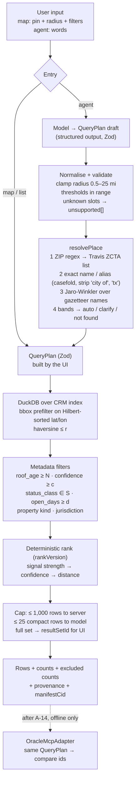

**How to read it:** the map and the agent meet at the **QueryPlan**. From that point on, the code path is the same, so for the same plan and the same `manifest_cid`, the agent and the map return the same rows. That is testable, and the test is written (§9).

#### 3.2 Components

| Need | Choice | Why |
| --- | --- | --- |
| Index storage | Private S3 `crm-index/index/{manifestCid}/crm_property.parquet`, `crm_permit.parquet`, `index_meta.json`; verified raw copies at `raw/{cid}` (metagross §4) | Immutable per run. The pointer flip is atomic and rollback is one write. |
| Query engine | `@duckdb/node-api` in the API Lambda (arm64, 3,008 MB, threads 4: the size at which Task A passed). The index is downloaded to `/tmp/{manifestCid}` once per sandbox. **No DuckDB extensions** are loaded at runtime (Task A's ERR-14: autoload reached `extensions.duckdb.org`). | `jaro_winkler_similarity`, `list_cosine_similarity` and the math for haversine are DuckDB core functions, so nothing needs installing. |
| Place gazetteer | `travis-places@1.0.0`, vendored with `query-core`. Its digest is checked against the manifest's `profiles[]` at sync. | It is public, versioned and cited (source URL + SHA-256). It is the only allowed geocoder (no third-party geocoding API, so no new external dependency). |
| Ranking | A pure function in `packages/domain` (`rankCandidates`, `rankVersion = "r1"`) | The same order on the map, in the list and in the agent. The version is recorded in every answer. |
| Ports | `CorpusStore` (S3 index files), `RetrievalIndex` (DuckDB adapter; MCP adapter later), `PlaceResolver`, `ReviewStore` (DynamoDB), `TraceSink`. `EmbeddingService` is defined but has **no adapter in v1**. | These are the skill's required interfaces. The missing embedding adapter is deliberate and visible, not forgotten. |

#### 3.3 The OpenSearch deviation and when to revisit it

| | CRM index (DuckDB) | OpenSearch `t3.small.search`, 1 node |
| --- | --- | --- |
| Idle cost | about $0 (S3 storage only, a few MB to about 100 MB) | about $28–30/month, plus EBS |
| Geo radius + filters | yes, Task A measured p95 95–200 ms in region | yes (`geo_distance`) |
| Vector search | `list_cosine_similarity` brute force over precomputed columns, fine for under 100k permit rows (**projection**) | k-NN (HNSW) |
| Free-plan risk | none known | domain creation not yet proven on this plan; 15–25 min create time |
| Local parity | the same DuckDB over the same Parquet files | Docker OpenSearch |

**Re-entry trigger:** OpenSearch comes back as a G3 change, behind the same `RetrievalIndex` port, if **both** of these become true:
1. Task A publishes free text (permit `description`, or contractor names at a volume where string similarity fails), **and**
2. a golden query that needs meaning-based matching fails on the DuckDB path.

Until then, building embeddings would be "semantic search" over nothing.

**Intermediate step:** if (1) happens without (2) being proven at scale, embed the permit text at sync time with Titan v2 through the AI SDK `embedMany` (`AI_PROVIDER` switch). Store the embeddings as a `FLOAT[1024]` column with `embedding_model` and `embedding_version`, and rank with `list_cosine_similarity` inside the same DuckDB query. This needs no new service.

---

### 4. Corpus and metadata contract (agent-facing)

The index row shapes are metagross §4 (`crm_property`, `crm_permit`, `index_meta.json`). I add or require the following.

**Additions to `crm_property`:**
- `ownerKind`, `tenureYears`, `isLongTenure`, `ownerAreaClass`, for G4. **No `owner_name`.**
- `nearestPlace` + `nearestPlaceMi`: the gazetteer place nearest the point, computed at sync, for the "near {place}" title.
- `kind` (`residential | commercial | unknown`), derived from the lexicon `property_type`/`property_usage_type` by a mapping that is versioned in `packages/domain`. Unmapped values are `unknown`, never guessed.

**Agent contracts.** These schemas are what the evaluator's Vitest and the UI depend on.

```ts
// packages/shared/src/agent/query-plan.ts
QueryPlan = z.object({
  intent: z.enum(["find_properties", "find_permits", "lookup_permit", "lookup_property", "coverage", "propose_leads"]),
  area: z.object({
    kind: z.enum(["place", "zip", "point", "county"]),
    query: z.string().max(80),                 // what the user typed
    resolved: z.object({ name: z.string(), lat: z.number(), lon: z.number(),
                         source: z.literal("travis-places@1.0.0"), sha256: z.string(),
                         match: z.enum(["exact", "alias", "fuzzy", "zip", "user_point"]),
                         score: z.number().min(0).max(1) }).optional(),
    radiusMi: z.number().min(0.5).max(25),
  }),
  filters: z.object({
    roofAgeMinYears: z.number().int().min(0).max(100).optional(),
    roofConfidenceMin: z.enum(["low", "medium", "high"]).optional(),
    statusClass: z.array(z.enum(["open", "stalled", "closed"])).optional(),
    openYearsMin: z.number().min(0).max(50).optional(),
    tenureYearsMin: z.number().int().min(0).max(100).optional(),
    kind: z.enum(["residential", "commercial"]).optional(),
    permitNumber: z.string().max(40).optional(),
  }),
  slotSources: z.record(z.enum(["stated", "default", "inherited"])), // drives the assumption chips
  unsupported: z.array(z.object({ constraint: z.string().max(80),
                                  reason: z.enum(["not_in_export", "no_lexicon_carrier", "out_of_scope", "no_free_text"]) })),
});

// packages/shared/src/agent/answer.ts
AgentAnswer = z.object({
  outcome: z.enum(["answered", "empty_in_scope", "out_of_scope", "not_found", "needs_clarification",
                   "field_not_published", "timed_out", "rate_limited", "paused"]),
  claims: z.array(z.object({ text: z.string().max(400), citationIds: z.array(z.number().int()).min(1) })),
  citations: z.array(z.object({ id: z.number().int(), kind: z.enum(["property", "permit", "run", "place"]),
      tcadId: z.string().optional(), propertyCid: z.string().optional(), permitCid: z.string().optional(),
      sourceUrl: z.string().nullable(), capturedAt: z.string(), tableCid: z.string(), manifestCid: z.string(), asOf: z.string() })),
  plan: QueryPlan,                    // "How I read this"
  resultSetId: z.string(),            // the UI pages the full rows from here, not from model text
  counts: z.object({ matched: z.number(), shown: z.number(), excludedNoCoordinates: z.number(),
                     excludedNoRoofDate: z.number(), truncated: z.boolean() }),
  missing: z.array(z.object({ field: z.string(), reason: z.string() })),
  proposals: z.array(z.object({ tcadId: z.string(), alreadyLead: z.boolean(), leadId: z.string().optional() })).optional(),
  trace: z.object({ traceId: z.string(), modelId: z.string(), promptVersion: z.string(), rankVersion: z.string(),
                    toolSteps: z.number(), modelCalls: z.number() }),
});
```

**Review and correction records** (DynamoDB, `crm-agent` table or prefixed keys in `crm-leads`):
- `INTERP#{hash(normalisedQuestion)}`: question, the accepted `QueryPlan`, `acceptedBy`, `at`, `manifestCid`, `promptVersion`. This is written when the user runs a plan after editing a chip, or marks an answer helpful.
- `ALIAS#{normalisedText}` → a gazetteer place id. It is written **only after review** (§7).
- `FEEDBACK#{traceId}`: up or down vote, reason, free-text note (≤ 500 chars, never sent to the model).

**Governance — what may be sent to the model:** `tcadId`, `nearestPlace`, lat/lon, roof fields, permit fields, `jurisdiction`, contractor *name as printed* (v1.1, a public business name), BBB state, and the counts.
- **Never sent:** owner name, notes, assignee, the user's email.
- Text that comes from the source (contractor name, a future description) is **untrusted data**: control characters are stripped, it is capped at 120 chars, and it is wrapped in a delimited data block. The system prompt says data blocks are never instructions.

---

### 5. Confidence and refusal policy

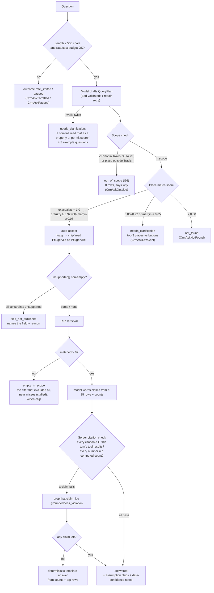

**The numbers:**

| Check | Auto | Ask (clarify) | Refuse |
| --- | --- | --- | --- |
| Place name | exact or alias = 1.0; Jaro-Winkler ≥ 0.92 **and** ≥ 0.05 ahead of the runner-up | 0.80 ≤ score < 0.92, or margin < 0.05 | < 0.80 → `not_found`. A known non-Travis place or ZIP → `out_of_scope`. |
| ZIP | `^\d{5}$` and in the gazetteer's Travis ZCTA list | — | otherwise `out_of_scope` |
| QueryPlan | valid on the first try or after 1 repair | invalid twice → clarify with examples | — |
| Defaults the user did not state | applied, shown as a chip with `slotSources = default`: radius 5 mi, roof ≥ 15 yrs, "many years" = open ≥ 5 yrs, status = open, plus stalled offered as a near miss | — | — |
| Data confidence | rows are always returned. A "mostly low confidence" note when more than 50 % of matches are `low`. Stalled rows are never called "open" (D-4a). | — | — |
| Groundedness | 100 % of claims cite this turn's tool results | — | uncited claims are dropped; if none are left, the template answer is used |

These thresholds are the **starting calibration**. B-09 calibrates them on the place fixture set (§9) and records the final values in `packages/shared/src/agent/thresholds.ts` with a version.

---

### 6. Agent runtime

#### 6.1 Runtime boundary

| Item | Choice |
| --- | --- |
| Ingress | The tRPC procedure `agent.ask` on the CRM API Lambda (same Cognito JWT). The kit's Asana and Chat SDK rules **do not apply**: this agent's ingress is the CRM web UI, not an Asana task. That is a recorded deviation; everything else in `build-ai-agents` applies. |
| Name | `alakazam-crm-agent` in config and traces (kit naming rule). The UI shows "Ask". |
| Loop | Vercel AI SDK `ToolLoopAgent` with fixed tools (no dynamic discovery). `stopWhen` is at most 6 steps. At most 3 model calls: one to plan, at most one repair, one to compose. One response, no streaming (design: "Working…" then the whole answer). |
| Models | Selected by `AI_PROVIDER`. Bedrock is the default: `eu.anthropic.claude-sonnet-4-6` for planning and composing, with `eu.anthropic.claude-haiku-4-5-20251001-v1:0` as the cheaper planner if latency or cost needs it. Gateway uses `anthropic/claude-sonnet-4.6`. Model ids come from config and never appear in agent code. |
| Prompt caching | Wrap the Bedrock model (cache points on the system prompt and the last non-system message). Log cache read/write tokens. Put `cacheStrategy` in the trace metadata. |
| Timeouts | Server abort at 23 s → `timed_out`; Lambda and client stop at 25 s; the HTTP API limit is 29–30 s. These are Task A's AD-09 layering, which the design reuses ("Took too long at 25 s"). |
| Memory | `ConversationEventStore`. The adapter is AgentCore Memory (`sessionId = threadId`, `actorId = Cognito sub`, `clientToken = ${requestId}:${ordinal}`), with a `DynamoDbConversationEventStore` fallback chosen by config. Events are the user turn, the `QueryPlan`, the tool calls with result-set ids (not the rows) and the answer. TTL 7 days. |
| Telemetry | The `TraceSink` facade: AI SDK `experimental_telemetry` → OpenTelemetry → X-Ray (always), plus a LangSmith adapter when `LANGSMITH_API_KEY` is in Secrets Manager. `flush()` runs before return. Powertools Logger, Tracer and Metrics. |
| Cost guard | A DynamoDB daily counter: $3/day cap, alarm at 80 %; when reached → `paused`. A token bucket of 8 model calls/min, under the measured Bedrock limit of 10/min (Task A, 2026-10-17); over it → `rate_limited` with retry-after. |

#### 6.2 Tools (Zod inputs; all are read-only except where noted)

| Tool | Input (contract column names) | Returns to the model | Returns to the UI (via `resultSetId`) |
| --- | --- | --- | --- |
| `resolvePlace` | `{ text }` | name, point, match kind, score, top 3 | — |
| `searchProperties` | `QueryPlan.area` + `filters` | counts, excluded counts, ≤ 25 compact rows | ≤ 1,000 full rows with provenance |
| `searchPermits` | the same + `statusClass`, `openYearsMin` | the same, sorted by `open_days` desc | the same |
| `getProperty` | `{ tcadId }` or `{ propertyCid }` | one property + its permits, compact | full detail |
| `getCoverage` | `{}` | `index_meta`: run, `as_of`, covered jurisdictions, limitations, counts | — |
| `proposeLeads` | `{ tcadIds[] (≤ 25) }` | which are already leads (read from `crm-leads`) | the confirmation card payload. **It writes nothing.** |
| `oracleCoverage` (after A-14, config-gated) | `{}` | Task A MCP `get_coverage`, cited to the MCP | — |

**G7 ("create a lead for the first result"):** `proposeLeads([first.tcadId])` → the confirmation card → the user taps Create → `leads.create({ tcadId, createdFrom: "agent", sourceManifestCid, signals })`. This is the same procedure, de-duplication included, as the map.

#### 6.3 Tool-loop sequence (G1, then G2 as a follow-up)

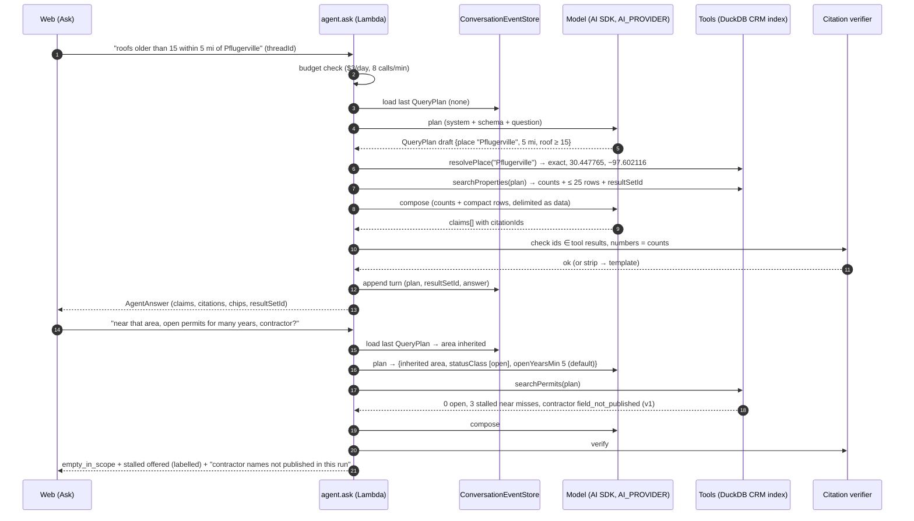

---

### 7. Human review and learning loop

The runtime decisions here are **how a question is read** and **which place a name means**. Lead writes are always confirmed by a person, so they need no confidence threshold.

| Signal | What is stored | How it is reused | Guard |
| --- | --- | --- | --- |
| User edits an assumption chip and re-runs | `INTERP#` record: question → accepted `QueryPlan` | The top 3 similar accepted interpretations (by normalised-question trigram similarity ≥ 0.85) go to the planner as few-shot examples | Only plans that produced a non-empty, verified answer; capped at 200 records; each one versioned by `promptVersion` |
| User picks a place in the clarify state | a candidate `ALIAS#` | Becomes an exact alias **only after review**: an admin action in the CRM, or a PR to the alias file | Never auto-promoted; aliases are versioned with the gazetteer digest |
| Thumbs down + reason | `FEEDBACK#` | A weekly review list; failing cases become new golden fixtures | Free text is never sent to the model |
| Lead created from an agent answer | the lead's `createdFrom = agent` + `traceId` | Precision metric: share of proposals confirmed | — |

**Rollback:** `promptVersion`, `rankVersion` and the thresholds version are config values. A bad change is reverted by a config change, without a redeploy of the index.

---

### 8. Local replay and AWS replay

The kit flow is "SAM local + Docker OpenSearch". Here it becomes **SAM local + the same DuckDB over real fixture Parquet**, because the production store *is* DuckDB over Parquet. This is not a second architecture.

1. `fixtures/rag/corpus/`: the **real** A-03 index built by the sync job from manifest `bafkreiasycmsr2qdlxqcfg3yc2conpn3jxmohz7gs55hkseipplhpqsk5i`, together with that manifest's CID. These are real rows, not synthetic ones, so constitution XI holds.
2. `fixtures/rag/queries/*.json`: (a) **plan-level** cases, which fix a `QueryPlan` and the expected `tcadId` set, with no model call, so they are deterministic and run in CI; (b) **question-level** golden cases G1–G7, rewritten to today's run (§9).
3. `npx cdk synth` → `sam local invoke -t cdk.out/CrmApi.template.json ApiFunction -e fixtures/rag/queries/<case>.json`, with `CRM_INDEX_DIR=fixtures/rag/corpus` (filesystem `CorpusStore` adapter).
4. `fixtures/rag/places.json`: every gazetteer place, plus generated case and spacing variants, plus about 30 hand-written misspellings and non-Travis names, for place-resolution calibration.
5. AWS replay: the same plan-level cases through a direct `aws lambda invoke` against the deployed function, then the question-level golden Vitest against the **hosted** `agent.ask` (checks.md §7.2).

SAM local proves the handler, events and retrieval. It does not prove IAM, Bedrock quotas or AgentCore Memory, which only the AWS replay covers.

---

### 9. Evaluation and operations

**Golden queries, adapted to the published data.** Each is graded for groundedness, correctness, recall and honesty (checks.md §7.2).

| # | Pass rule now (A-03 run) | Pass rule at A-11 |
| --- | --- | --- |
| G1 | The Pflugerville point is stated; every returned `tcadId` is in the index and satisfies the filter; if 0, the answer says 0 and why | recall ≥ 80 % (target 100 %, deterministic) against the `query-core` SQL on the same `manifest_cid` |
| G2 | The area is inherited; "many years = open ≥ 5 yrs" is stated; contractor reads `field_not_published` (v1) | contractor name as printed (v1.1) and BBB state |
| G3 | Exact thresholds (≥ 5 yrs, 5 mi, Manor); sorted by `open_days` desc | the same |
| G4 | Tenure ≥ 10 applied; "owner outside area" listed in `unsupported` (`not_in_export`) | the same until a contract version adds the mailing ZIP |
| G5 | A **real** permit number from the run; BBB state + reason, cited | the same |
| G6 | ZIP 99999 → `out_of_scope`, 0 rows, 0 citations to properties | the same |
| G7 | A confirmation card for the first `tcadId`; after Create, it appears in the lead list | the same |
| G8 (added) | The same QueryPlan through the map procedure and through `agent.ask` gives identical `tcadId` sets | the same, plus the MCP shadow comparison after A-14 |

**Release gates for the agent (B-09 G7):**
- 100 % groundedness
- 100 % G6 no-fabrication
- G1–G8 pass on the hosted URL
- place top-1 ≥ 95 % on `places.json`
- clarify-instead-of-wrong ≥ 99 % on the misspelling set: a wrong auto-accept counts as a failure, a clarify does not
- p95 latency per the NFRs

**Drift checks:**
- On each promoted run, re-run the plan-level cases against the new index and diff the counts against `index_meta`.
- The manifest `profiles[]` digest is compared with the vendored copy (metagross §3.3).

**Metrics** (namespace `RoofingCrm`, Powertools; registered in the metrics list in `packages/observability`):
- `AgentRequests`, `AgentOutcome{outcome}`, `AgentLatencyMs`, `AgentToolSteps`, `AgentModelCalls`
- `AgentTokensIn/Out`, `AgentCacheReadTokens`, `GroundednessViolations`, `PlaceClarifyRate`
- `ProposalsConfirmedRate`, `AgentCostUsdDaily`, `SearchLatencyMs`, `IndexManifestAgeHours`

**Alarms:**
- `GroundednessViolations > 0` over 1 h
- `AgentOutcome{timed_out}` > 10 % over 15 min
- cost at 80 % of $3/day
- `IndexManifestAgeHours` > 48 after a newer validated run exists

Critical alarms go to SNS and PagerDuty, or the documented substitute (constitution VIII).

---

### 10. Patterns of mine that must be visible in the code

1. **Ports before adapters:** `CorpusStore`, `RetrievalIndex`, `PlaceResolver`, `ReviewStore`, `TraceSink`, `ConversationEventStore` and `EmbeddingService` (no adapter, with a comment pointing to §3.3), in `packages/shared/src/rag/ports.ts`.
2. **One `QueryPlan` for map and agent**, with a test that proves both paths return the same ids (G8).
3. **Normalise → exact alias → string similarity → filters → rank**, in that order, in `resolvePlace` and `searchProperties` (`packages/domain`).
4. **Versioned confidence bands** in `thresholds.ts`, and every outcome state mapped to a design board (`CrmAskLowConf`, `CrmAskNotFound`, `CrmAskOutside`, `CrmAskNoResults`, `CrmAskThrottled`, `CrmAskPaused`).
5. **A server-side citation verifier**, with numbers filled from computed counts, never copied from model text. Uncited claims are dropped, and there is a template fallback.
6. **The model sees at most 25 compact rows**; the UI pages the full set by `resultSetId`.
7. **Suggest-only writes:** `proposeLeads` never writes, and creation goes through `leads.create`.
8. **The review loop:** `INTERP#`, `ALIAS#` (review-gated) and `FEEDBACK#` records.
9. **Golden fixtures and replay:** plan-level cases in CI, and question-level cases against the hosted URL.
10. **The trace carries** `modelId`, `promptVersion`, `rankVersion`, the thresholds version, `manifestCid`, cache tokens and `traceId`.

---

### 11. Non-functional requirements (numeric)

| NFR | Threshold | Measured how |
| --- | --- | --- |
| Map/list search, server time | p95 ≤ 1,000 ms warm over 20 calls (5 mi ring, full county) | Powertools `SearchLatencyMs` |
| Pin + radius redraw, end to end | p95 < 3 s (SC-01) | Playwright on the hosted URL |
| Cold sandbox, first search (index download) | ≤ 6 s at full county (**projection**; measure in B-02) | X-Ray init + first query |
| Agent end to end | p95 < 20 s; abort at 23 s; client stop at 25 s | golden Vitest × 20 |
| Agent effort per answer | ≤ 6 tool steps, ≤ 3 model calls, ≤ 1,500 output tokens, ≤ 12,000 input tokens per call | trace |
| Rows | ≤ 1,000 per tool result; ≤ 25 to the model; ≤ 10 citations in text | unit tests |
| Groundedness | 100 % of citations exist in this turn's tool results and in the index | verifier + golden |
| Recall vs `query-core` SQL | ≥ 80 % of top-N (target 100 %) | golden |
| Place resolution | top-1 ≥ 95 %; wrong auto-accepts ≤ 1 % | `places.json` |
| Out of scope (G6) | 100 % zero rows | golden |
| Cost | agent ≤ $3/day (cap enforced); search store idle ≤ $1/month | Budgets + counter |
| Bedrock pacing | ≤ 8 model calls/min | token bucket |
| Index freshness | a validated newer run promoted ≤ 24 h after publication (daily discovery), or ≤ 15 min after a manual start, unless frozen | `IndexManifestAgeHours` |
| Index completeness | index counts = manifest `coverage` counts, 0 difference or documented | sync Validate step |

---

### 12. P0 rules (a violation blocks the story)

1. Runtime data comes **only** from published CIDs (CloudFront CID copy, then Filebase, then Pinata, each byte verified against its CID) or Task A's MCP. No calls to Task A's API, S3, SSM, Query DB or CloudFormation exports.
2. No invented, sample or synthetic rows shown as real. `contract/v1/pilot-manifest.json` is used for contract tests only, never synced.
3. Every row and every agent claim carries provenance (`manifest_cid`, `cid`, `source_url` or its missing reason, `as_of`). Every null shows its `missing` reason.
4. The agent never shows a property, permit, count or contractor that is not in this turn's tool results.
5. The agent never writes a lead; a person confirms each one.
6. Stalled is never presented as open (D-4a). Roof age is always shown with its basis and confidence.
7. All LLM calls go through the Vercel AI SDK with the `AI_PROVIDER` switch. Zod on every tool. No `any`. No direct provider SDK.
8. No SQL from the model. No free-form SQL tool.
9. No owner names, notes or user identity in prompts. No secrets in logs.
10. No DuckDB extension autoload at runtime. The region comes from config. CDK only.

---

### 13. Open risks

| Risk | L | I | Mitigation |
| --- | --- | --- | --- |
| **The demo needs scale that only A-11 brings** (14 parcels today; checks.md expects more than 20 rows in a ring) | H | H | Same code at full scale; pick the demo area from real A-11 data; until then the honest empty states are the evidence |
| Long-open permits: "open > 5 yrs" is 0 on a Sept 2026 slice; Pflugerville has 0 open reroofs even county-wide (Task A, 2026-10-19) | H | M | Near-miss stalled offer + widen chip (design); demo the area A-13/A-14 choose |
| Contractor and BBB stay empty (FU-A-01 not scheduled, BBB 403) | H | M | `field_not_published` and the BBB state with its reason; demo line 5 shows the "not available" case |
| G4 "owners outside the area" cannot be answered in v1 | H | L | Answer the supported part and list the unsupported one |
| Vendored `query-core` drifts from Task A | M | H | Profile digest check holds the sync; Task A's tests are re-run here |
| Bedrock throttling (10/min) during the evaluator's run | M | M | Token bucket, `rate_limited` state, `AI_PROVIDER=gateway` switch (Gateway Claude needs a paid top-up, see CLAUDE.md) |
| AgentCore Memory not creatable on the free plan | L | L | DynamoDB adapter behind the same interface, chosen by config |
| The planner misreads a question | M | M | Chips show every slot's source; one repair retry; clarify state; golden + review loop |
| A cold sandbox downloading a full-county index exceeds NFR | M | M | Measure in B-02; split the index into geo tiles (Hilbert ranges) and download lazily, as a fallback |
| OpenSearch is needed later (free text arrives) | L | M | `EmbeddingService` port + DuckDB cosine first, then OpenSearch behind `RetrievalIndex` (§3.3) |

---

### 14. Agreement with metagross, and what I add

- **Agree:** D-2 (Parquet + DuckDB index, no OpenSearch), D-3/D-4 (CID-verified sync, public CID copy first), D-5 (vendored `query-core`, sync only, plus the gazetteer for the agent), D-6 (TCAD id as the lead key), D-8 (own agent, MCP optional), D-12 (no embeddings in v1).
- **Add:**
  - (a) the owner fields G4 needs (`ownerKind`, `tenureYears`, `isLongTenure`, `ownerAreaClass`), without names
  - (b) one shared `QueryPlan` for map and agent, with the G8 equality test
  - (c) the confidence bands and refusal states (§5)
  - (d) `proposeLeads` as a non-writing tool
  - (e) `ConversationEventStore` with AgentCore Memory (kit default), not ad-hoc DynamoDB history
  - (f) the MCP as a shadow cross-check adapter with contract-named tool fields
- **Deviations from my kit, to be recorded at G3:**
  - no OpenSearch, and the replay is SAM local + DuckDB instead of Docker OpenSearch (§3.3, §8)
  - no Asana or Chat SDK ingress, because this is a web agent (§6.1)
  - LangSmith is conditional on a key (§6.1)

**Open questions (they do not block G3):**
1. Is there a LangSmith API key for this project? If not, X-Ray/OTel traces are the record.
2. Which demo area should be used once A-11 lands? It must come from real data, with at least 20 properties in 5 mi and at least one long-open or stalled permit.


## soofi-xyz-team-kit:espeon

### Espeon: index sync (how Task A's published data gets into the CRM search store and stays current)

**Scope and method.** This is a read-only consult. I created, changed and deployed nothing. Everything below comes from these sources:
- the CRM's README, `docs/01-intent.md`, `docs/plan.md`, `design/docs/CRM-HANDOFF.md` and the constitution's Task B addendum;
- `../assessment-guide/reference/B-roofing-crm.md` §3–4 and `reference/checks.md` §7;
- Task A's `contract/v1/` (README, `columns.json`), `runs/index.json`, the A-03 run manifest, ADR-0001, the A-04, A-11 and A-14 stories, FU-A-01, `docs/evidence/A-03.md`, and `packages/contract` and `packages/query-core`.

I made two read-only AWS calls:
- **Price list:** OpenSearch `t3.small.search` in eu-north-1 costs $0.041 per hour, and gp3 storage costs $0.1275 per GB-month.
- **Credit check:** account 515618610572 is on the FREE plan, ACTIVE, with **$137.85 of credit left** (2026-10-22), expiring 2027-04-16.

I loaded the skills `build-local-rag-pocs`, `build-rag-systems`, `build-batch-workflows` and `apply-engineering-guidelines`. I did not spawn any sub-agents; the "Review plan" section says which agents should review the build.

---

### 1. Summary of the decision

| Question | Decision (plain words) |
| --- | --- |
| What is "the index"? | A search store holding one document per published property and one per published roofing permit. Each document has a map point, the filter fields, provenance (where the record came from) and a list of missing fields with the reason for each. Each Task A run gets its own fresh copy of the index, and the CRM switches to it in one step only after every check passes. |
| Where does it live? | **Amazon OpenSearch Service, one `t3.small.search` node, 10 GB gp3, public HTTPS endpoint locked by IAM, no VPC.** One index answers the map radius query (`geo_distance`), the filters, the sort and, later, vector search. Cost is about $31 a month, all of it idle cost (see §8). |
| How does the CRM learn about a new run? | **It checks Task A's published `runs/index.json` every hour** and treats the entry only as a hint. Once Task A's MCP exists (A-14), its `list_runs` is a second, cross-checking source. A **manual command** with a manifest CID always works and is how the first run gets loaded. **IPNS is not possible:** Task A forbids it (AD-03). **The manifest chain cannot find new runs:** `previousManifestCid` points backward only, so it is used to check lineage, not for discovery. |
| How is a run trusted? | Three checks: (1) the manifest's bytes must hash to its CID; (2) the manifest must pass Zod validation, which checks the county, FIPS code and lineage; (3) every table part's size and SHA-256 must match before the part is stored. Only after these checks does the CRM build the four contract views with Task A's own view SQL. It then reconciles counts against the manifest's `coverage` section, replays golden geo queries, and only then switches the alias. |
| Where are the bytes read from? | Public gateways, in this order: **Filebase**, then **Pinata**; never ipfs.io or dweb.link, which are retired. Each verified file goes into the **CRM's own S3 copy, keyed by CID**. The CRM never reads Task A's signed CloudFront copy, its buckets or its Query DB, even though both tasks run in the same AWS account. |
| How is the work run? | **AWS Step Functions (Standard)**: one execution per manifest CID, with TypeScript Lambdas for each step. DuckDB (`@duckdb/node-api`) runs in a Lambda to build the views; Task A proved this sizing in A-03. Step Functions **Distributed Map** handles bulk indexing at full-county size. No Glue and no Python: the data is under 1 GB and needs no Spark-class joins. |
| Is a local POC worth it? | **Yes, as a small TypeScript CLI that runs the real pipeline on the real A-03 CIDs.** It should **not** be the default libSQL plus embeddings POC: contract/v1 has almost no free text to embed (§9). |

---

### 2. Data flow from Task A's publication to the CRM index

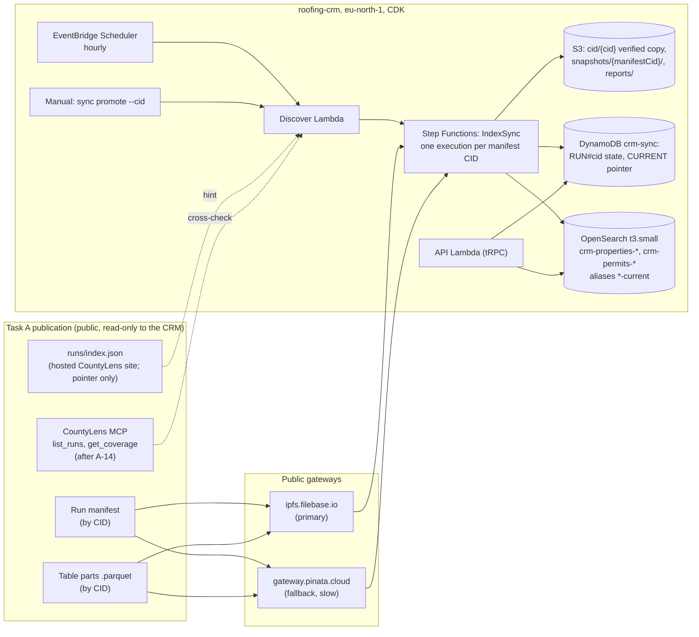

How the flow works:
- **Task A publishes** a manifest and its table parts by CID. Neither can ever change, because the address is the hash of the content. It also updates one changeable file, `runs/index.json`, that lists all runs.
- **The CRM checks that list every hour.** A new manifest CID starts one Step Functions run.
- **That run copies the bytes once** from a public gateway, checks each one against its hash, and stores it in the CRM's own S3 bucket. Gateways are rate-limited (Filebase answered 429 after about 50–65 requests in Task A's ERR-15), so the CRM never re-downloads anything.
- **It then builds a new index next to the live one.** Users keep searching the old run until the new one passes every check. The switch is one atomic alias change.

---

### 3. Sync pipeline as a state machine

```mermaid
stateDiagram-v2
  [*] --> Discovered: new manifestCid seen (index.json / MCP / manual)
  Discovered --> CostGate
  CostGate --> AwaitingApproval: prediction over limit
  AwaitingApproval --> FetchManifest: operator approves
  AwaitingApproval --> Rejected: operator rejects
  CostGate --> FetchManifest: within limits
  FetchManifest --> Quarantined: CID mismatch / schema invalid / wrong county
  FetchManifest --> LineageCheck
  LineageCheck --> AwaitingApproval: fork (previousManifestCid unknown) or older finishedAt
  LineageCheck --> FetchArtifacts
  FetchArtifacts --> Quarantined: sha256/size mismatch after retries on all gateways
  FetchArtifacts --> ContractCheck
  ContractCheck --> Quarantined: breaking change (required table/column missing or retyped)
  ContractCheck --> BuildViews: identical or additive
  BuildViews --> Validate: snapshot NDJSON in S3
  Validate --> Quarantined: rejects > 0.1% or provenance null
  Validate --> Reconcile
  Reconcile --> Quarantined: count diff not explained
  Reconcile --> BulkIndex
  BulkIndex --> GoldenReplay
  GoldenReplay --> Quarantined: OpenSearch ≠ DuckDB result sets
  GoldenReplay --> Promoted: atomic alias swap + CURRENT conditional put
  Promoted --> Superseded: a newer run is promoted
  Quarantined --> [*]: alarm; current run keeps serving
  Promoted --> [*]
```

What each step does and why:

1. **Cost gate (first step, required by `build-batch-workflows`).**
   - Before downloading anything, the step reads the planned artifact sizes from the manifest and the expected row counts from `coverage` (`parcels_published`, `permits_emitted`). From these it predicts the bytes to download, the documents to index and the cost.
   - **The run pauses for PO approval when any of these is true:** predicted cost above **$1.00** for the run, more than **600,000 documents**, or more than **2 GB** to download.
   - Approval uses a Step Functions `waitForTaskToken` plus an SNS email, and is given with `sync approve <cid>`.
   - Expected first full-county run: about 0.2–0.95 GB of table parts and about 512,000 documents (493,246 properties and about 19,000 permits). That is below the limits, but close enough that a jump is caught.
   - **CARs are never downloaded.** The county CAR is projected at 2.74 GB and the CRM does not need it.
2. **Fetch the manifest.**
   - GET `/ipfs/{cid}` from Filebase, then Pinata.
   - Recompute the raw-leaves CIDv1 of the bytes (Task A's `rawCid`, copied).
   - Validate the manifest with the copied `RunManifestV1` Zod schema. Then check `county = travis`, `fips = 48453`, `state = TX`, and that the schema is in the CRM's supported list.
3. **Lineage check.**
   - A run is accepted when its `previousManifestCid` is the currently promoted CID, or any ancestor the CRM has seen.
   - The first run (`previousManifestCid: null`) is accepted only through the manual bootstrap.
   - A run with an older `finishedAt` than the current one, or a run on an unknown branch, waits for approval. This means a stale or forked pointer in `runs/index.json` can never silently roll the CRM back.
4. **Fetch the artifacts.**
   - Only `kind: "table"` parts under `tables/county/` and `tables/property_improvement/` are fetched, for the tables the views read.
   - Before fetching, the step checks whether `cid/{cid}` already exists in S3. Unchanged parts across runs keep their CID, so they cost nothing.
   - **Rate limits:** at most 2 downloads at a time and at most 30 requests per minute per gateway. On a 429 the step honours `Retry-After`, then backs off exponentially with jitter (1, 2, 4, 8, 16 s; at most 5 tries per gateway) before switching gateway.
   - **Verification:** size and SHA-256 must match before the S3 write, and the write uses a conditional `If-None-Match: *`.
5. **Contract check.**
   - The step reads each part's Parquet schema (DuckDB `parquet_schema`) and builds a **schema fingerprint**: the sorted list of (table, column, type) plus `profiles[]` name, version and SHA.
   - It compares the fingerprint with the CRM's supported-contract registry. The result is *identical*, *additive* or *breaking*; see §6.
6. **Build the views.**
   - Task A's `query-core` (`bindManifest` + `VIEWS_SQL` + the status map) runs in a Lambda with DuckDB on Node, over the S3 copies.
   - It produces `v_property`, `v_roofing_permit`, `v_contractor` and `v_run`. These are then flattened into gzipped NDJSON index documents under `snapshots/{manifestCid}/`.
   - **The CRM never re-derives `status_class`, `open_days` or roof age itself.** It uses Task A's SQL, pinned to a Task A commit, so the CRM, CountyLens and the MCP give the same answer.
7. **Validate.**
   - Every document is parsed with the CRM's Zod document schema.
   - Rejected rows go to `rejects/{manifestCid}.ndjson` with a reason.
   - **Promotion is blocked when:** rejects exceed 0.1% of rows, any document lacks a provenance field, or a null field is not listed in `missing[]`.
8. **Reconcile.** All counts go into `reports/{manifestCid}/sync-report.json`. Promotion requires:
   - documents indexed = view rows, with a difference of exactly 0;
   - `v_property` rows = `coverage.parcels_published`;
   - roofing permit rows reconciled with `coverage.permits_emitted`; a difference is allowed only when it has a stated cause, such as non-roofing emitted permits;
   - after A-14, the counts also equal the MCP's `get_coverage` for the same run.
9. **Bulk index.**
   - The new index is created with `number_of_replicas: 0` and `refresh_interval: -1`.
   - Batches of 5,000 documents (under 5 MB each) are loaded, at most 2 at a time.
   - Each bulk response is checked: `errors:false`, and the count of items returned must equal the count sent.
   - Then the step refreshes the index and sets `refresh_interval: 1s`.
10. **Golden replay.**
    - For 5 fixed points with radii of 1, 5 and 10 miles (Pflugerville, Manor, Lakeway, downtown Austin, and the A-03 permit centroid), the OpenSearch `geo_distance` result IDs must **equal** DuckDB's haversine result over the same snapshot. Points within 5 m of the edge are ignored.
    - The roof-age ≥ 15 and ≥ 25 counts and the stalled/open counts must also match DuckDB.
11. **Promote.**
    - One `_aliases` call moves `crm-properties-current` and `crm-permits-current` to the new indices.
    - Then a DynamoDB conditional put updates `CURRENT` (expected version = old version).
    - The previous run's indices are kept so rollback takes under a minute. Older ones are deleted.

---

### 4. Sequence of a run promotion

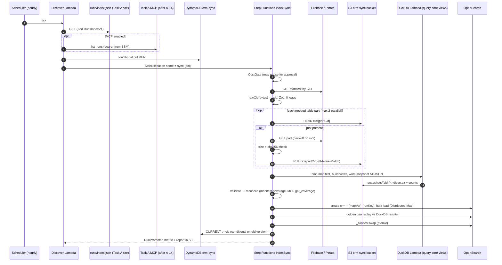

**Idempotency, in plain terms:**
- The Step Functions execution name is derived from the manifest CID. Starting the same run twice is refused by AWS for 90 days, and the DynamoDB state record is a conditional put.
- S3 objects are keyed by CID, so a rerun never downloads twice.
- Index names include the run, so a rerun reuses or rebuilds the same index, and document IDs are deterministic (§5), so reloading overwrites rather than duplicates.
- Replay is one command, `sync replay <cid>`. It starts a new execution `sync-{cid}-r{n}` from the S3 copy and needs no gateway calls.

---

### 5. Data contracts

**5.1 Inputs, owned by Task A and consumed read-only.**

| Contract | Shape (key fields) | How the CRM uses it |
| --- | --- | --- |
| `runs/index.json` (`oracle-travis-runs-index.v1`) | `{schema, runs:[{runId, manifestCid, finishedAt}]}` | Discovery hint only. A wrong or stale entry cannot do harm, because everything is checked against the CID. |
| Run manifest (`oracle-travis-run-manifest.v1`) | `runId, county, state, fips, startedAt, finishedAt, previousManifestCid, sources[] (captured_at, url, watermark, added/changed/removed, limitations), artifacts[] (cid, name, kind, codec, size, sha256, carCid), profiles[], coverage{name:{count, derivation, note}}, limitations[]` | Lineage, verification, the coverage counts used to reconcile, and the limitations shown in the UI's coverage note. |
| Table parts (export-tables Parquet) | Raw lexicon tables (`property`, `geometry`, `structure`, `property_improvement`, `property_has_*`, …) | Input to Task A's view SQL. |
| `contract/v1` views (built by Task A's `query-core` code inside the CRM) | `v_property` (31 columns incl. `parcel_identifier`, `latitude/longitude`, `roof_age_years/basis/confidence`, owner and tenure, provenance, `missing`); `v_roofing_permit` (incl. `status_class`, `open_days`, `contractor_resolution`, `bbb_status(_reason)`); `v_contractor`; `v_run` | Source of every index field. Column names are kept unchanged (the AD-07 names). |
| MCP (after A-14) | `list_runs`, `get_coverage` (6 tools in total, bearer token) | Second discovery source and count cross-check. It is **not** a bulk data source: it is capped at 1,000 rows and 5 requests per second. |

**5.2 CRM index documents (owned by the CRM, versioned by `mappingVersion`).**

`PropertyDoc` (index `crm-properties-m{mappingVersion}-{runKey}`):
- **`_id`:** `tcad:{parcel_identifier}`. When `parcel_identifier` is null, the ID is `cid:{property_cid}` and `stable_key_basis: "property_cid"` is set (see P0-7).
- **Identity:** `property_cid`, `parcel_identifier`, `property_type`, `property_usage_type`, `segment` (residential or commercial, from `property_type`).
- **Location:** `location` (geo_point; left out when coordinates are null, with the reason kept in `missing`), `coordinate_source`.
- **Roof:** `roof_date`, `roof_age_years`, `roof_age_basis`, `roof_age_confidence`, `property_structure_built_year`.
- **Owner and tenure:** `owner_kind`, `owner_name`, `owner_area_class`, `owner_is_out_of_area`, `tenure_years`, `is_long_tenure`.
- **Permit roll-up**, so a property-and-permit filter is one query: `permit_count`, `open_permit_count`, `stalled_permit_count`, `max_open_days`, `latest_permit_status_class`, `permit_ids[]`.
- **Address (v1.1, optional):** `situs_address`, `city_name`, `postal_code`. These are absent in v1 and listed in `missing` as `not_in_export`.
- **Provenance (all required):** `source_url`, `captured_at`, `table`, `table_cid`, `run_id`, `manifest_cid`, `as_of`.
- **`missing[]`:** `{field, reason}`, copied as published.
- **Sync stamps:** `schema_fingerprint`, `mapping_version`, `indexed_at`.

`PermitDoc` (index `crm-permits-m{mappingVersion}-{runKey}`):
- **`_id`:** `permit:{jurisdiction}:{permit_number}`. When either is null, the ID is `cid:{permit_cid}` with `stable_key_basis` set.
- **Fields:** `permit_cid`, `property_cid`, `property_key` (the PropertyDoc `_id`), `location` (copied from the property), `jurisdiction`, `permit_number`, `improvement_type/action/status`, `status_class`, `is_open`, `issue_date`, `final_date`, `permit_close_date`, `final_inspection_date`, `open_days`, `long_open` (open_days ≥ 1,826, about 5 years), `contractor_resolution`, `contractor_company_cid`, `contractor_name` (from `v_contractor.name` when resolved; `contractor_name_raw` in v1.1), `bbb_status`, `bbb_status_reason`, `profile_version`, `profile_sha256`, plus provenance and `missing[]` as above.

Mapping rules:
- `dynamic: "strict"` at the top level, so an unmapped field fails loudly in the build step and not at query time.
- `missing` is a `nested` field of keyword `field` and keyword `reason`. Reasons are **keyword, not enum**: A-04 adds new reasons (`no_gis_feature`, `gis_null_geometry`, `no_permit_point`), and an unknown reason must index and show as "Not published · {code}", never fail.
- No vector field in mapping version 1 (§9).

**5.3 Sync state (DynamoDB `crm-sync`, on-demand capacity).**

- `pk=RUN#{manifestCid}`:
  - `state` (discovered, awaiting_approval, fetching, building, indexing, promoted, superseded, quarantined, rejected) and `stateReason`;
  - `runId`, `finishedAt`, `previousManifestCid`, `runOrdinal` (position in `runs/index.json`; null when bootstrapped by hand, and the UI then shows `runId`);
  - `discoveredVia` (index_json, mcp or manual), `schemaFingerprint`, `contractClass` (identical, additive or breaking);
  - `counts` (artifacts, bytes, views, docs, rejects, reconcile diffs), `costEstimateUsd`, `timings`, `executionArn`, `reportKey`.
- `pk=CURRENT`: `manifestCid`, `runId`, `runOrdinal`, `finishedAt`, `promotedAt`, `propertiesIndex`, `permitsIndex`, `mappingVersion`, `version` (used for the optimistic lock), `previousManifestCid` (the rollback target).
- `pk=DISCOVERY`: `lastPollAt`, `lastPollStatus`, `consecutiveFailures`.

**5.4 What the API and UI receive** (`sync.status`, which drives the design's data chip):

`{ current: {runId, runOrdinal, manifestCid, asOf, promotedAt}, pending?: {runId, runOrdinal, state}, health: "up_to_date" | "updating" | "index_unavailable" | "discovery_failing", coverageNote: string[] }`

- `coverageNote` is copied from the manifest `sources[].limitations` and `limitations[]`, for example "one month of issue dates (2026-09)".
- This is the "Data: CountyLens Run {n}" chip and its three states in `CRM-HANDOFF.md` E-62.
- Every search result carries `run_id`, `manifest_cid` and `as_of` from the document itself.

---

### 6. Contract version change (v1 to v1.1) and other shape changes

The facts behind this design:
- `columns.json` says `"contract": "contract/v1"`, but **the published manifest carries no contract version**. Its schema literal is `oracle-travis-run-manifest.v1`, and Task A validates it with `.strict()`.
- FU-A-01 will add the situs address and the printed contractor name in a story after A-04. How the contractor name is carried is still open: possibly a side table.

The CRM therefore **detects the contract from the data itself**:

| Class | Detected when | What the sync does |
| --- | --- | --- |
| Identical | Fingerprint equals a registered one | Normal run. |
| Additive (v1 to v1.1 is expected to be this) | Every required table and column from `REQUIRED_TABLES` is present with the same type, and there are new tables, columns, enum values or `missing` reasons | Index normally. Fields the CRM's mapper already knows (address, `contractor_name_raw`) are filled and their `missing` entries disappear. Unknown new fields are ignored and listed as `unmappedFields` in the sync report, with a warning metric. **The UI switches from the NoAddress/NoContractor states to the field-present states with no UI code change**, as FU-A-01 promises. |
| Breaking | A required column is missing, renamed or retyped; the manifest schema literal is unknown; or the profile name changed | **Quarantine with `contract_incompatible`.** The CRM keeps serving the last good run and raises an alarm. A CRM change is needed: copy the new `query-core` at a pinned Task A commit, rerun its tests here, bump `mappingVersion`. Because every run gets a fresh index, a new mapping uses the same blue/green switch with no migration. |

To be candid about "no CRM code change": the view SQL comes from Task A's `query-core`. If v1.1 adds the columns through new SQL in `query-core`, the CRM needs a **dependency bump** to the pinned query-core version, which is logged in `docs/reuse-log.md`. It does not need UI or mapper changes. To make the bump small, the v1.1 field paths should be written into the mapper now as optional fields.

The CRM's copy of the manifest validator must accept additive top-level keys. It stays strict on the schema family and on the fields the CRM actually uses. Otherwise a harmless Task A addition, such as a future `contractVersion` field, would quarantine every run.

**Request to Task A (cheap, removes guessing):** add `contract: "contract/v1.1"` to the manifest, or to `profiles[]`, when FU-A-01 ships.

---

### 7. From about 35 rows to the full county

The code path is the same at every size; only the sizing thresholds change.

| Concern | A-03 run (today) | Full county (A-04, then A-11) |
| --- | --- | --- |
| Published rows | 14 parcels, 35 permits, 23 table parts, about 212 KB | About 493,246 properties (TCAD roll; A-04 AC-2 allows a classified gap under 2%) and about 19,000 permit candidates. Table parts about 0.18 GB, at most 0.95 GB (ADR-0001 projection). |
| Fetch | Seconds | About 30 tables × 2–4 parts at `--part-size 48m`, so at most about 120 GETs: about 4–6 minutes at 30 per minute through Filebase, about 12 minutes through Pinata. **Filebase throughput at this size has not been measured** (ADR-0001 gap, A-11). |
| View build | One Lambda invocation | Lambda arm64, **3,008 MB**, DuckDB `threads=4`, **10 GB ephemeral `/tmp`** for spill, 15-minute timeout. This is Task A's measured sizing. If the build takes more than 12 minutes in the replay test, move the same TypeScript handler to a Fargate task (a contingency, not the plan). |
| Indexing | One bulk call | Distributed Map over about 103 NDJSON chunks of 5,000 documents, at most 2 at a time. Estimated 5–15 minutes on one `t3.small`. Replicas stay 0 (one node). |
| Storage | KB | About 0.6–0.8 GB per pair of run indices; current plus previous is about 1.6 GB on 10 GB. |
| Map | Plain points | The mapping already has `geo_point`, so the API can add `geohash_grid` or `geotile_grid` clustering without re-indexing. That is API scope, not sync scope. |
| Properties without coordinates | n/a | Indexed with no `location`, counted in the report, findable in lists but not on the map, with the reason shown (A-04 AC-10 expects under 1%). |

**Does an incremental run publish a full snapshot or only the changes?**
- A-11 says each run "publishes new CIDs for changed groups" and an unchanged group "keeps the previous CID". That implies **every manifest lists the complete current table set**, so the CRM rebuilds a full index per run, and unchanged parts are free because they are already in S3.
- **If Task A instead publishes only the changed rows** (for example, Run 2's `property_improvement` holds only the new window), a full rebuild from that one manifest would silently drop older permits.
- **Safety net:** the reconcile step compares each table's row count with the previous run. A drop of more than 5% with no `removed` delta in `sources[]` blocks promotion and sends the run for approval.
- **Open question Q-1 (§13)** asks Task A to state which model it uses. If it is delta-only, the CRM must merge along the `previousManifestCid` chain by stable key, and removals then need published tombstones, which do not exist today.

---

### 8. AWS components and why

| Component | Choice | Why | Cost (eu-north-1) |
| --- | --- | --- | --- |
| Search store | OpenSearch Service, 1 × `t3.small.search`, 10 GB gp3, latest engine version in the region, encryption at rest, node-to-node encryption, HTTPS only, IAM resource policy limited to the sync and API roles, **no VPC** | One index serves `geo_distance` radius, filters, sort, aggregations and later kNN, so there is no second geo store. It is the kit's non-negotiable production RAG store and the task guide's default. Out of VPC avoids a NAT gateway, which would cost about $35 a month and is needed for Lambdas to reach the IPFS gateways. | $0.041 × 730 h = $29.93, plus 10 GB × $0.1275 = $1.28: **about $31.2 a month (about $1.03 a day), all idle cost**. |
| Orchestration | Step Functions Standard, plus Distributed Map for bulk index | A visible state per run, waits for approval, per-step retry and catch, replay, and the execution name gives idempotency. Distributed Map is the skill's tool for data movement. | Under $0.10 a run. |
| Compute | TypeScript Lambdas (Node 22, arm64) with Powertools Logger, Tracer and Metrics. DuckDB Lambda at 3,008 MB. | Golden Path. DuckDB is the engine Task A's views are written for. | Cents per run. |
| Byte copy and snapshots | S3, Block Public Access, SSE-S3, `enforceSSL`; lifecycle: `snapshots/` and `reports/` kept for the last 3 runs; `cid/` kept while referenced | Content-addressed and immutable; rebuilds need no gateway calls. | Under $0.05 a month. |
| State | DynamoDB on-demand | Conditional writes give the idempotent state machine and the optimistic `CURRENT` pointer. | About $0. |
| Scheduling | EventBridge Scheduler, hourly | Task A publishes at most a few runs a day; hourly is cheap and meets the freshness target. | About $0. |
| Failure path | SQS DLQs (Discover Lambda async failures, Step Functions failure events through an EventBridge rule), **one self-resolving CloudWatch alarm per DLQ** to SNS email; alarms on `PromotionBlocked` and on `DiscoveryConsecutiveFailures ≥ 6` | `observability-dlq-alarms`. PagerDuty is the kit standard, but the assessment has no PagerDuty account. SNS email is the channel, and the subscriber is a config value so PagerDuty Events v2 can be added later. **Recorded deviation.** | About $0. |
| Config and secrets | SSM parameters: gateway list, `runs/index.json` URLs, thresholds, `MCP_ENABLED`. SSM SecureString: MCP bearer token (after A-14). | No secrets in code or logs. | About $0. |
| Not chosen | OpenSearch Serverless (high minimum: at least 2 OCUs, well above $100 a month); Glue (Python plus a DPU minimum, unnecessary below 1 GB); a VPC (NAT cost); Task A's CloudFront CID copy (signed URLs, Task A-internal) | | |

**Budget, in plain words.**
- With $137.85 left, the always-on domain uses about $31 a month. Over a 2-week evaluation that is about $14.5; over a month, about 23% of what remains.
- **Task A runs in the same account and spends from the same credit.** Keep the existing $10 budget alert and add a $40 alert on the RoofingCrm cost tag.
- Tear down or shrink the OpenSearch domain after the evaluation (RISK-03/10 in the plan). Because S3 holds the snapshots, rebuilding the domain is one `sync replay` and needs no gateway calls.
- **Fallback if OpenSearch is blocked on the free plan:** serve reads from DuckDB on Lambda over the CRM's own `snapshots/{cid}/` Parquet, which Task A proved at p95 < 3 s on 2.38 M rows. The `RetrievalIndex` interface (§10) makes this an adapter swap, not a redesign.

---

### 9. Embeddings and the local POC

**Embeddings: not in mapping version 1.**
- contract/v1 has no permit description, no printed contractor name, no raw status and no address: all are `no_lexicon_carrier` or `not_in_export`. Every question in the README and the golden queries is structured (radius, age, status, open duration, place).
- `build-rag-systems` forbids using embeddings when exact fields and rules are available. The agent's "retrieval" is typed tools over this index: geo plus filters plus sort.
- When v1.1 adds `contractor_name_raw`, use **exact plus fuzzy keyword matching first**. Add a `knn_vector` field only if the golden queries show a need for it. In that case use Titan Text Embeddings v2 through the Vercel AI SDK (`AI_PROVIDER=bedrock` with an `eu.` profile, or gateway `amazon/titan-embed-text-v2`), stamped with `embedding_model`, `embedding_dimension` and `embedding_version`. Embed permit and contractor text only, never all 493,000 properties.
- **Check before relying on it:** whether Titan v2 is offered in eu-north-1 or only through a cross-region `eu.` profile.

**Local POC: yes, worth about half a day.**
- Build it as `packages/index-sync` with a CLI. **Do not** build a libSQL vector POC.
- **What it proves on the real A-03 CIDs:** CID verification, the contract mapping, provenance on every row, `missing[]` handling, the count reconciliation (14 properties and 35 permits against the manifest coverage), and geo parity between DuckDB and OpenSearch. These are exactly the gates production uses.
- **The production pieces it runs:** the same TypeScript modules with local adapters. A filesystem CID store replaces S3, a JSONL state file replaces DynamoDB, and Docker OpenSearch (`docker compose up opensearch`) replaces the managed domain.
- **Commands** (JSON on stdout, debug lines on stderr when `SYNC_DEBUG=true`):
  - `pnpm sync:inspect`: current run, manifest CID, counts per index, fingerprint, contract class.
  - `pnpm sync:runs`: discovered runs and their states.
  - `pnpm sync:verify -- <manifestCid>`: fetch and verify only; prints per-artifact gateway, size and sha256 status.
  - `pnpm sync:build -- <manifestCid>`: builds the snapshot and prints the reconcile report.
  - `pnpm sync:query -- --at 30.4478,-97.6021 --r 5 --roof 15 --permit stalled`: ranked documents with provenance.
- **Fixtures:** `fixtures/index/corpus/*.jsonl` is cut from the real A-03 snapshot. No synthetic rows ever go into the index. Test-only edge cases, such as a missing coordinate, are built in unit tests and never indexed.
- An `AGENTS.md` section tells agents to run `inspect` first, and to say "not in the index" rather than guess.
- **AWS readiness gate:** the CDK stack is written only after the POC passes `inspect`, a known `query`, the reconcile check and the gitignore check (`data/`, `.env`). **Question for the PO at that point: "Are you ready to move this RAG system to AWS?"**

---

### 10. Patterns that must be visible in the code

1. **Ports and adapters, defined before the AWS code.**
   - `RunDiscovery`, with implementations `IndexJsonDiscovery`, `McpDiscovery` and `ManualDiscovery`;
   - `ArtifactFetcher`, a gateway chain with a `Verifier`;
   - `CidStore` (S3 or filesystem), `ViewBuilder` (query-core over DuckDB);
   - `RetrievalIndex` (OpenSearch, Docker OpenSearch, or the DuckDB fallback);
   - `SyncStateStore` (DynamoDB or JSONL), `Reconciler`, `CostEstimator`, `TraceSink`.
2. **Zod at every boundary:** `RunsIndexV1`, `RunManifestV1` (accepts additive top-level keys), `PropertyDoc`, `PermitDoc`, `SyncReport`, and the `sync.status` output. No `any`.
3. **Verify before store:** `verifyAndPut(cid, bytes)` is the only path into the CID store. It checks size, sha256 and the raw CID, and writes with `If-None-Match`.
4. **Deterministic IDs:** an execution named after the manifest CID, run-suffixed index names, document `_id` from the stable key, and S3 keys equal to the CID.
5. **Blue/green promotion:** one `_aliases` call, then a conditional put on `CURRENT`; rollback with `sync rollback`, which points the alias back to the previous run's indices.
6. **Cost gate as the first state,** with `waitForTaskToken` approval.
7. **Bounded external calls:** a concurrency of 2, a per-gateway token bucket, `Retry-After`, exponential backoff with jitter, and gateway failover. The gateway list comes from config; ipfs.io and dweb.link are refused in code.
8. **Response validation:** every OpenSearch bulk response is parsed; `errors:true` or an item-count mismatch fails the batch.
9. **Pinned reuse:** `query-core`, `contract` and `rawCid` copied at a named Task A commit, logged in `docs/reuse-log.md`, with Task A's own tests for those modules rerun in this repo.
10. **Per-worker business metrics** (Powertools, namespace `RoofingCrm/IndexSync`):
    - `RunsDiscovered`, `ArtifactsFetched`, `ArtifactBytes`, `ArtifactVerifyFailed`, `GatewayThrottled{gateway}`;
    - `ViewRows{view}`, `DocsIndexed{index}`, `DocsRejected`, `ReconcileDiff{check}`;
    - `PromotionSucceeded`, `PromotionBlocked{reason}`, `SyncDurationMs`, `CurrentRunAgeHours`, `DiscoveryConsecutiveFailures`.
11. **Region from config:** demo `eu-north-1`, default `us-east-2`. CDK only, stacks prefixed `RoofingCrm`, cost tags on every resource.
12. **Least privilege, enforced in IAM** (see P0-1).

---

### 11. Non-functional requirements (numeric)

| ID | Requirement | Threshold |
| --- | --- | --- |
| NFR-S1 Freshness | From a new entry appearing in `runs/index.json` to promotion | ≤ 75 min for A-03-sized runs; ≤ 2 h for a full-county run (60 min poll plus at most 45 min sync) |
| NFR-S2 Sync duration | End-to-end for one execution | ≤ 5 min at 100 or fewer documents; ≤ 45 min at 600,000 or fewer documents |
| NFR-S3 Integrity | Artifacts accepted with a size or sha256 mismatch | 0 (100% verified before storage) |
| NFR-S4 Completeness | Documents indexed vs view rows | Difference = 0; `v_property` rows = `coverage.parcels_published`; any other difference written in the sync report with its cause |
| NFR-S5 Provenance | Documents with all 7 provenance fields non-null, and every null field listed in `missing[]` | 100% |
| NFR-S6 Rejects | Rows rejected by Zod | ≤ 0.1% of rows, otherwise promotion is blocked; 0 for A-03 |
| NFR-S7 Geo parity | OpenSearch `geo_distance` result set vs DuckDB haversine, 5 points × 3 radii | Identical sets, ignoring points within 5 m of the edge |
| NFR-S8 Read availability during sync | Read downtime or mixed-run results | 0. The alias swap is atomic and responses never mix runs. |
| NFR-S9 Rollback | Time to point reads back to the previous run | ≤ 1 min |
| NFR-S10 Gateway politeness | Load on each gateway | ≤ 2 parallel and ≤ 30 requests/min per gateway; ≤ 5 retries per gateway per artifact; retired gateways never used |
| NFR-S11 Cost | Spend per run and at steady state | ≤ $0.50 per full-county run (gate at $1.00); steady state about $31.2 a month for OpenSearch plus under $2 for everything else; tag-scoped budget alert at $40, account alert at $10 (existing) |
| NFR-S12 Detection | Time until a failure is noticed | A quarantined run or a non-empty DLQ alarms within 5 min; discovery failing for 6 consecutive hourly polls alarms |
| NFR-S13 Query support (for the API) | Index query time at full county | p95 ≤ 500 ms for radius plus filters, which leaves room inside SC-01's 3 s end-to-end |
| NFR-S14 Retention | Indices and S3 copies kept | Current plus previous run indices; S3 `snapshots/` and `reports/` for the last 3 runs; logs 14 days |

---

### 12. P0 rules for the sync

1. **Access boundary (B1).** The sync reads only published CIDs (through public gateways or the CRM's own verified copy), Task A's public `runs/index.json`, and Task A's MCP. **Both tasks are in account 515618610572**, so the CRM roles get an **explicit IAM Deny** on Task A resource ARNs: CountyLens buckets, its CloudFront keys and its tables. It is a resource-pattern deny, so it holds even when someone is tempted to cut a corner.
2. **Nothing unverified is stored or indexed.** A CID or sha256 mismatch means the bytes are dropped and the run is quarantined.
3. **No partial promotion.** The alias moves only after every gate passes. A failed or quarantined run never changes what users see.
4. **No invented or synthetic data in a deployed index.** Fixtures come from real published CIDs and live only in tests.
5. **Provenance and `missing[]` on every document.** A document without `manifest_cid` or `run_id` is rejected. Missing data keeps its published reason, and unknown reason codes are shown with their raw code.
6. **No re-derivation of Task A semantics.** Status class, open days, roof age and owner rules come only from Task A's pinned `query-core` SQL. Any difference from CountyLens or the MCP for the same run is a defect.
7. **Leads are never keyed on `property_cid` alone across runs.** A CID is a content hash, so it changes whenever the property record changes, which is certain when A-04 adds fields. The index `_id` and lead de-duplication use the stable key `tcad:{parcel_identifier}`, with `property_cid` kept as the snapshot reference. This amends the task guide's lead model ("conditional put by `property_cid`"); see Q-4.
8. **The sync never edits or deletes leads.** A property absent from the new run puts its leads into the "Property not in Run {n}" snapshot state (design E-81, E-86), computed when the lead is read.
9. **Fail closed** on an unknown manifest schema, a breaking contract change, a lineage fork or an older `finishedAt`: hold or quarantine, and keep serving the current run.
10. **No secrets in logs** (the MCP token is in SSM). Gateway URLs are never stored; they are derived from the CID.
11. **TypeScript only, CDK only, region from config.** Every LLM or embedding call goes through the Vercel AI SDK.

---

### 13. How the CRM depends on Task A over time, and what the sync does while a piece is missing

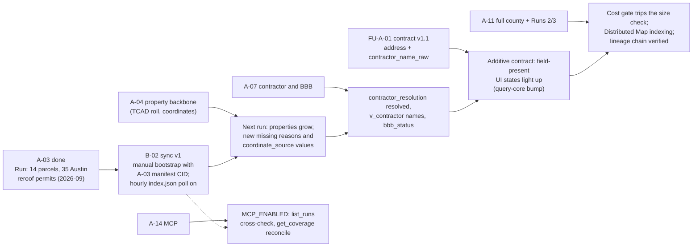

**In time, the CRM's sync depends only on A-03, which is done.** Every later Task A story makes the data richer or larger. None of them blocks a CRM story. Each one is picked up by the next poll, through the gates.

| Task A piece missing | What the sync and the UI do |
| --- | --- |
| No newer run | Stay on the promoted run. The data chip reads "Data: CountyLens Run {n} · as of {finishedAt}". The coverage note quotes the manifest limitations, for example "one month of issue dates (2026-09)" and "Comptroller baseline not loaded (A-07)". |
| Full county not published (before A-04 and A-11) | Index what is published (14 parcels today). The county map stays honest: the coverage note says what the run covers. The demo area is chosen from the real data (plan RISK-06). |
| Contract v1.1 not published | Documents keep `missing: [{field:"unnormalized_address", reason:"not_in_export"}, {field:"contractor_name_raw", reason:"no_lexicon_carrier"}]`, and the UI ships the NoAddress and NoContractor boards (design E-93). |
| A-07 not done | `contractor_resolution = unresolved` (35 of 35 today) and `bbb_status = not_checked` with its reason; never a guessed rating. |
| MCP not available (before A-14) | Discovery uses `runs/index.json` plus manual. Reconcile uses the manifest `coverage` only, and the sync report says "MCP cross-check: not available (A-14 not published)". |
| `runs/index.json` unreachable or invalid | The poll is skipped and the failure counter increases; an alarm fires after 6 consecutive failures. Manual `sync promote <cid>` still works. |
| Both gateways failing or rate-limiting | The run retries with backoff, then is quarantined as `fetch_failed`. The current run keeps serving. `sync replay` resumes from the CIDs already copied. |
| Bootstrap today | `sync promote bafkreiasycmsr2qdlxqcfg3yc2conpn3jxmohz7gs55hkseipplhpqsk5i`. Its `previousManifestCid` is null, so the first-run approval applies. |

---

### 14. Open risks and questions

| # | Risk or question | Impact | Mitigation or ask |
| --- | --- | --- | --- |
| Q-1 | **Does an incremental run (A-11 Run 2 and 3) publish a full snapshot, or only the changed rows?** | High. A full rebuild from a delta-only run drops data. | Ask Task A to say so in the A-11 spec. The 5% row-drop guard blocks the bad case meanwhile. If delta-only, the CRM needs chain-merge plus published tombstones. |
| Q-2 | `runs/index.json` is a changeable, non-CID file: is it an allowed input under B1? | Medium | It is Task A's published run history (A-11 AC-8). The CRM treats it as a hint verified by CID. Confirm the public URL to poll: the CountyLens hosted `/runs/index.json`, with a raw GitHub copy as a second source if the repo is public. |
| Q-3 | No contract version in the manifest | Medium | The CRM detects it by schema fingerprint. Ask Task A to add `contract` when FU-A-01 ships (§6). |
| Q-4 | The lead model in the task guide de-duplicates by `property_cid`, which changes across runs | High for SC-4 ("cannot be added twice") and the lead "Now" column | De-duplicate by `tcad:{parcel_identifier}` (P0-7). B-07's spec must adopt this. `parcel_identifier` is nullable; fallback `cid:` with a flag. |
| R-1 | Filebase throughput and 429s at full-county size are not measured (ADR-0001, ERR-15) | Medium | Throttle to 30 requests/min; Pinata fallback (slow, 3.7–6.7 s per request); content-addressed copy means each part is downloaded once ever. |
| R-2 | OpenSearch idle cost (about $1.03 a day) on a shared $137.85 credit, plus access stopping when credit runs out | High | Tag budget alert at $40; tear down after evaluation; rebuild from S3 with `sync replay`; DuckDB fallback adapter. |
| R-3 | `t3.small.search` (2 GB RAM) under bulk load plus live queries at 500,000 documents | Medium | Concurrency 2, refresh disabled while loading, build happens off the live alias. Measure in the AWS sample backfill; next step up is `t3.medium.search` at about twice the cost. **Verify** that t3 supports encryption at rest in this region at deploy time. |
| R-4 | DuckDB view build at full county may exceed Lambda's 15-minute or 10 GB limits | Low–Medium | Task A measured compute ≤ 175 ms at p95 for 2.38 M rows; the risk is mostly I/O. Contingency: the same handler on Fargate. |
| R-5 | Task A's `query-core` changes between copies (A-04, A-07, v1.1) | Medium | Pin by commit; rerun Task A's tests here; `contract_incompatible` quarantine catches silent drift. |
| R-6 | A Task A run forks or is republished out of order | Low | Lineage and `finishedAt` checks send it for approval. |
| R-7 | Docker or SAM local is not available on the laptop for local replay | Low | Docker OpenSearch is required for the geo-parity replay. SAM local invoke of the synthesized CDK template is optional tooling, not IaC, so it does not break the CDK-only rule. |
| R-8 | Deadline 2026-10-22 (today) | High | Ship sync v1 on the A-03 run with manual bootstrap plus hourly polling. Every later Task A story is absorbed with no CRM story change, except a query-core bump for v1.1. |

---

### 15. Review plan (when B-02 is built)

- **`machamp`** reviews the batch: cost gate, throttling, idempotency, DLQ alarm, replay.
- **`alakazam`** reviews the index mapping, the geo-parity replay and the no-embeddings decision.
- **`porygon`** checks the count reconciliation against the manifest `coverage`.
- **`donphan`** confirms the counts through Task A's MCP once A-14 is live; until then it records "not available".
- **Evidence for G7:**
  - the sync report JSON for the promoted A-03 run;
  - the `sync.status` output on the hosted API showing `manifestCid bafkreiasycmsr2qdlxqcfg3yc2conpn3jxmohz7gs55hkseipplhpqsk5i`;
  - document counts of 14 properties and 35 permits equal to the manifest;
  - the golden geo-parity table;
  - one forced quarantine (a tampered CID in a test bucket) showing that the current run kept serving.

**Files read** (all absolute):
- `/Users/hebagaber/Github/roofing-crm/README.md`
- `/Users/hebagaber/Github/roofing-crm/docs/01-intent.md`
- `/Users/hebagaber/Github/roofing-crm/docs/plan.md`
- `/Users/hebagaber/Github/roofing-crm/design/docs/CRM-HANDOFF.md`
- `/Users/hebagaber/Github/roofing-crm/.specify/memory/constitution.md`
- `/Users/hebagaber/Github/assessment-guide/reference/B-roofing-crm.md`
- `/Users/hebagaber/Github/assessment-guide/reference/checks.md`
- `/Users/hebagaber/Github/oracle-property-intelligence-platform-pipeline-travis-tx/contract/v1/README.md`
- `/Users/hebagaber/Github/oracle-property-intelligence-platform-pipeline-travis-tx/contract/v1/columns.json`
- `/Users/hebagaber/Github/oracle-property-intelligence-platform-pipeline-travis-tx/runs/index.json`
- `/Users/hebagaber/Github/oracle-property-intelligence-platform-pipeline-travis-tx/runs/travis-202609-permits-20261021t103516z/manifest.json`
- `/Users/hebagaber/Github/oracle-property-intelligence-platform-pipeline-travis-tx/docs/decisions/0001-read-path.md`
- `/Users/hebagaber/Github/oracle-property-intelligence-platform-pipeline-travis-tx/docs/decisions/FU-A-01-contract-address-contractor.md`
- `/Users/hebagaber/Github/oracle-property-intelligence-platform-pipeline-travis-tx/docs/evidence/A-03.md`
- `/Users/hebagaber/Github/oracle-property-intelligence-platform-pipeline-travis-tx/stories/A-04-property-backbone.md`
- `/Users/hebagaber/Github/oracle-property-intelligence-platform-pipeline-travis-tx/stories/A-11-publish-and-runs.md`
- `/Users/hebagaber/Github/oracle-property-intelligence-platform-pipeline-travis-tx/stories/A-14-agent-and-mcp.md`
- `/Users/hebagaber/Github/oracle-property-intelligence-platform-pipeline-travis-tx/packages/contract/src/manifest.ts`
- `/Users/hebagaber/Github/oracle-property-intelligence-platform-pipeline-travis-tx/packages/query-core/src/bind-manifest.ts`
- `/Users/hebagaber/Github/oracle-property-intelligence-platform-pipeline-travis-tx/apps/web/src/data/runs-index.ts`


## soofi-xyz-team-kit:mew

### Mew: the lead data model as a domain extension (B-07, with B-02 and B-09 touchpoints)

**Scope.** This section covers the CRM's own records: the lead, its notes, status history, assignment, signals snapshot and source-run reference. It treats them as a reusable CRM-domain extension that points at lexicon core records owned by Task A. It does not redesign `property`, `property_improvement` or `company`. Everything here is a proposal for G3 and B-07. Inferred choices are marked **[assumption]**.

**Sources read.** README, `docs/01-intent.md`, `docs/plan.md`, `design/docs/CRM-HANDOFF.md` (§4.1–4.7, §5, open items 9–13), task guide `B-roofing-crm.md` §3–4, Task A `contract/v1/README.md`, ADR-0002 (lexicon carriers), FU-A-01, A-03 evidence, and the Task A architecture constitution (AD-03 manifest chain). Bundled lexicon precedent was queried in small, bounded slices. `jq` is not installed, so the same select/project/limit filters ran through `node`. No whole reference file was read.

---

### 1. Plain-language summary

- **A lead is the CRM's own record of "we are pursuing this property."** Everything a lead says about the property (roof age, permit, contractor, BBB) is copied evidence with a source stamp. The CRM never owns, edits or reinterprets it.
- **The lead points at the property by a key that survives new data runs: the TCAD account id** (`property.request_identifier`, county FIPS 48453). It does **not** use the property's CID. A CID is a fingerprint of the record's content, so it changes whenever Task A republishes a changed record (A-11 incremental runs). Keying leads on `property_cid`, as the task guide's §4 sketch does, would let the same house become a second lead after the next run. This is the single most important decision in this section.
- **Changes are recorded, never overwritten.** Creation, status changes, reassignments, notes and deletion are each an immutable event. The status and assignee shown on screen are a summary rebuilt from those events.
- **The CRM adds very few things of its own:** `lead`, `lead_note`, `lead_event` (history), `lead_signals_snapshot`, and a reference to the source run. Every other noun in this domain already exists in the lexicon or belongs to Task A.

---

### 2. What the lexicon already has, and what we reuse

Paradigm: Task A publishes in the **class / relationship-catalog** paradigm (lexicon classes, `{from}_has_{to}` relationships, data groups). The extension follows the same paradigm and naming style. DynamoDB is only the storage mapping (§7).

| Concept | Bundled precedent | Decision |
| --- | --- | --- |
| `lead` | A class exists, with `lead_identifier` (string), `lead_source` (enum: EmployeeContact, Facebook, Instagram, MailOut, NetworkingEvent, OpenHouse, PhoneCall, Referral, SMS, YardSign, Zillow), `lead_type` (enum: Buy, Sell) and a relationship `has_property → property` (plus many mortgage and real-estate relationships) | **Reuse the class name `lead`, `lead_identifier`, and the lead → property relationship (`lead_has_property`).** Leave `lead_source` and `lead_type` unset: their enums describe a marketing channel and a real-estate transaction side, not "created from map/list/agent". Adding members such as `Map` or `Agent` would be inventing enum values. The CRM uses its own `lead_origin` instead. Do not use the precedent's `has_company`: on a lead it means the prospect's organisation, not the roofing contractor. |
| Lead status | Not on `lead`. `interaction.lead_interaction_type` (Archived, Read, Snoozed, Starred, Unread) is an inbox state, and `task.task_status` is work tracking. Both mean something else. | New CRM field `lead_status` (§4). |
| Note | `chat_note` has `note_content` (string) and `note_datetime` (dateTime). The property-graph precedent records a note-added fact with `note_identifier`, `note_body`, `created_at`, `effective_at`. | New `lead_note`, **reusing the class-catalog names `note_content` and `note_datetime`** (not mixing paradigms), plus `note_identifier`. |
| Status history and assignment events | No status-history or assignment class. The property-graph precedent models events as first-class records with required `effective_at`, `event_type` and an id. | New `lead_event` following that event pattern. |
| `property` | Class exists. Task A's live-schema check (ADR-0002) confirms `request_identifier`, `parcel_identifier`, `property_type`, `property_usage_type`, `property_structure_built_year`. | **Referenced, never copied as owned data.** |
| `property_improvement` | Class exists: `permit_number`, `permit_issue_date`, `improvement_status`, `improvement_type`, `improvement_action`, `completion_date`, … ; `property_has_property_improvement`; `property_improvement_has_contractor → company` (Property Improvement data group) | **Referenced** as the lead's main permit. |
| `company` | `name`, `sunbiz_document_number` (+ `request_identifier`, `source_http_request` in the live schema) | **Referenced only through the permit** (`property_improvement_has_contractor`), never from the lead directly. |
| `person`, `address`, `geometry`, `parcel`, `sales_history`, `structure` | Core classes | **Never copied into the lead** (owner, address and location belong to Task A; see §6). |

---

### 3. The keys a lead uses to point at core records (CID or stable id)

| Target | Identity key (survives runs) | Evidence pointer (pinned to one run) | Why |
| --- | --- | --- | --- |
| **Property** | `property_key = "48453:tcad:" + property.request_identifier` (TCAD pID exactly as printed, P0-5 in Task A; never empty in `v_property`) | `property_cid`, `property_table_cid`, `manifest_cid` in the snapshot | The CID changes when the record changes (A-11). The pID is the county's own account number and stays the same. The county prefix keeps the key valid if a second county is ever added. |
| **Main permit** (optional) | `permit_key = jurisdiction + ":" + permit_number` (for example `austin:2020-047812 BP`) | `permit_cid`, `table_cid` | `permit_number` is the authority's printed id. **[assumption]** If `permit_number` is null (`source_missing`), `permit_key` is null and the lead keeps only the pinned `permit_cid`, labelled "permit pinned to Run n". |
| **Contractor** | None in v1 (all 35 A-03 permits are `contractor_unresolved`). After A-07: `company.request_identifier` (the registry id) if Task A publishes it | `contractor_company_cid` | The lead stores contractor details only inside the snapshot. It never stores a contractor link of its own. |
| **Source run** | `run_id` (human-readable) | `manifest_cid` (CIDv1, immutable) | The manifest CID *is* the provenance. Runs chain through `previousManifestCid` (Task A AD-03). |

Rule: **identity = stable key; provenance = CID.** The dedupe guard, the "Already a lead" check, the agent's "already a lead" markers and the Leads → map link all use `property_key`. Snapshots and citations use CIDs.

How a lead follows its property across runs:

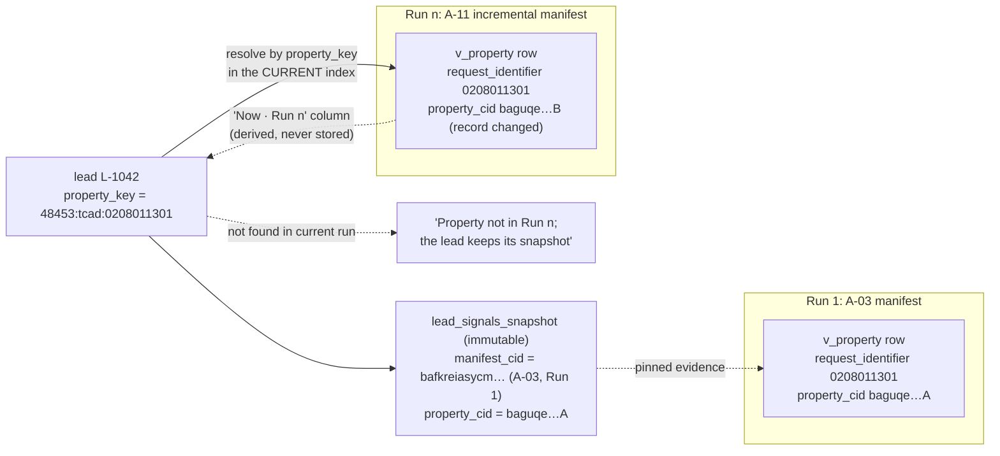

The sync job (B-02) must index `request_identifier` and fail the sync if two `v_property` rows in one run share it. When this check fails, the old index stays live.

---

### 4. CRM-owned extension: entities, fields, enums and relationships

Layer: **reusable CRM-domain extension.** `lead`, notes, status and assignment work the same for a roofer, a solar installer or an insurance adjuster. **Organisation-specific:** the five status values, the origin values and `L-n` ids.

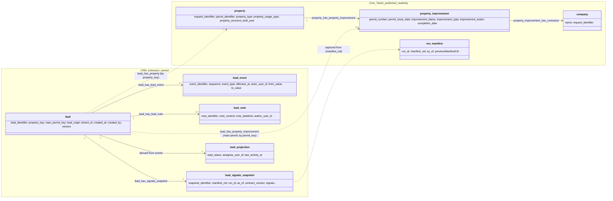

Dotted arrows are cross-boundary references by key. Nothing is written into Task A's data.

#### 4.1 `lead` (durable entity)

| Field | Type | Req. | Notes |
| --- | --- | --- | --- |
| `lead_identifier` | string, pattern `^L-\d+$` | yes | Reused lexicon name. Display id from an atomic counter; gaps are allowed. |
| `tenant_id` | string | yes | Single company today (`OS-04`). Kept so the dedupe scope is explicit. |
| `property_key` | string, `^\d{5}:tcad:.+$` | yes | Identity input. **One open lead per (`tenant_id`, `property_key`).** |
| `main_permit_key` | string or null | no | Set when created from a permit. Null means the main signal is the roof. |
| `main_permit_cid` | string (CIDv1) or null | no | Pinned evidence, for when `permit_key` is null. |
| `lead_origin` | enum `map`, `list`, `agent`, `property_page`, `triage` | yes | CRM-owned. Not the lexicon `lead_source`. Design §4.3/4.4 shows triage as origin Map, so **[assumption]** keep `triage` only if the PO wants it shown separately; otherwise map triage to `map`. |
| `created_at` | date-time (UTC) | yes | Persistence time, set by the server. |
| `created_by` | string (Cognito `sub`) | yes | |
| `version` | integer ≥ 1 | yes | Equals the last event `sequence`. Used for optimistic concurrency (design open item 11). |
| `lead_source`, `lead_type` | — | absent | Lexicon fields with no valid value here. Leave them unset; never fill them with a guess. |

#### 4.2 `lead_event` (immutable event: the status history and assignment)

| Field | Type | Req. | Notes |
| --- | --- | --- | --- |
| `event_identifier` | string (`{lead_identifier}#{sequence}`) | yes | Deterministic, so retries cannot duplicate an event. |
| `sequence` | integer, 1…n, no gaps | yes | **Ordering and tie-break rule.** Never sort by timestamp. |
| `event_type` | enum `created`, `status_changed`, `assignee_changed`, `note_added`, `deleted` | yes | Each is contractually required by the design (§4.6 History, E-86 deleted state). |
| `effective_at` | date-time (UTC, ms) | yes | When the action happened (equals the server time of the write). |
| `actor_user_id` | string (Cognito `sub`) | yes | |
| `from_value`, `to_value` | string or null | for status and assignee changes | For example `new` → `contacted`, or `sub-a` → `sub-b`. |
| `note_identifier` | string | for `note_added` | References the note. The note text lives only in `lead_note`. |
| `delete_reason` | enum `undo`, `user` | for `deleted` | `undo` = the snackbar Undo right after create. |
| `correlation_id` | string | yes | The create call's `idempotency_key`, or the request id. |

Assignment is a lifecycle-bearing association between a lead and a user, so it is recorded as `assignee_changed` events, not as a plain field that gets overwritten. The `created` event carries the initial `to_value` for both status (`new`) and assignee (the creator).

#### 4.3 `lead_note` (immutable)

| Field | Type | Req. | Notes |
| --- | --- | --- | --- |
| `note_identifier` | string | yes | |
| `note_content` | string, 1–4,000 chars | yes | Reused precedent name. Free text, so it may contain personal data: never logged, never embedded, never sent to the agent. |
| `note_datetime` | date-time (UTC) | yes | Reused precedent name. |
| `author_user_id` | string | yes | |

Notes cannot be edited or deleted in this release. Editing a note would need a superseding note, which is out of scope.

#### 4.4 `lead_signals_snapshot` (immutable value object, captured once at creation)

This copies **published view values with their provenance**. It is evidence of what the rep saw, not CRM data. Field names are the **exact `contract/v1` column names**, so the snapshot, the index and the "Now" column compare field by field.

| Group | Fields (exact contract/v1 names) |
| --- | --- |
| Run provenance | `manifest_cid`, `run_id`, `as_of`, `contract_version` (`v1` now, later `v1.1`), `snapshot_taken_at` (CRM time), `snapshot_schema_version` |
| Property evidence | `property_cid`, `request_identifier`, `parcel_identifier`, `property_type`, `property_usage_type`, `latitude`, `longitude`, `coordinate_source`, `roof_date`, `roof_age_years`, `roof_age_basis`, `roof_age_confidence`, `property_source_url`, `property_captured_at`, `property_table_cid`, `property_missing[]` |
| Main permit evidence (if any) | `permit_cid`, `jurisdiction`, `permit_number`, `improvement_type`, `improvement_action`, `improvement_status`, `status_class`, `issue_date`, `open_days`, `contractor_resolution`, `contractor_company_cid`, `bbb_status`, `bbb_status_reason`, `profile_version`, `source_url`, `captured_at`, `table_cid`, `missing[]` |
| v1.1 additions (optional, present only when synced) | `unnormalized_address`, `city_name`, `postal_code`, `contractor_name_raw` |

Rules:
- `missing[]` is copied verbatim, so every empty field still says why (for example `no_lexicon_carrier`, `contractor_unresolved`).
- `open_days` and `roof_age_years` are the view's values computed at that run's `as_of`. The CRM never recomputes them with `now()`.
- Owner fields (`owner_name`, `owner_kind`, tenure, mailing) are **not** copied (design §4.6: read from the property when opened).
- `latitude` and `longitude` are copied only so the Leads list can filter by radius when the property is missing from the current run (design open item 10). The current run's point takes precedence when the property is found.

#### 4.5 Derived projection (recomputable, stored for listing speed)

`lead_status` (`new`, `contacted`, `qualified`, `won`, `lost`), `assignee_user_id`, `last_activity_at`, `last_activity_kind`, `is_deleted`. These are rebuilt by replaying `lead_event` in `sequence` order, and they are written in the same transaction as the event.

The "Now · Run m" column and the Changed pill are a **read-time projection**. The CRM resolves `property_key` and `main_permit_key` in the current index, then compares the result with the snapshot. That projection is never stored on the lead.

#### 4.6 Source run and index build (CRM-owned, B-02)

`index_build`: `manifest_cid`, `run_id`, `as_of`, `contract_version`, `previous_manifest_cid`, `property_count`, `permit_count`, `started_at`, `finished_at`, `outcome` (`succeeded`, `failed`, `skipped_unsupported_contract`). The lead does not depend on this record. It is listed here because the snapshot's `manifest_cid` must be one the CRM actually indexed (invariant I-6).

#### 4.7 Lead lifecycle

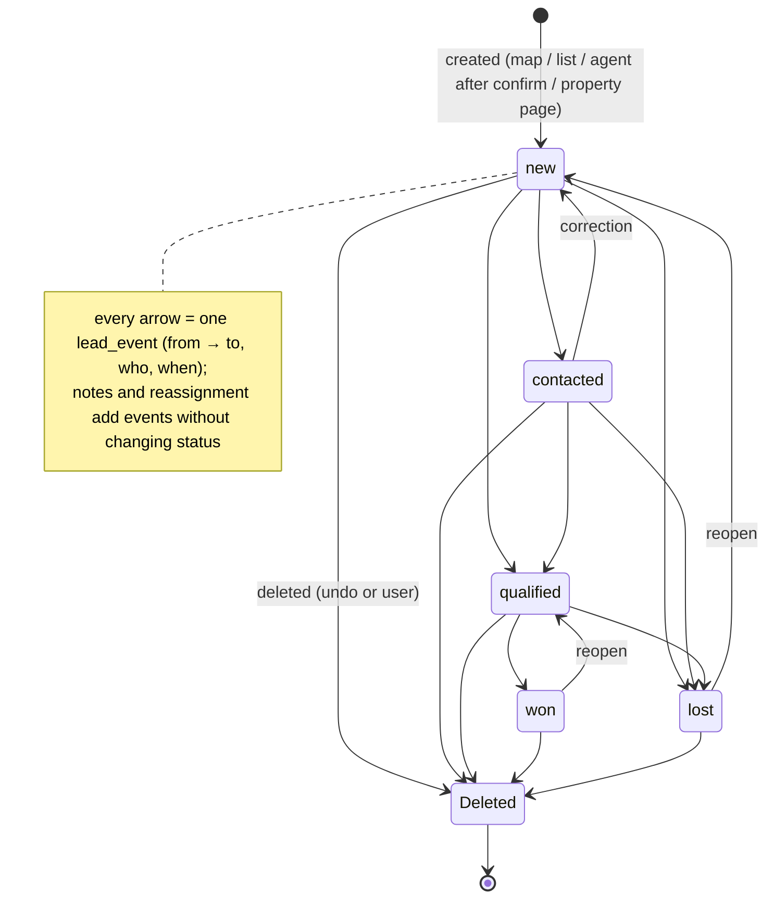

The design's status menu allows any status to any other status, so **[assumption]** the API allows every change except to the same value. The diagram shows the usual path. "Won" and "lost" are final in meaning but can be reopened, and the reopen is recorded. Deleting a lead releases the dedupe guard, so the property can become a lead again. The deleted lead and its history are kept.

---

### 5. Components and AWS services for the lead slice (and why)

All resources are in the region read from config (demo `eu-north-1`), defined in CDK (TypeScript) only.

| Component | Choice | Why |
| --- | --- | --- |
| Lead store | **DynamoDB, one table, on-demand**, point-in-time recovery on, deletion protection on during evaluation | About $0 idle (NFR-02). Supports conditional writes and transactions, which dedupe and history need. |
| Write path | tRPC procedures on **Lambda (Node 22, arm64)** behind **API Gateway HTTP API** with a **Cognito JWT authorizer** | Golden Path. The agent's `createLead` tool calls the same procedure. |
| Identity of reps | **Cognito user pool**: `sub` is the user id, display name read from Cognito | Reps are app users, not lexicon `person` records. Rep PII stays out of the data model. |
| Current-run resolution | The B-02 search index (keyed by `request_identifier` and `permit_number`) | Leads never call IPFS or the MCP on the request path. |
| Observability | Powertools Logger, Tracer and Metrics. Metrics: `LeadCreated`, `LeadDuplicateRefused`, `LeadSaveConflict`, `LeadSaveFailed`, `LeadStaleProperty` | Constitution VII–VIII. Each metric must also be registered and put on the dashboard (Golden Path non-negotiable #6). |

**Storage mapping** (single table; `t` = tenant):

| Item | PK | SK | Written by |
| --- | --- | --- | --- |
| Lead + projection | `LEAD#{lead_identifier}` | `META` | create, every change (`version` condition) |
| Event | `LEAD#{id}` | `EVT#{sequence:08d}` | same transaction as META |
| Note | `LEAD#{id}` | `NOTE#{note_identifier}` | same transaction as its `note_added` event |
| Snapshot | `LEAD#{id}` | `SNAP#1` | create transaction |
| **Dedupe guard** | `PROPKEY#{t}#{property_key}` | `LEAD` | create (`attribute_not_exists`); removed on `deleted` |
| Id counter | `COUNTER#{t}#lead` | `SEQ` | `UpdateItem ADD` before create |
| GSI1 (my leads) | `{t}#ASSIGNEE#{sub}` | `{last_activity_at}#{id}` | on META |
| GSI2 (all reps) | `{t}#ALL` | `{last_activity_at}#{id}` | on META |

The task guide says to dedupe "by `property_cid`". **This proposal deliberately replaces that with `property_key`** (§3), and the change should be recorded as a G3 decision.

Create sequence: one `TransactWriteItems` writes the guard, META, `EVT#00000001`, `SNAP#1` and, if given, the first note. A guard conflict returns "Already a lead · {status} · {assignee}" with the existing id. If the same `idempotency_key` is retried (a double tap), the API returns the existing lead as success, not as a refusal. Every update is a transaction: `ConditionExpression version = :expected`, increment `version`, and put `EVT#{version}`. A version mismatch returns "This lead was updated by {name}. Reload to see the latest."

Status, assignee, roof-age, permit and radius filters on the Leads list run in Lambda over the GSI page. That is fine for a single tenant with up to about 10,000 leads; past that, revisit with an index. Paging uses DynamoDB `LastEvaluatedKey` as an opaque cursor in the URL.

---

### 6. Never add these to the extension (they belong to the core or to Task A)

- No `address`, situs text, city, ZIP, owner name, owner kind, mailing address, tenure, `person` or `company` record. These are read from the current run when needed. Only the snapshot keeps view values, as evidence.
- No CRM-editable roof age, roof date, permit status, `status_class`, `open_days`, contractor identity or BBB rating. The CRM must not re-derive Task A's rules (D-4a "empty status means stalled", the roof-date estimator, AD-24 contractor resolution). It displays the view's values.
- No `business_rating` or BBB class, and no contractor entity. Those are Task A's drafted lexicon requests (R3–R5), not CRM concepts.
- No new members in the lexicon `lead_source`, `lead_type`, `improvement_status` or `contractor_type` enums.
- No `property_cid` or `permit_cid` used as identity or as the dedupe key.
- No lead → company link for the contractor (it goes through the permit only).
- No copy of `contract/v1` views or Parquet in DynamoDB beyond the one snapshot per lead.

---

### 7. How the extension evolves as Task A adds fields

| Task A change | Effect on the lead model | CRM code change |
| --- | --- | --- |
| **v1 → v1.1** (FU-A-01: `unnormalized_address`, `city_name`, `postal_code`, `contractor_name_raw`) | The snapshot schema already lists them as optional. New leads capture them. Existing snapshots are **not backfilled** (they are immutable); their "Now" column shows the new values. The lead title becomes the address when present; until then it is "TCAD {pID} · near {place}" with "Address not published in Run {n}". | None, if the Zod contract parser accepts additive columns (passthrough) and branches only on presence. |
| **A-04 property backbone** | More properties, so property-only leads (roof signal, `roof_age_basis = built_year`, confidence low) become common. | None. |
| **A-07 contractor identity** | `contractor_resolution = resolved` and `contractor_company_cid` appear. If Task A publishes the company `request_identifier` (registry id), add `main_contractor_key` to the snapshot as a stable key. BBB stays `bbb_status` until a rating carrier (R5) exists. | Additive snapshot field only. |
| **A-11 full county + incremental runs** | Record CIDs change for changed records. `property_key` keeps leads attached. Removed source records (`sources[].removed`) show as "Property not in Run n; the lead keeps its snapshot". The index switches to the new `manifest_cid` atomically; leads are untouched. | None (this is what §3 is for). |
| **A-14 MCP** | The agent may use the MCP to ground answers. Creating a lead still goes only through the CRM `createLead` procedure, after the user confirms. | None to the model. |
| **contract/v2** (rename, retype or change of meaning) | The sync job refuses an unknown major version (`index_build.outcome = skipped_unsupported_contract`) and keeps the last good index. Snapshots keep their `contract_version`, so old leads stay readable. | Planned migration. |

---

### 8. How the lead model depends on Task A over time

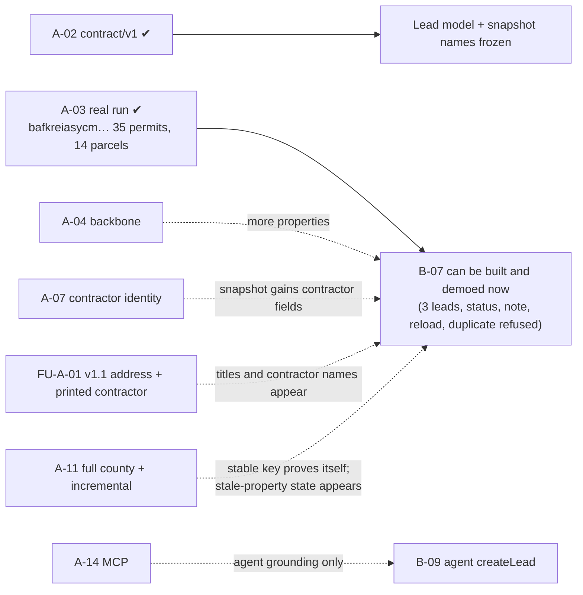

B-07 has **no blocking Task A dependency beyond A-03**. It can ship on the 14 published A-03 parcels. Leads created during the demo on A-03 data will survive A-11 because they are keyed by TCAD pID. Test this once with two manifests: the A-03 manifest, and any later manifest that republishes the same pIDs.

---

### 9. Patterns that must be visible in the code

1. A `propertyKey(countyFips, requestIdentifier)` helper and the dedupe guard item, with no `property_cid` in any dedupe or lookup path.
2. One transaction per mutation (`event` + `META` with a `version` condition). History and projection are never written separately.
3. A projection rebuilt by `replay(events)` (a pure function, unit tested). A test checks that the stored META equals the replayed events.
4. An immutable snapshot type generated from `contract/v1` `columns.json` names, carrying `manifest_cid` and `missing[]`.
5. A `Missing<T>` / reason type in the UI layer: no empty cell without a reason.
6. A Zod contract parser that tolerates additive columns and rejects an unknown major version.
7. `createLead` input has `idempotency_key`. The agent tool needs `confirmed: true`, which is set only from the UI confirmation card.
8. Logs never include `note_content`, rep email or owner fields (Powertools logger redaction).

---

### 10. Non-functional requirements (numeric)

| NFR | Threshold |
| --- | --- |
| Duplicate refusal | 100% of second creates for the same `property_key` are refused, including 10 parallel creates (test: exactly 1 succeeds) |
| No lost writes | 100% of concurrent updates with a stale `version` are rejected with a conflict (none silently overwritten) |
| History completeness | For every lead, the number of events equals `version`, sequences 1…n with no gaps; every status, assignee and note change has exactly 1 event |
| Create latency | p95 < 800 ms server-side (hosted, warm); p95 < 1.5 s end to end including cold start |
| Status, assignee and note save | p95 < 500 ms server-side |
| Leads list | p95 < 1.5 s for one page with combined filters at 1,000 leads |
| Read-your-writes | After a save, reload shows it 100% of the time (strongly consistent `GetItem` and `Query` on the base table; GSIs used only for lists) |
| Provenance | 100% of leads have a non-null `manifest_cid` that matches an `index_build` with `outcome = succeeded` |
| Survival across runs | 100% of leads still resolve or show the stale state after an index switch to a new manifest; 0 leads change `property_key` |
| Note size | 1–4,000 characters; rejected outside that range |
| Recovery | Point-in-time recovery 35 days; RPO ≤ 5 min |
| Cost | Lead store idle cost about $0 (on-demand); fits inside the $10 budget alert |
| Leads independent of the index | Leads list, lead page and notes open with the index unavailable (design §4.2); only "Now" and "View property" are degraded, with a reason |

---

### 11. P0 rules (a breach blocks merge)

- **P0-L1** Leads are keyed and de-duplicated by `property_key` (county FIPS + TCAD pID), never by a CID.
- **P0-L2** Every lead mutation writes an immutable `lead_event` in the same transaction. No history row is ever updated or deleted.
- **P0-L3** The snapshot is immutable and carries `manifest_cid`, `run_id`, `as_of` and `missing[]`. Every signal shown on a lead traces to a CID.
- **P0-L4** The CRM never stores or edits core facts (address, owner, roof age, permit status, contractor, BBB) outside the snapshot, and never re-derives Task A's rules.
- **P0-L5** No invented values: `lead_source` and `lead_type` stay unset, and no enum member is made up. Placeholder or seed leads are never shown as real.
- **P0-L6** The agent never creates a lead without an explicit user confirmation. The tool requires `confirmed: true` from the UI.
- **P0-L7** Note text and personal data are never logged, embedded or sent to the model.
- **P0-L8** Data is read only from published CIDs or the Task A MCP. Lead requests never touch Task A's internal stores.
- **P0-L9** CDK only; region from config; no console-created table.

---

### 12. Validation checklist

Should pass:
- Create a lead from the A-03 run for TCAD `0208011301`. Re-sync the index from a second manifest in which that property has a new `property_cid`. The lead page shows "Now · Run n", and a second create is refused.
- Create a lead from a stalled permit. The snapshot has `status_class = stalled`, `missing` contains `{status_raw, no_lexicon_carrier}`, and the UI shows "derived: no status in source".
- Change status new → contacted, add a note, reload. The History shows 3 events in sequence 1–3.

Should fail:
- A second create for the same `property_key`, including from the agent and from bulk create (listed as skipped).
- An update with a stale `version`.
- An agent `createLead` call without confirmation.
- A snapshot without `manifest_cid`.
- `lead_source = "Map"`.

Assertion queries:
- No two non-deleted leads share (`tenant_id`, `property_key`).
- For every lead, max `EVT` sequence equals `META.version`.
- `replay(events)` equals META.
- Every snapshot `manifest_cid` is in the `index_build` history.

---

### 13. Open risks and the one decision to make

| # | Risk | Mitigation |
| --- | --- | --- |
| R-1 | **TCAD pID can be retired, split or merged** (a new roll year), so a lead could point at a pID that no longer exists. | The snapshot keeps `parcel_identifier`; a mismatch or missing pID shows the stale state, never a silent re-link. The PO decides merges by hand. |
| R-2 | `permit_number` is null for some permits (`source_missing`). | Fall back to the pinned `permit_cid`, labelled "permit pinned to Run n". |
| R-3 | The task guide's `property_cid` dedupe is in other documents (task guide §4, plan §3 "de-duplicated by `propertyCid`"). | Record the switch to `property_key` as a G3 decision and update the B-07 story. |
| R-4 | The sample's extra `property_cid` column is the Seed root, not the property CID (contract README). | Read `property_cid` only from `v_property` and `v_roofing_permit`; add a test. |
| R-5 | v1.1 may slip past the deadline. | Ship the NoAddress / NoContractor states. The model already supports both states. |
| R-6 | An incremental run may remove a property the demo lead uses. | The stale state is designed in; choose demo leads from the latest manifest at release time. |
| R-7 | `status_class` null (`needs_review`) on non-Austin permits. | Snapshot as is, with its reason. The lead remains creatable (design: partial data still allowed). |
| R-8 | Display counter (`L-n`) contention or gaps. | Gaps are acceptable. The id is a display id only and never the key for dedupe. |
| R-9 | Cross-region: Bedrock `eu.` profile vs the table region. | The lead store has no model calls; no impact. |

**Open decision for the PO:** who may reassign a lead, any rep or managers only (design open item 11)? This changes the authorisation rule on `assignee_changed`, but not the data model. **[assumption]** Until the PO decides, any signed-in user may reassign, and every reassignment is recorded in the history.

---

**Files read:**
- /Users/hebagaber/Github/roofing-crm/README.md
- /Users/hebagaber/Github/roofing-crm/docs/01-intent.md
- /Users/hebagaber/Github/roofing-crm/docs/plan.md
- /Users/hebagaber/Github/roofing-crm/design/docs/CRM-HANDOFF.md
- /Users/hebagaber/Github/assessment-guide/reference/B-roofing-crm.md
- /Users/hebagaber/Github/oracle-property-intelligence-platform-pipeline-travis-tx/contract/v1/README.md
- /Users/hebagaber/Github/oracle-property-intelligence-platform-pipeline-travis-tx/docs/decisions/0002-lexicon-carriers.md
- /Users/hebagaber/Github/oracle-property-intelligence-platform-pipeline-travis-tx/docs/decisions/FU-A-01-contract-address-contractor.md
- /Users/hebagaber/Github/oracle-property-intelligence-platform-pipeline-travis-tx/docs/evidence/A-03.md

No files were created or changed.


## Where the answers disagree

Compiled by the main session after the four consults, 2026-10-22. Each row names who says what, the facts I checked in the files, and a **recommendation for G3**. The PO decides; nothing here is approved yet.

Two of the four agents were not fully independent. alakazam read metagross's section before answering, so its "Agreement with metagross" part (§14) is not a second opinion. espeon and mew were told not to read this file.

### What all four agree on (no decision needed)

- **The CRM keeps its own copy.** It builds its own index from Task A's published, CID-verified files, one index per `manifest_cid`. It never calls Task A's API, buckets or Query DB at request time, and Task A's MCP is never on the request path.
- **Leads are keyed on a stable TCAD key, not `property_cid`.** A CID changes whenever Task A republishes a changed record. This replaces the task guide's "dedupe by `property_cid`" and must be recorded at G3 and in the B-07 story.
- **Task A's rules are reused, not rewritten.** The sync copies (vendors) Task A's `query-core`, pinned to a Task A commit. The CRM never recomputes `status_class`, `open_days` or roof age.
- **No embeddings or vectors in v1.** contract/v1 publishes no free text to embed.
- **The agent cannot create a lead on its own.** A person confirms every lead the agent suggests.
- **Only A-03 is needed today.** Every later Task A story (A-04, A-07, FU-A-01, A-11, A-14) makes the data richer through a re-sync, not a CRM rebuild. The real-scale demo still needs A-11.
- **Partial data is shown honestly.** Missing fields keep their published `missing[]` reason, and v1.1 fields are optional now.

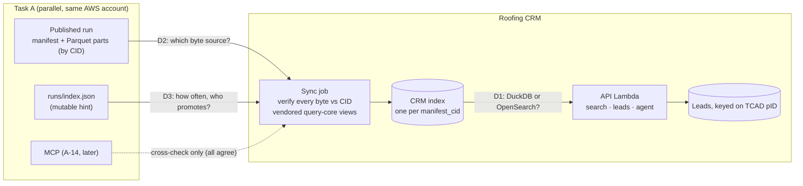

The arrows labelled D1–D3 are where the agents disagree. The detail follows.

### D1. Search store: DuckDB over Parquet, or OpenSearch? (largest disagreement)

| | metagross (D-2) + alakazam (R-1, R-2) | espeon (§1, §8) |
| --- | --- | --- |
| Store | Parquet in the CRM's private S3, queried by `@duckdb/node-api` inside the API Lambda | OpenSearch `t3.small.search`, 1 node, 10 GB, public endpoint behind IAM |
| Idle cost | about $0 | about $31.2/month, all of it idle |
| Why | Task A measured DuckDB in a Lambda in eu-north-1: radius p95 200 ms, roof-age p95 95 ms over 2.38 M rows. No text to search by meaning. | Kit default for production RAG (`build-rag-systems`). One store gives `geo_distance`, filters, aggregations and later kNN. |
| Fallback | OpenSearch behind the `LeadIndex` / `RetrievalIndex` port, if free text arrives **and** a golden query fails | DuckDB on Lambda over the CRM's snapshots, if OpenSearch is blocked on the free plan |

**Facts checked:**
- Credit is **$137.85** (espeon's read-only check, 2026-10-22), and Task A spends from the same account.
- OpenSearch over 2 weeks costs about $14.5; over a month, about 23 % of what remains.
- Domain creation on the free plan is unproven.

**Recommendation:** DuckDB (2 agents to 1). Record the deviation from the kit's OpenSearch default at G3, with alakazam's re-entry trigger (§3.3). espeon's other designs (gates, blue/green, cost gate) still apply: the "alias swap" becomes metagross's pointer flip on `META#index`, and the golden geo-parity check becomes "index result = `query-core` SQL result".

### D2. Where the sync reads the bytes from

| | metagross (D-4) + alakazam (P0 1) | espeon (§1, §8 "Not chosen") |
| --- | --- | --- |
| Order | Task A's **CloudFront CID copy** first, then Filebase, then Pinata | Filebase, then Pinata only. "Never reads Task A's signed CloudFront copy." Also an explicit IAM Deny on Task A resource ARNs. |

**Fact checked:** Task A's production CID copy (`infra/src/data-stack.ts`) is **public**: CloudFront with OAC to a private bucket, CORS `allowedOrigins: ["*"]`, and no signed URLs or trusted key group. The signed `/cid/*` URLs espeon describes belonged to the temporary `CountyLensSpike` stack in ADR-0001, which was removed. espeon's premise is out of date.

**What is still a real question** is policy, not technology. Is Task A's public CloudFront copy "a published CID" under the access boundary (constitution B1, CLAUDE.md)?
- **For:** it is a byte-for-byte public copy, and every byte is checked against its CID, so the source cannot change what the CRM sees.
- **Against:** it is Task A's infrastructure, not IPFS, and if Task A tears it down, the CRM falls back to gateways.

```mermaid
flowchart LR
  S["Sync FetchPart"] --> CF{"Task A CloudFront<br/>CID copy (public)"}
  CF -- "200 + sha256 = CID" --> OK["store raw/{cid}"]
  CF -- "error / mismatch" --> FB{"ipfs.filebase.io"}
  FB -- "429 → backoff" --> FB
  FB -- "fail" --> PN{"gateway.pinata.cloud<br/>(~5 s TTFB)"}
  FB -- "ok" --> OK
  PN -- "ok" --> OK
  PN -- "fail" --> Q["quarantine run<br/>current run keeps serving"]
```

**Recommendation:** use the public CloudFront copy first (fastest, and it avoids Filebase's 429s after about 50–65 requests), verified by CID, with the gateway fallback. Also keep espeon's IAM Deny on Task A's resource ARNs: it does not block a public HTTPS read and it enforces "never Task A's internal stores". Ask the PO to confirm the boundary reading at G3.

### D3. How a new Task A run is discovered and promoted

| | metagross (§4) | espeon (§1–§4, §11) | alakazam (§11) |
| --- | --- | --- | --- |
| Schedule | Daily, plus manual | **Hourly**, plus manual | Daily, or within 15 min of a manual start |
| Authority | A **pinned CID in SSM** is the authority. `runs/index.json` and MCP `list_runs` only propose. | `runs/index.json` is a hint verified by CID, and lineage checks decide | — |
| Auto-promote | `AUTO_PROMOTE` true by default, false during the demo freeze | Automatic after all gates. **Pauses for a person** on the first run, a lineage fork, an older `finishedAt`, or over the cost gate. | — |
| Cost gate | None (budgets only) | First state: more than $1/run, 600,000 docs or 2 GB → `waitForTaskToken` approval | — |
| Freshness NFR | ≤ 24 h | ≤ 75 min (A-03 size), ≤ 2 h (full county) | ≤ 24 h |

**Recommendation:** metagross's pinned-CID authority plus `AUTO_PROMOTE` (it gives a demo freeze), with espeon's lineage checks and cost gate added. The cost gate is a `build-batch-workflows` rule, and a reviewer will look for it. Use a daily schedule (≤ 24 h freshness), since Task A publishes rarely; hourly polling buys little.

### D4. Owner data

| | metagross | alakazam | espeon | mew |
| --- | --- | --- | --- | --- |
| Owner name in index | No, and "not displayed" | No; `ownerKind`, `tenureYears`, `isLongTenure`, `ownerAreaClass` yes (G4) | **Yes: `owner_name`** in `PropertyDoc` | Not in the lead snapshot; "read from the property when opened" (design §4.6) |

The design hands off an owner block on the property page, so metagross's "not displayed" conflicts with design §4.6 as mew reads it.

**Recommendation (PO decision):** keep owner names out of the index, prompts and logs (3 to 1). Index only the G4 fields (kind, tenure, area class). Decide at G3 whether the property page shows the owner name at all. If it does, it needs a read path other than the index, and the B1 boundary then also covers that path.

### D5. The lead model (metagross §6.4 against mew §4–5; espeon P0-7)

| Topic | metagross | mew | espeon |
| --- | --- | --- | --- |
| Stable key | `UNIQ#PROP#{tcadId}` (`request_identifier`), no tenant | `PROPKEY#{tenant}#48453:tcad:{request_identifier}` | `tcad:{parcel_identifier}`, falling back to `cid:` |
| Lead id | ULID | `L-n` display id from a counter (gaps allowed) | — |
| History | `HIST#{ts}#{ulid}`, ordered by time | `EVT#{sequence}`, **gapless sequence, never by time**; status and assignee are a projection replayed from events | — |
| Signals snapshot | Inline `signals` attribute, camelCase | Separate immutable `SNAP#1` with **exact contract/v1 column names** | — |
| Delete / undo | Not covered | A `deleted` event (`undo` or `user`) releases the dedupe guard | — |
| Origin values | map, list, triage, agent | map, list, agent, property_page, (triage?) | — |
| Concurrency test | 20 parallel creates → 1 winner | 10 parallel creates → 1 winner | — |

**Fact checked:** in contract/v1, `request_identifier` is the TCAD pID and is **never empty**. `parcel_identifier` is nullable (`source_missing`). espeon's choice would fall back to a CID for some properties, which is exactly what everyone agrees to avoid.

```mermaid
flowchart LR
  L["lead<br/>key 48453:tcad:{request_identifier}"] -->|"resolve in CURRENT index"| P2["Run n: property_cid …B"]
  L --> S["snapshot (immutable)<br/>manifest_cid Run 1, property_cid …A"]
  S -. "evidence" .-> P1["Run 1: property_cid …A"]
  P2 -. "'Now' column, Changed pill" .-> L
```

**Recommendation:**
- Key on mew's `48453:tcad:{request_identifier}`, with the tenant in the guard. Reject espeon's `parcel_identifier`.
- Use mew's gapless event sequence and a separate snapshot with contract column names: sorting by time can mis-order events written in the same millisecond, and the snapshot can then be compared field by field with the index.
- Use mew's delete/undo event.
- Keep a ULID as the storage key, and add `L-n` only if the design needs a short display id.
- Test 20 parallel creates (the stricter number).

### D6. The agent

| Topic | metagross (§6.5, §8) | alakazam (§4–6, §11) | mew (§9) |
| --- | --- | --- | --- |
| Query contract | `OpportunityQuery`, radius ≤ 50 mi, limit ≤ 100 | `QueryPlan`, radius 0.5–25 mi, ≤ 25 rows to the model, ≤ 1,000 to the UI | — |
| Model calls per ask | ≤ 2 | ≤ 3 (plan, one repair, compose) | — |
| Rate limit | 5 asks/min/user | 8 model calls/min (token bucket) | — |
| Conversation memory | DynamoDB `SESSION#…/LAST_QUERY`, TTL 24 h | `ConversationEventStore`: **AgentCore Memory** (kit default), DynamoDB fallback, TTL 7 days | — |
| Lead creation | `proposeLeads` → user clicks → `leads.createMany` | `proposeLeads` writes nothing → user clicks Create → `leads.create` | An agent tool `createLead` that **needs `confirmed: true`** from the UI card, plus `idempotency_key` |
| Refusal / outcome states | `refusal?` with 7 values | `outcome` with 9 values, numeric place-confidence bands (auto ≥ 0.92, clarify 0.80–0.92, not found < 0.80) | — |

metagross says it "adopts alakazam's contract unchanged", but the names and limits it quotes differ, so the two sections must be merged into one contract.

**Recommendation:**
- Take alakazam's `QueryPlan` / `AgentAnswer`, outcome states and confidence bands. It is the specialist, and the design boards map one-to-one to its outcomes.
- Use radius ≤ 25 mi: the Travis county diagonal is about 50 mi, so 50 adds nothing useful.
- Allow ≤ 3 model calls.
- Use alakazam's non-writing `proposeLeads`, not mew's `createLead(confirmed)`. A tool that can never write is a stronger guarantee than a flag. Keep mew's `idempotency_key` on `leads.create`.
- For memory, use the port with **DynamoDB first** and AgentCore as an option. AgentCore creation on the free plan is unproven, and alakazam itself calls DynamoDB the fallback.

### D7. Numeric thresholds that differ

| NFR | metagross | alakazam | espeon | mew |
| --- | --- | --- | --- | --- |
| Search, API/server time | warm p95 < 500 ms; cold p95 < 3 s | p95 ≤ 1,000 ms warm | index query p95 ≤ 500 ms | — |
| Index cold load (full county) | < 2 s (projection) | ≤ 6 s (projection) | — | — |
| Sync, A-03 size | < 3 min | — | ≤ 5 min | — |
| Sync, full county | < 30 min (build < 12 min) | — | ≤ 45 min | — |
| Gateway concurrency | 3 | — | 2, and ≤ 30 req/min per gateway | — |
| Budget alerts | $10 actual / $20 forecast | agent $3/day | $10 account + **$40** on the CRM tag | ≈ $0 for leads |
| Rejected rows tolerated | 0 rows without provenance | — | ≤ 0.1 % Zod rejects, 0 without provenance | — |
| Create lead | — | — | — | p95 < 800 ms server, < 1.5 s end to end |

**Recommendation:**
- Search: warm p95 < 500 ms (the stricter number, and DuckDB already measured 200 ms).
- Cold load: ≤ 6 s until B-02 measures it, then tighten.
- Sync: ≤ 5 min (A-03 size) and ≤ 30 min (full county).
- Gateways: concurrency 2 and ≤ 30 req/min. Filebase's 429 is a measured fact.
- Budgets: the $10/$20 alerts. The $40 tag alert only matters if OpenSearch is built.
- Rejected rows: 0 for A-03, ≤ 0.1 % at full county.

### D8. Assumptions one agent questioned and the others did not

| Topic | Who raised it | Gap |
| --- | --- | --- |
| **Does an incremental Task A run (A-11) publish a full snapshot or only the changes?** | espeon Q-1 | metagross and mew assume full snapshots. If Task A publishes deltas, a rebuild from one manifest silently drops older permits. espeon blocks promotion on a > 5 % row drop. **Ask Task A to state this in the A-11 spec.** |
| **The manifest carries no contract version** | espeon §6 | metagross refuses an "unknown major contract version" using `index_meta.contractVersion`, but nothing in the manifest supplies that. Use espeon's schema fingerprint, and ask Task A to add `contract` to the manifest with FU-A-01. |
| **Account-wide Lambda concurrency may be 10, shared with Task A** | metagross R-2 | No one else sized for it; check `get-account-settings` at B-01. |
| **Local proof** | espeon (CLI + Docker OpenSearch), alakazam (SAM local + DuckDB on the real A-03 index) | Follows D1. If DuckDB, alakazam's replay plus espeon's `sync:*` CLI commands. |

### Decisions to take at G3 (summary)

1. D1: DuckDB, not OpenSearch (record the kit deviation and the re-entry trigger).
2. D2: Task A's public CloudFront CID copy as the first byte source. Confirm this is inside the access boundary.
3. D3: a pinned CID, daily discovery, `AUTO_PROMOTE`, lineage checks and the cost gate.
4. D4: whether the owner name is shown anywhere.
5. D5: the lead key `48453:tcad:{request_identifier}`, an event-sourced history and a separate snapshot.
6. D6: one agent contract (alakazam's), a non-writing `proposeLeads`, and DynamoDB-first memory.
7. D7: the threshold set above.
8. D8: two questions for Task A (full snapshot or delta in A-11; a contract version in the manifest).
