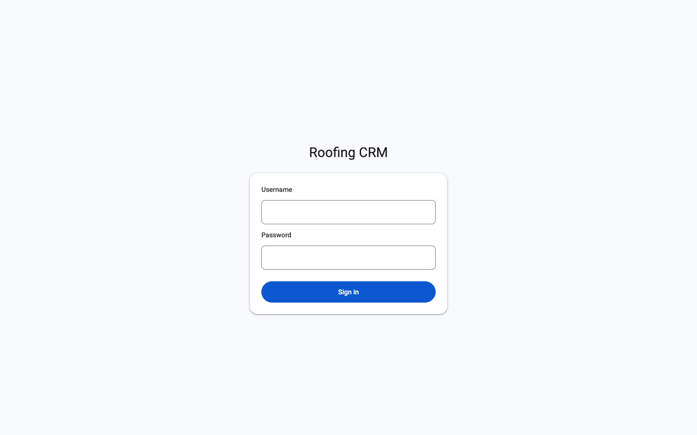
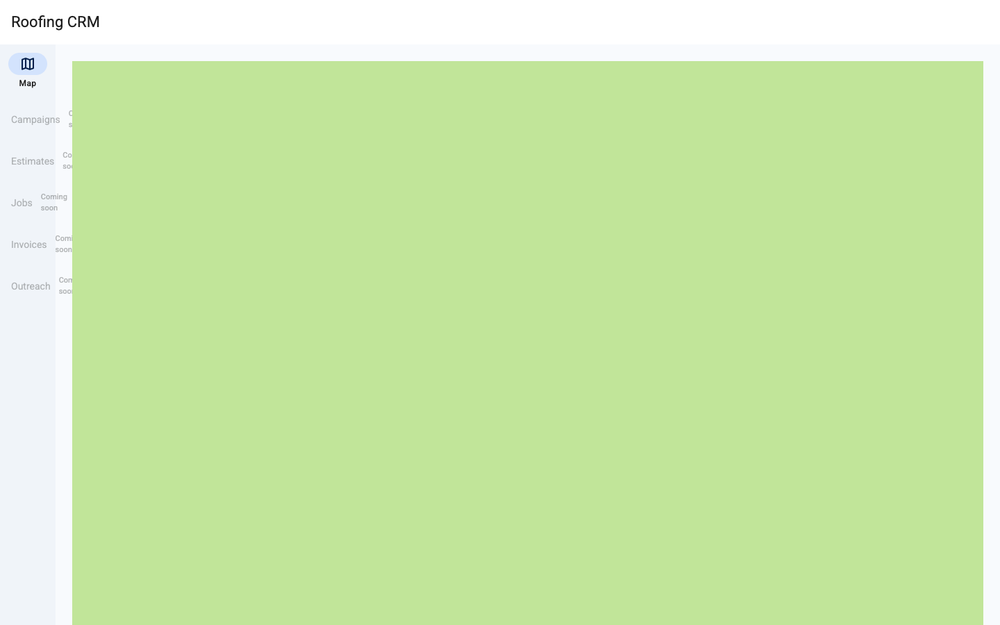
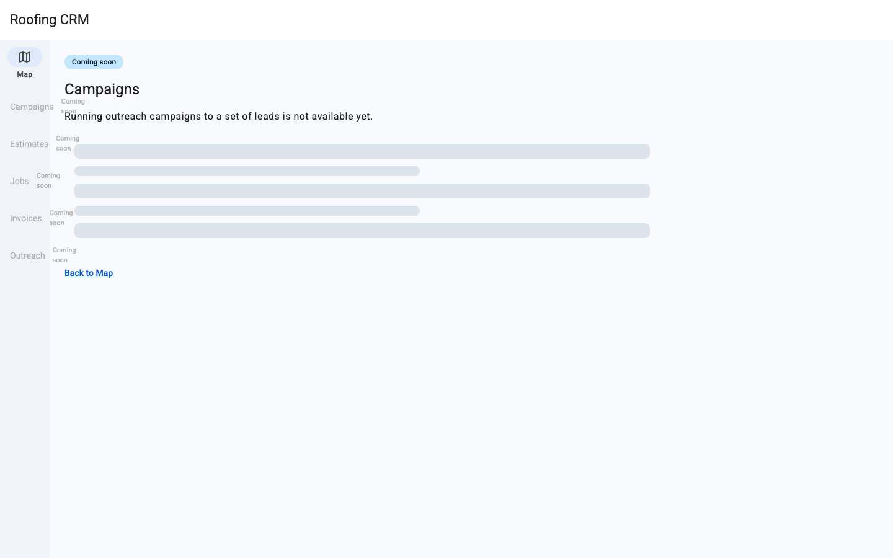

# B-01 CRM shell with disabled roadmap sections

| Field | Value |
| --- | --- |
| Runtime URL | `https://001-crm-shell.d1zmhc6kkyzsbe.amplifyapp.com/sign-in` |
| Date | 2026-10-23T07:30:00Z |
| Data snapshot | n/a — this story reads no Oracle/Elephant property/permit data |
| Playwright | `tests/e2e/B-01.spec.ts` — 9/9 cases × 3 viewports = 27/27 ✓; `tests/e2e/config-guard.spec.ts` 3/3 ✓; `tests/e2e/responsive/*.spec.ts` (TZ04) 33/33 ✓ |
| Logs / trace | X-Ray trace `1-6adadfe7-2b595441410c685671e27d7b` (`health.ping`, `crm-api-trpc` Lambda, eu-north-1) |
| Test report | `docs/reports/TR-B-01.md` |
| Code review | `docs/reviews/CR-B-01.md` (pending — Phase E) |

## Action

1. Open `https://001-crm-shell.d1zmhc6kkyzsbe.amplifyapp.com/sign-in` in a private window.
2. Confirm no "Sign up" / "Create account" link appears anywhere on the page.
3. Enter the seeded admin username (`admin@roofing-crm.test`) and password (Secrets Manager `roofing-crm/admin-user`, never printed or committed).
4. Click "Sign in".
5. Confirm the Map screen renders, centered on Travis County, and `health.ping` traces in X-Ray within 3 s of load.
6. Reload the page — confirm the session persists and the Map screen stays rendered.
7. Pan and zoom the map freely; confirm it never drops below full-county visibility.
8. Open the nav rail ( ≥768 px) or the "More" sheet (390 px); confirm all five roadmap rows (Campaigns, Estimates, Jobs, Invoices, Outreach) are `aria-disabled="true"` with a "Coming soon" tooltip.
9. Tap "Campaigns" — confirm it opens a real Coming Soon page (never a 404), with a working "Back to Map" action.
10. Sign out (clear session) and attempt sign-in with the wrong password four times in a row — confirm the 4th attempt shows "Too many attempts — try again in 5 minutes." (never a generic error or raw 500).

## Expected

From `stories/B-01-crm-shell.md`:

- **AC-1** — rep signs in with the shared test login at the hosted URL in a private window → lands on the Map screen centered on Travis County (≈30.2672°N, −97.7431°W), no self-sign-up link visible.
- **AC-2** — once signed in, the map can be panned/zoomed across all of Travis County (≈1,023 sq mi) without reload, and `health.ping` appears in X-Ray within 3 s.
- **AC-3** — four failed sign-in attempts → a typed lockout state naming the cause, never a generic 500 or blank screen.
- **AC-4** — the nav rail (or 390 px "More" sheet) shows Campaigns/Estimates/Jobs/Invoices/Outreach as `aria-disabled` rows with a "coming soon" tooltip; tapping one does not navigate into a working feature.
- **AC-5** — tapping a disabled row opens a Coming Soon page with "Back to Map," never a 404 or blank page.

## Observed

All five ACs confirmed live, via 27 Playwright cases (9 test scenarios × 3 viewports: mobile-390, tablet-768, desktop-1440) run against the hosted URL, plus 3 config-guard cases and 33 responsive/Atlas-token cases (TZ04) — 63/63 passing. Screenshots below are from a manual confirmation run matching the Playwright flow exactly.

- Sign-in: no self-sign-up link; typed "Incorrect username or password." on a wrong attempt; typed "Too many attempts — try again in 5 minutes." on the 4th consecutive wrong attempt (not a 5th — see the lockout design note below).
- Map: renders centered on Travis County; `health.ping` responds within 3 s of load, traced in X-Ray (`crm-api-trpc` Lambda, trace id above); free pan/zoom never clips below full-county visibility (client-side `cameraForBounds`-derived `minZoom`, no `maxBounds` cap).
- Session persists across a full page reload (not just client-side navigation).
- Tile-host network failure renders the named `CrmMapFailed390` state with a "Retry" action, never a blank grey grid.
- All 5 roadmap rows render `aria-disabled="true"` with the exact "Coming soon" tooltip text, in the nav rail at ≥768 px and inside the "More" sheet at 390 px — the same shared `NavRow` component, not a duplicate implementation.
- Tapping a disabled row opens `/coming-soon/:section` with a real heading and a working "Back to Map" link — never a 404.

**Lockout design note, disclosed:** Cognito's PreAuthentication trigger fires before password validation, so it cannot itself observe a failed attempt. The failure count is reported by the client (`apps/web`) to a new, unauthenticated `auth.reportFailedAttempt` procedure only when Cognito itself rejects the password with `NotAuthorizedException`; the actual *block* (rejecting a sign-in attempt while locked) stays entirely server-side via Cognito's PreAuthentication trigger and is not spoofable. This was a deliberate, user-approved tradeoff (AskUserQuestion, three options presented) for a one-shared-login demo account with no public attacker surface worth a full Custom Auth Challenge rearchitecture. See `specs/001-crm-shell/run-log.md`'s D1/D2 entry for the full reasoning.

## Missing data or limitations seen

- No Oracle/Elephant property or permit data is read by this story at all (by design — B-01 is the walking skeleton only; B-02+ adds the lead index).
- `CrmDomain`'s custom domain (`crm.aldarraj.com`) is not yet cut over (Round 1 decision D-2) — RUNTIME_URL is the Amplify branch preview domain; the custom domain cuts over after this story merges to `feature/roofing-crm`.
- One intermittent, non-reproducing Playwright flake (an unused `StatusPill` component's Atlas-token audit, mobile-390 only, inside the full combined suite) is documented in `specs/001-crm-shell/run-log.md` — never reproduces in isolation, most likely a CDN/browser-cache artifact from this session's unusually rapid iterative redeploy cadence (10 Amplify builds), not a functional or design regression.

## Screenshot

---

## § B-10 Disabled roadmap sections (AC-4, AC-5, D-9)

The merged story's second part — the honest, disabled roadmap sections (Campaigns, Estimates, Jobs, Invoices, Outreach) — proven together with the rest of B-01 above (same Playwright run, same hosted URL, same deploy).

### Action

See steps 8–9 above: open the nav rail / "More" sheet, confirm all five rows are `aria-disabled="true"` with a "Coming soon" tooltip, tap "Campaigns", confirm it opens a real Coming Soon page.

### Expected

AC-4 and AC-5 (quoted above); README OOS-3 ("show, don't hide, planned-but-not-built sections").

### Observed

All five rows are real `role="button"` elements with `aria-disabled="true"` (not a native `disabled` attribute — they remain keyboard- and tap-reachable so the "Coming soon" tooltip and the Coming Soon page stay reachable, per the story's own honesty requirement: a disabled-*looking* row that is still interactive, never a dead end). The same `NavRow` component (`packages/ui`) is reused unmodified between the ≥768 px nav rail and the 390 px "More" sheet. The Coming Soon page reads its section list from `packages/shared`'s `RoadmapSection` enum — not hardcoded per-page — and its "Back to Map" action returns to the signed-in Map screen.

### Missing data or limitations seen

None — this part has no data dependency; it is pure UI honesty (marking what is not built yet, rather than hiding it or faking it).
