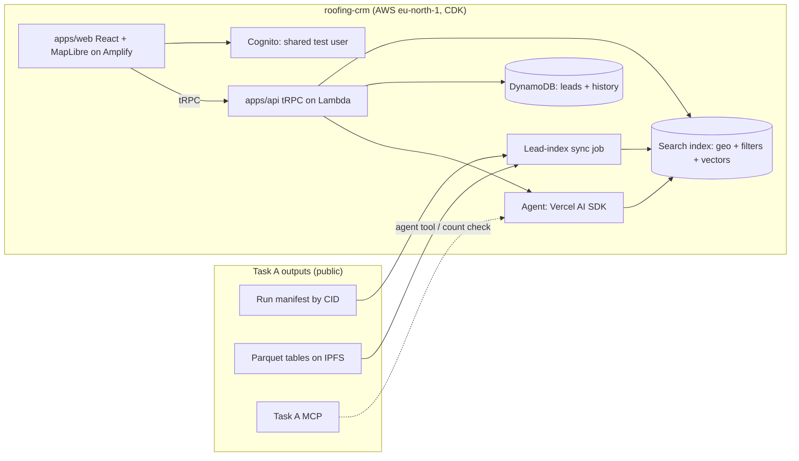

# High-Level Implementation Plan: Roofing CRM

> Generated by `developmentsupport-hlplan` from the feature list and intent. It sequences features into delivery phases that feed Spec Kit, one story branch per feature.

## 1. Plan overview

We are building a hosted, map-based roofing lead CRM for a sales rep working Travis County. It reads only the data the Oracle task (Task A) publishes, and adds what Task A does not have: a map with pin/GPS radius search, CRM leads, and an agent that can create leads. Delivery follows the playbook's build order (Part 3, relative days 4–8), **interleaved with Task A**: each phase starts when the Task A story it copies code or data from is done (PO decision, 2026-10-21). The walking skeleton goes live first, then the search index on real Task A data, then map search, leads, and finally the agent, the disabled sections and hardening.

**Delivery approach:** Spec-Driven Development. Each FEAT becomes `stories/{ID}.md`, then `/speckit-specify` creates the branch `NNN-slug` from `feature/roofing-crm`, then specify → clarify → plan → tasks → analyze → implement → deploy → verify on the live URL → merge with `--no-ff`.

**Days:** "Day N" is the playbook's relative day, not a calendar date (PO decision, 2026-10-21). Days 1–3 are planning (P1–P8). A phase's day only holds once its Task A source is done (§ 6).

## 2. Traceability

| Source | Reference | Role |
| --- | --- | --- |
| Vision | VIS-B (`docs/01-intent.md`, approved 2026-10-21) | Problem, outcome, success criteria (§ 8 there, § 10 here) |
| Feature list | FL-B (`docs/feature-list.md` v0.2) | Features assigned to phases (§ 8) and Task A reuse (§ 4.6 there) |
| Architecture | ARD-B (`docs/architecture-constitution.md`, written at P6 / G3) | Rules every plan is checked against; decides the open items Q-03, Q-04 |

## 3. Architecture summary (conceptual)

Source: `../assessment-guide/reference/B-roofing-crm.md` § 3. Final choices are made at G3.

**Major components:** web app — map, search, detail drawer, lead list, agent panel · API — search, leads and agent procedures, Zod-validated · sync job — reads Task A's manifest by CID and builds the index, recording `sourceManifestCid` · search index — radius, filters and permit-text vectors · lead store — the CRM's own leads, de-duplicated by `propertyCid` · agent — tools over the index and leads, cited answers · Cognito — one shared test user.

## 4. Technology stack

| Tier | Technology | Justification |
| --- | --- | --- |
| Frontend | React + Vite + MapLibre GL on Amplify; Atlas design system (Material 3, mobile-first) | Golden Path; `build-frontend-backends`; MapLibre needs no paid map key (CLAUDE.md: Atlas only) |
| API | tRPC on Lambda behind API Gateway; Zod on every input | Golden Path; constitution V |
| Data | Search index (technology decided at G3, see Q-03/Q-04); DynamoDB for leads; DuckDB in the sync job to read Task A's Parquet by CID | Task guide § 3; leads are the CRM's own data (constitution B2) |
| AI | Vercel AI SDK; `AI_PROVIDER=bedrock` (works as of 2026-10-21), Gateway for Titan v2 embeddings | Golden Path, constitution VI |
| IaC / CI | CDK (region from config; demo `eu-north-1`), GitHub Actions | Golden Path, constitution III, X |

## 5. Scope (G2 required)

| # | In scope | Delivered in |
| --- | --- | --- |
| S-01 | Hosted CRM, shared test login, map on Travis County (FEAT-B01) | Phase 0 |
| S-02 | Search index built only from Task A's published data (FEAT-B02) | Phase 0 (full county re-sync when A-11 lands) |
| S-03 | Pin/GPS radius search, aged roofs, open and long-open permits, detail drawer (FEAT-B03…B06) | Phase 1 |
| S-04 | Leads and the filterable candidate/lead list (FEAT-B07, B08) | Phase 2 |
| S-05 | Agent, disabled future sections, responsive + observable (FEAT-B09…B11) | Phase 3 |
| S-06 | Manager lead view (FEAT-B12, Could) | Phase 3, only if time allows |

| # | Out of scope | Rationale |
| --- | --- | --- |
| OS-01 | Data collection and ingestion pipelines | README Out of Scope; Task A owns them |
| OS-02 | Live BBB API (FEAT-B14, Won't) | README Out of Scope; BBB stays blocked (PO) |
| OS-03 | Real outbound messages (FEAT-B13, Won't) | README Out of Scope ("mocked or deferred") |
| OS-04 | Other counties, more than one company (FEAT-B15, Won't) | PO decision; task guide future work |

## 6. Dependencies (G2 required)

| ID | Type | Dependency | Needed by | Status |
| --- | --- | --- | --- | --- |
| DEP-01 | Inter-phase | Phase 0 → Phase 1 | Search needs hosting, login and the index | — |
| DEP-02 | Inter-phase | Phase 1 → Phase 2 | Leads are created from the detail drawer and results | — |
| DEP-03 | Inter-phase | Phase 2 → Phase 3 | The agent's `createLead` tool needs leads | — |
| EXT-01 | External (Task A) | A-02 `contract/v1` frozen with real sample rows | Planning (P6, P8), Phase 0 | Pending (A-02 in progress on 2026-10-21) |
| EXT-02 | External (Task A) | A-03 done: code to copy + first published CIDs (one month of Austin reroof permits) | Phase 0 | Pending |
| EXT-03 | External (Task A) | A-11 done: full-county manifest | Phase 0 B-02 re-sync, before the demo | Pending |
| EXT-04 | External (Task A) | A-13 done: filters, drawer and responsive code to copy | Phase 1 (and B-11) | Pending |
| EXT-05 | External (Task A) | A-14 done: agent frame to copy | Phase 3 (B-09) | Pending |
| EXT-06 | External (Task A) | A-18 done: "Coming soon" pattern to copy | Phase 3 (B-10) | Pending |
| EXT-07 | External | AWS account `assess`, `eu-north-1`, free plan $120 credit | Phase 0 | Available |
| EXT-08 | External | Bedrock model access | Phase 3 | Available (PO, 2026-10-21) |
| EXT-09 | External | Domain `crm.aldarraj.com` (Namecheap CNAMEs, as Task A does for `countylens.aldarraj.com`) | Phase 0 | Decided (PO, 2026-10-21); DNS set up in B-01 |
| EXT-10 | External | Search-index service available on the free plan (Q-04) | Phase 0 | Available (read-only check 2026-10-21; confirmed at first deploy) |
| ORG-01 | Organisational | G1 approval of the feature list (Q-01) | P8 stories | Pending |
| ORG-02 | Organisational | G3 approval of the architecture constitution (P6) | Phase 0 | Pending |
| ORG-03 | Organisational | Assessor questions | — | Resolved: answered by the PO 2026-10-21 (VIS-B § 12) |

## 7. Constraints (G2 required)

| # | Type | Constraint | Impact |
| --- | --- | --- | --- |
| CON-01 | Technical | TypeScript only; CDK only; region from config (demo `eu-north-1`, default `us-east-2`); Vercel AI SDK for every LLM call | Shapes every story; no Python, no console-made resources |
| CON-02 | Budget | Zero idle cost by default; $10 budget alert; $120 credit, access stops when it runs out | Rules out services with a high minimum charge for the index (Q-03) |
| CON-03 | Timeline | Deadline Thursday 2026-10-22; 5 build days in the playbook; speed is scored up to the last commit | The plan does not fit before the deadline unless Task A finishes fast (RISK-02) |
| CON-04 | Resourcing | One person | Gates are self-approved with AI pre-checks |
| CON-05 | Access | Data only from Task A's CIDs or MCP; BBB blocked; Travis County only | B-02 is a sync from CIDs; BBB shows "not available" |

## 8. Implementation phases

Order: Project-class enablers first, the walking skeleton live before feature work, Must before Should/Could, and dependencies respected. Each phase ends with testable exit criteria on the **hosted** URL.

### Phase 0: Foundation, walking skeleton and real data (Days 4–5)

- **Objective:** a hosted CRM where the test user logs in to a Travis County map, backed by a search index built from Task A's real published CIDs.
- **Features:** FEAT-B01, FEAT-B10, FEAT-B02
- **Story branches:** `001-crm-shell` (B-01 with part B-10), `002-lead-index`
- **Starts when:** A-03 is done (EXT-02). B-02 first indexes A-03's real Austin permits, then re-syncs on the A-11 full-county manifest when it lands (EXT-03), with no code change.
- **Duration:** 2 days (Day 4: B-01; Day 5: B-02)
- **Exit criteria:** in a private window, the test user logs in on the hosted URL and the map opens on Travis County; `health.ping` shows a log in CloudWatch and a trace in X-Ray; the hosted API reports the index's `sourceManifestCid` and a record count equal to that manifest's count (checked by `porygon`, confirmed by `donphan` through the MCP).

### Phase 1: Map search (Day 6)

- **Objective:** the rep finds aged roofs and long-open roofing permits around a pin or GPS position and inspects them.
- **Features:** FEAT-B03, FEAT-B04, FEAT-B05, FEAT-B06
- **Story branches:** `003-map-search` (B-03 with parts B-04, B-05, B-06)
- **Starts when:** Phase 0 exit passes and A-13 is done (EXT-04).
- **Duration:** 1 day
- **Exit criteria:** on the hosted URL, a pin plus 5 mi redraws the ring and results; Playwright GPS (`setGeolocation`) works; changing the roof-age threshold from 15 to 25 changes the count; permits sort by open duration with an "open > 5 years" badge; the drawer shows status, open duration, contractor, BBB or "BBB not available", and a source link; copied A-13 tests pass here.

### Phase 2: Leads (Day 7)

- **Objective:** the rep turns matches into tracked leads and works a filterable list.
- **Features:** FEAT-B07, FEAT-B08
- **Story branches:** `007-leads` (B-07 with part B-08)
- **Starts when:** Phase 1 exit passes (no Task A dependency).
- **Duration:** 1 day
- **Exit criteria:** on the hosted URL, 3 leads are created (at least one from a property and one from a permit), a status changes and a note is added, and all of it survives a reload; adding the same property twice is refused; the list paginates, combines roof-age + permit status/duration + radius filters, and the URL reproduces the filters.

### Phase 3: Agent, expansion surface and hardening (Day 8)

- **Objective:** plain-language opportunity search that creates leads; disabled future sections; responsive and observable in production.
- **Features:** FEAT-B09, FEAT-B11; FEAT-B12 only if time allows (FEAT-B10 moved to Phase 0)
- **Story branches:** `009-agent-hardening` (B-09 with part B-11); `012-manager-view` (optional)
- **Starts when:** Phase 2 exit passes; B-09 needs A-14 (EXT-05). B-10 (now part of B-01) is built without waiting for A-18's pattern (EXT-06 no longer blocks).
- **Duration:** 1 day
- **Exit criteria:** golden queries G1–G7 pass as Vitest against the deployed endpoint, with citations and an honest "no results"; an agent result opens on the map and becomes a lead; Campaigns, Estimates, Jobs, Invoices and Outreach are visible, `aria-disabled`, with a "coming soon" tooltip; the `smeargle` suite passes at 390 / 768 / 1440; Powertools business metrics, a DLQ alarm and a CloudWatch dashboard exist in CDK.

After Phase 3: the release steps (playbook Part 4, R1–R7): PR, hosted URL, credentials, demo video.

### 8.x Feature-to-phase coverage

| FEAT-ID | Feature | MoSCoW | Phase | Branch |
| --- | --- | --- | --- | --- |
| FEAT-B01 | Walking skeleton | Must | 0 | `001-crm-shell` |
| FEAT-B02 | Lead search index | Must | 0 | `002-lead-index` |
| FEAT-B03 | Radius search | Must | 1 | `003-map-search` |
| FEAT-B04 | Aged roofs | Must | 1 | `003-map-search` (part B-04) |
| FEAT-B05 | Open permits | Must | 1 | `003-map-search` (part B-05) |
| FEAT-B06 | Permit, contractor and BBB detail | Must | 1 | `003-map-search` (part B-06) |
| FEAT-B07 | Leads | Must | 2 | `007-leads` |
| FEAT-B08 | Candidate and lead list | Must | 2 | `007-leads` (part B-08) |
| FEAT-B09 | Grounded agent | Must | 3 | `009-agent-hardening` |
| FEAT-B10 | Disabled future sections | Must | 0 | `001-crm-shell` (part B-10) |
| FEAT-B11 | Responsive and observable | Must | 3 | `009-agent-hardening` (part B-11) |
| FEAT-B12 | Manager lead view | Could | 3 (optional) | `012-manager-view` |
| FEAT-B13…B15 | Outbound messaging, live BBB, more counties | Won't | — (not built) | — |

## 9. Risk register (G2 required: at least one mitigation per risk)

| Risk | Description | L | I | Mitigation | Owner |
| --- | --- | --- | --- | --- | --- |
| RISK-01 | Task A delays block Task B: each phase waits for a Task A story | H | H | Interleave (start each phase as its Task A source lands, not after all of Task A); B-02 starts on A-03's real CIDs and re-syncs on A-11 without code changes; B-07/B-08 have no Task A dependency | HebaGaber |
| RISK-02 | The 5 build days don't fit before the 2026-10-22 deadline | H | H | Build the critical path first (B-01 → B-02 → B-03…B-05 → B-07 → B-09); drop FEAT-B12 first; keep B-10 small; raise the timeline with the assessor now if Task A is not near done (Q-05) | HebaGaber |
| RISK-03 | The search index has an idle cost (an OpenSearch domain runs hourly; Serverless has a high minimum) or is unavailable on the free plan | M | H | Decide at G3 with `alakazam` against NFR-02; options: smallest domain torn down after evaluation, or a lighter index; budget alert at $10 | HebaGaber |
| RISK-04 | Permit coverage is mostly Austin city | H | M | Show the covered jurisdictions in the UI (PO-approved); never imply full coverage | HebaGaber |
| RISK-05 | No BBB ratings in Task A's data (source blocked) | H | L | Show "BBB not available" with the reason (README "when available"; constitution XI) | HebaGaber |
| RISK-06 | The README-style demo query near Pflugerville finds 0 open Austin reroof permits (Task A A-13/A-14 fact, 2026-10-19: 44 permits, 0 open, 3 stalled) | H | M | The agent answers honestly and offers the stalled permits, labelled; pick the demo area at release from real data | HebaGaber |
| RISK-07 | Copied Task A code breaks in this repo | M | M | Rerun the copied part's Task A tests here (FL-B § 4.6); log every copy with its commit in `docs/reuse-log.md`; owning agent reviews the copy | HebaGaber |
| RISK-08 | The evaluator's GPS is outside Travis County | H | M | Pin drop is the main path; an out-of-county GPS position says so (VIS-B SC-1) | HebaGaber |
| RISK-09 | Bedrock throttling (10 requests/min measured by Task A, 2026-10-17) or cost | M | M | Reuse A-14's timeouts and $3/day cap; `AI_PROVIDER` can switch to the Gateway | HebaGaber |
| RISK-10 | Credits run out and AWS stops access | L | H | $10 budget alert; zero idle cost; tear down the paid parts after evaluation; check plan state before debugging "Access Denied" | HebaGaber |
| RISK-11 | Map tile provider terms or rate limits | M | M | Choose a free OSM-based provider at G3, check its terms, show attribution | HebaGaber |

## 10. Success criteria (G2 required: each traces to VIS)

| SC | Measurable criterion | Traces to | Verified in phase |
| --- | --- | --- | --- |
| SC-01 | A pin plus 5 mi redraws the ring and the results in < 3 s (p95) on the hosted URL | VIS-B SC-1 (B1) "dropping a pin or using GPS and setting 5 mi redraws the circle and the results" | 1 |
| SC-02 | Changing the threshold from 15 to 25 years changes the result count; every result shows roof age, basis and confidence | VIS-B SC-2 (B2) "changing 15 to 25 changes the count" | 1 |
| SC-03 | Permits are sorted by open duration; 100% of drawer views show contractor and BBB or "not available" with the reason | VIS-B SC-3 (B3) "Permit results sorted by open duration; the detail panel shows … contractor and BBB, or "not available" with the reason" | 1 |
| SC-04 | 3 leads created, a status changed and a note added survive a reload; a duplicate create is refused 100% of the time | VIS-B SC-4 (B4) "the same property cannot be added twice" | 2 |
| SC-05 | All golden queries G1–G7 pass against the deployed endpoint; every cited record exists in the index | VIS-B SC-5 (B5) "returns real records with citations, which open on the map or become leads" | 3 |
| SC-06 | A combined roof-age + permit + radius filter narrows both list and map; 5 disabled sections are visible | VIS-B SC-6 (B6) "Combined roof-age + permit status / open duration + radius filter narrows both" | 2, 3 |
| SC-07 | Index record count equals the source manifest's count (or the difference is documented) | VIS-B SC-6 (B6) "real data scale" | 0 |

## 11. Spec Kit mapping

| Spec dir / branch | Story | Phase | Command sequence |
| --- | --- | --- | --- |
| `specs/001-crm-shell` | B-01 (parts B-01, B-10) | 0 | specify → clarify → plan → tasks → analyze → implement |
| `specs/002-lead-index` | B-02 | 0 | specify → clarify → plan → tasks → analyze → implement |
| `specs/003-map-search` | B-03 (parts B-03, B-04, B-05, B-06) | 1 | specify → clarify → plan → tasks → analyze → implement |
| `specs/007-leads` | B-07 (parts B-07, B-08) | 2 | specify → clarify → plan → tasks → analyze → implement |
| `specs/009-agent-hardening` | B-09 (parts B-09, B-11) | 3 | specify → clarify → plan → tasks → analyze → implement |
| `specs/012-manager-view` (optional) | B-12 | 3 | specify → clarify → plan → tasks → analyze → implement |

## 12. Gate G2: Plan Approval

| # | Criterion | Status |
| --- | --- | --- |
| G2-01 | Correct artifact type for the classification (plan for a Project) | ☑ (AI: PASS) |
| G2-02 | Scope documented (§ 5) | ☑ (AI: PASS) |
| G2-03 | Dependencies of all three types documented (§ 6) | ☑ (AI: PASS) |
| G2-04 | Constraints documented (§ 7) | ☑ (AI: PASS) |
| G2-05 | Every risk has at least one concrete mitigation (§ 9) | ☑ (AI: PASS) |
| G2-06 | Every success criterion traces to VIS (§ 10) | ☑ (AI: PASS) |
| G2-07 | Every Must feature is assigned to a phase and a branch (§ 8.x) | ☑ (AI: PASS) |
| G2-08 | The walking skeleton is the first phase that ships to the hosted URL | ☑ (AI: PASS) |
| G2-09 | No `{placeholders}` or undocumented TBDs; open items are in § 13 | ☑ (AI: PASS) |
| G2-10 | AI pre-check (`developmentsupport-g2-precheck`): PASS | ☑ |

**AI pre-check report:** see `docs/gates/G2-PROJ-B-precheck.md`.

**Decision:** ☑ Approved ☐ Returned · HebaGaber · 2026-10-21

## 13. Open questions and gaps

| # | Question / gap | Raised to | Status |
| --- | --- | --- | --- |
| Q-01 | G1 decision on `docs/feature-list.md` is not recorded yet | PO | Open |
| Q-02 | Which domain hosts `crm.`? | PO | Closed 2026-10-21: `crm.aldarraj.com` |
| Q-03 | Which search-index technology meets NFR-02 (zero idle cost) and serves geo + filters + vectors? | G3 (`alakazam`) | Open until G3 (PO, 2026-10-21). Proposed by `alakazam` (2026-10-21), to be decided at G3: Parquet index (properties sorted by geohash; permits with Titan v2 embeddings) queried by DuckDB in Lambda, reusing Task A's `query-core`; about $0 idle. Fallback: one `t3.small.search` OpenSearch domain for the evaluation window only (about $28–30/month idle), behind the same retrieval interface. Main risk: Lambda cold start vs. NFR-01 p95 < 3 s |
| Q-04 | Is that index service available on the AWS free plan in `eu-north-1`? | G3 (check in the account) | Checked 2026-10-21 (read-only): account 515618610572 is on the FREE plan, ACTIVE, $120.00 credit left, expires 2027-04-16. Lambda, S3, OpenSearch (`t3.small.search` offered) and S3 Vectors all answer in `eu-north-1`. A read-only check can't prove the free plan allows creating each resource; the first CDK deploy in B-01/B-02 confirms it |
| Q-05 | Calendar dates for A-03, A-11, A-13, A-14 and A-18, to check the 2026-10-22 deadline | PO (Task A plan) | Deferred by the PO 2026-10-21: keep the timeline flexible (relative days); revisit as each Task A story lands |

## 14. Change log

| Version | Date | Change |
| --- | --- | --- |
| 0.1 | 2026-10-21 | Initial draft: playbook Part 3 order, relative days 4–8, interleaved with Task A (PO decision) |
| 0.2 | 2026-10-21 | Q-02 closed (`crm.aldarraj.com`); Q-03 stays open until G3; Q-05 deferred (flexible timeline); Q-04 checked |
| 0.2.1 | 2026-10-21 | Story merge before P8 (PO decision): 11 stories → 5 (B-10 → B-01 · B-04, B-05, B-06 → B-03 · B-08 → B-07 · B-11 → B-09), so the loop runs 5 times. FEAT-B10 moves to Phase 0 with the shell; branches and the Spec Kit mapping updated. No scope change; the G2 approval stands |
