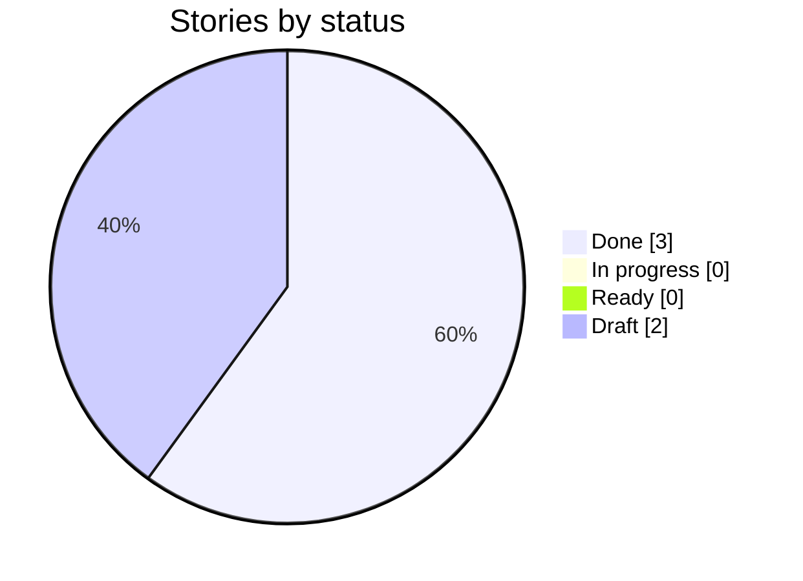
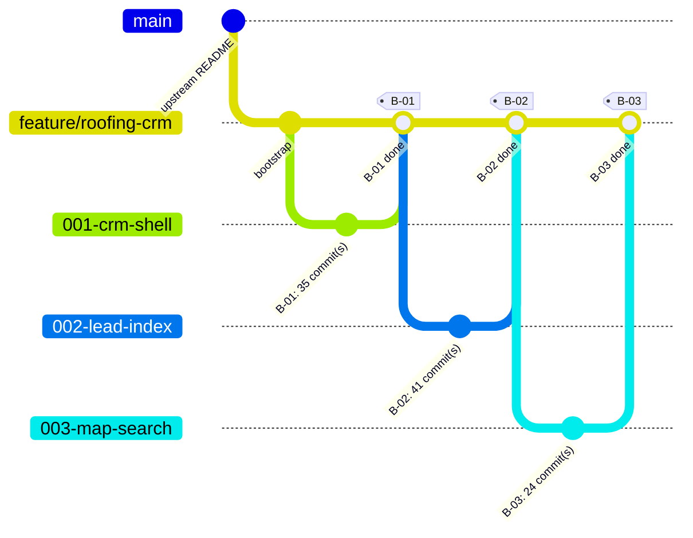

# Delivery Progress: `feature/roofing-crm`

Generated by `scripts/progress.sh` at 2026-10-23T21:37Z from `feature/roofing-crm` @ `80873e1`. Do not edit by hand.

**3 of 5 stories done** · 0 in progress · 0 ready · 2 draft

## Status



## Branch graph (one branch and merge per story)



## Board

| Story | Title | Status | Branch | Merged | G4 | G5 | G6 | G7 | Evidence | Last commit |
| --- | --- | --- | --- | --- | --- | --- | --- | --- | --- | --- |
| ✅ B-01 | Open the CRM shell and show the roadmap sections | Done | `001-crm-shell` | yes | ❌ | — | — | ? | [✅](evidence/B-01.md) | 2026-10-23 |
| ✅ B-02 | Build the lead search index from Task A's published data | Done | `002-lead-index` | yes | ❌ | — | ❌ | ? | [✅](evidence/B-02.md) | 2026-10-23 |
| ✅ B-03 | Search a radius for aged roofs and open permits, with full detail | Done | `003-map-search` | yes | ? | ❌ | — | ? | [✅](evidence/B-03.md) | 2026-10-24 |
| ⬜ B-07 | Create, manage and browse CRM leads | Draft | `007-leads` | no | — | — | — | — | — | — |
| ⬜ B-09 | Answer roofing-opportunity questions with a grounded agent, hardened for production | Draft | `009-agent-hardening` | no | — | — | — | — | — | — |

Legend: ✅ done · 🔄 in progress · 🟦 ready · ⬜ draft. Gate cells come from `docs/gates/` pre-check reports (✅ PASS, ❌ FAIL, — not run).

## Mismatches

None: story status and git history agree.

## Raw history (first parent = one line per merged story)

```text
80873e1 2026-10-24 B-03: merge map search (G7 PASS)
0362a37 2026-10-23 docs: G3 approval — architecture constitution (ARD-B), 9/9 pre-check, reviewer score 80/100
087854b 2026-10-23 B-02: update progress
d01c06e 2026-10-23 B-02: merge lead search index (G7 PASS)
8eb848c 2026-10-23 B-01: close out — status Done, gate G7, progress.md updated
fcd6d6a 2026-10-23 B-01: merge CRM shell with disabled roadmap sections
9170946 2026-10-22 docs: draft PR body (planning done up to G3)
9e992ce 2026-10-22 docs: agent architecture consults (metagross, alakazam, espeon, mew) with Task A's published run, and where they disagree
9580d50 2026-10-22 design: P5 design checkpoint approved (CRM prototype, review log, demo-line map)
0994028 2026-10-21 Merge Task B stories into five (B-01, B-02, B-03, B-07, B-09) before P8
bbbb37a 2026-10-21 Story loop: light lane (no /speckit-checklist, G5+G6 together, one review round)
bc4046e 2026-10-21 docs: plan v0.2, domain crm.aldarraj.com, Q-03 open until G3, flexible timeline
a5bfb95 2026-10-21 docs: P4 high-level plan (G2), G1 and G2 approved
3f28606 2026-10-21 docs: P3 feature list (G1 pre-check) and Task A reuse
0b1ab10 2026-10-21 docs: CLAUDE.md, Bedrock works as of 2026-10-21
a3eab7d 2026-10-21 docs: P2 vision (G0) and traceability
814a366 2026-10-21 docs: P1 kit routing and kit usage
a3f5d33 2026-10-17 docs: align constitution, templates and CLAUDE.md with the demo setup
64ce66f 2026-10-15 docs: add fill-in playbooks (planning, per story, release)
c610fe3 2026-10-15 chore: add Spec Kit git extension for branch-per-story
b7f5972 2026-10-15 chore: bootstrap Spec Kit, kit plugin, developmentSupport skills and docs skeleton
f874802 2026-08-28 Update README.md
2b33638 2026-08-12 Pivot README requirements to roofing lead CRM
d10d871 2026-08-12 Update README.md
0d4e31d 2026-08-12 Initial commit
```
