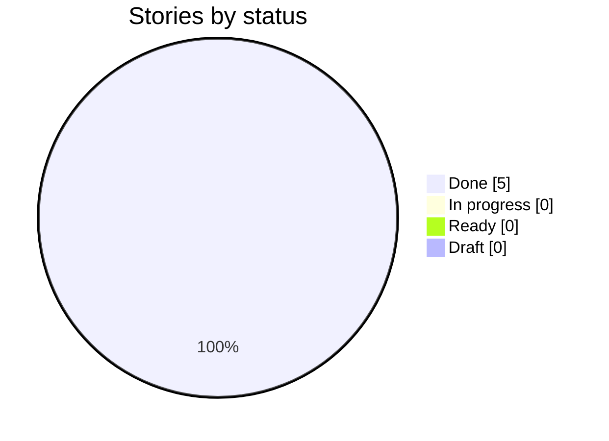
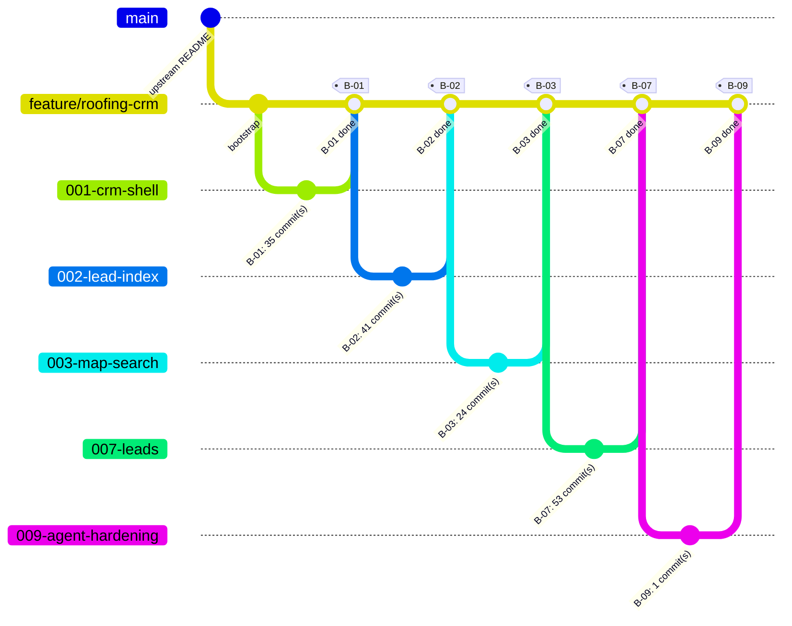

# Delivery Progress: `feature/roofing-crm`

Generated by `scripts/progress.sh` at 2026-10-25T13:34Z from `feature/roofing-crm` @ `414a3f8`. Do not edit by hand.

**5 of 5 stories done** · 0 in progress · 0 ready · 0 draft

## Status



## Branch graph (one branch and merge per story)



## Board

| Story | Title | Status | Branch | Merged | G4 | G5 | G6 | G7 | Evidence | Last commit |
| --- | --- | --- | --- | --- | --- | --- | --- | --- | --- | --- |
| ✅ B-01 | Open the CRM shell and show the roadmap sections | Done | `001-crm-shell` | yes | ❌ | — | — | ? | [✅](evidence/B-01.md) | 2026-10-23 |
| ✅ B-02 | Build the lead search index from Task A's published data | Done | `002-lead-index` | yes | ❌ | — | ❌ | ? | [✅](evidence/B-02.md) | 2026-10-23 |
| ✅ B-03 | Search a radius for aged roofs and open permits, with full detail | Done | `003-map-search` | yes | ? | ❌ | — | ? | [✅](evidence/B-03.md) | 2026-10-24 |
| ✅ B-07 | Create, manage and browse CRM leads | Done | `007-leads` | yes | — | ✅ | ❌ | ❌ | [✅](evidence/B-07.md) | 2026-10-24 |
| ✅ B-09 | Answer roofing-opportunity questions with a grounded agent, hardened for production | Done | `009-agent-hardening` | yes | ✅ | ✅ | ✅ | ❌ | [✅](evidence/B-09.md) | 2026-10-25 |

Legend: ✅ done · 🔄 in progress · 🟦 ready · ⬜ draft. Gate cells come from `docs/gates/` pre-check reports (✅ PASS, ❌ FAIL, — not run).

## Mismatches

None: story status and git history agree.

## Raw history (first parent = one line per merged story)

```text
414a3f8 2026-10-25 B-09: the legend closes on Escape only when focus is on it, so dismissing the Layers dialog keeps it open
c42c65c 2026-10-25 B-09: e2e follows the docked tablet map, the Leads table and the Ask header; new map UI spec
babe718 2026-10-25 B-09: tablet map is a docked split with overlays, compact collapsed rows, compass direction and a pager; list view fits 768
a5d8202 2026-10-25 B-09: Ask panel collapses the composer after an answer, tabs first, Widen to n mi, honest permit coverage note
6c9e79c 2026-10-25 B-09: deep-link camera waits for idle and jumps; sheet bodies scroll with viewport-unit caps; candidate list pane scrolls
34080f5 2026-10-25 B-09: Leads table with Roof, Main permit and Last activity; Permit open filter; numbered pager; one stale-run notice
63b81be 2026-10-25 B-09: leads.list returns each lead's saved signals and last activity, and filters on permit open days
011a3fe 2026-10-25 B-09: quote front matter values with colons so GitHub can render plan, feature list and a gate report
1bc88cf 2026-10-25 B-09: fix two sequence diagrams that GitHub could not render (semicolons in message text)
979ed9b 2026-10-25 B-09: PR description links point to the fork branch
4ab8281 2026-10-25 B-09: view toggle is Map + cards | List; hexagon click drops the pin at its center; selected property centers the map
d2d4afe 2026-10-25 B-09: probe lead removed; TC-016 note updated
fdd20b9 2026-10-25 B-09: note why B-07-TC-016 skips (probe lead kept by the PO)
2deb10f 2026-10-25 B-09: B-07 e2e follows the drawer's lead lookup (pill instead of a refused button); test plan and evidence updated
5c97380 2026-10-25 B-09: permit empty state names the filter and the count matches the rows; no Create lead flash after reload; latency test times from the click
4d72b7d 2026-10-25 B-09: prefetch the Leads list when a lead can be created so the created lead lands in a cached page
13f5b8b 2026-10-25 B-09: PR description updated with all five stories, Run 2 and the known gaps
97aa14b 2026-10-25 B-09: progress updated after the merge (5 of 5 stories done)
66b4196 2026-10-25 B-09: tick TZ07 after the merge
ab6f520 2026-10-25 B-09: merge 009-agent-hardening (agent, hardening, responsive and observable) into feature/roofing-crm
cb6551a 2026-10-24 B-07: PR description links the fork's CI runs (they do not show in the PR checks list)
5e1498e 2026-10-24 B-07: refresh the PR description (four stories done, crm.aldarraj.com live, CI green)
e5a3fa8 2026-10-24 B-07: cut over crm.aldarraj.com to the feature branch (Amplify domain; DNS records go in at Namecheap)
28aa65a 2026-10-24 B-07: format cdk.json (Prettier failed CI on the branch-list line)
06d160c 2026-10-24 B-07: deploy feature/roofing-crm as an Amplify branch so the PR head has a hosted preview and its CI job can reach it
74c8ad3 2026-10-24 B-07: update progress
8b13240 2026-10-24 B-07: merge leads + lead list (G7 approved with exceptions)
869da34 2026-10-24 B-07: story ready for planning (G4 PASS)
3e549ac 2026-10-24 B-03: update progress
80873e1 2026-10-24 B-03: merge map search (G7 PASS)
0362a37 2026-10-23 docs: G3 approval — architecture constitution (ARD-B), 9/9 pre-check, reviewer score 80/100
087854b 2026-10-23 B-02: update progress
d01c06e 2026-10-23 B-02: merge lead search index (G7 PASS)
8eb848c 2026-10-23 B-01: close out — status Done, gate G7, progress.md updated
fcd6d6a 2026-10-23 B-01: merge CRM shell with disabled roadmap sections
9170946 2026-10-22 docs: draft PR body (planning done up to G3)
9e992ce 2026-10-22 docs: agent architecture consults (metagross, alakazam, espeon, mew) with Task A's published run, and where they disagree
9580d50 2026-10-22 design: P5 design checkpoint approved (CRM prototype, review log, demo-line map)
0994028 2026-10-21 Merge Task B stories into five (B-01, B-02, B-03, B-07, B-09) before P8
bbbb37a 2026-10-21 Story loop: light lane (no /speckit-checklist, G5+G6 together, one review round)
bc4046e 2026-10-21 docs: plan v0.2, domain crm.aldarraj.com, Q-03 open until G3, flexible timeline
a5bfb95 2026-10-21 docs: P4 high-level plan (G2), G1 and G2 approved
3f28606 2026-10-21 docs: P3 feature list (G1 pre-check) and Task A reuse
0b1ab10 2026-10-21 docs: CLAUDE.md, Bedrock works as of 2026-10-21
a3eab7d 2026-10-21 docs: P2 vision (G0) and traceability
814a366 2026-10-21 docs: P1 kit routing and kit usage
a3f5d33 2026-10-17 docs: align constitution, templates and CLAUDE.md with the demo setup
64ce66f 2026-10-15 docs: add fill-in playbooks (planning, per story, release)
c610fe3 2026-10-15 chore: add Spec Kit git extension for branch-per-story
b7f5972 2026-10-15 chore: bootstrap Spec Kit, kit plugin, developmentSupport skills and docs skeleton
f874802 2026-08-28 Update README.md
2b33638 2026-08-12 Pivot README requirements to roofing lead CRM
d10d871 2026-08-12 Update README.md
0d4e31d 2026-08-12 Initial commit
```
