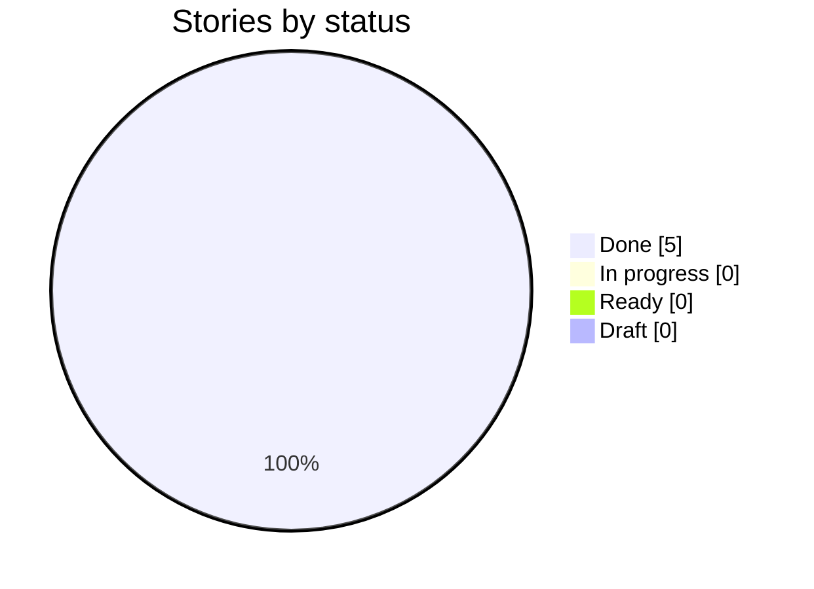
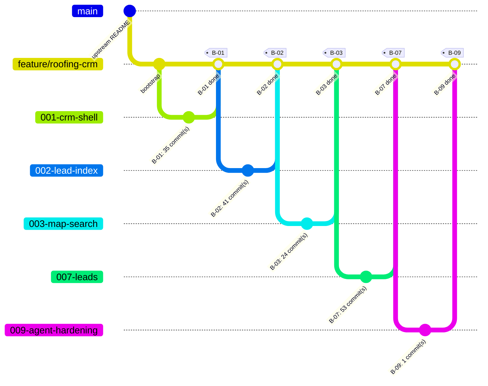

# Delivery Progress: `feature/roofing-crm`

Generated by `scripts/progress.sh` at 2026-10-26T16:00Z from `feature/roofing-crm` @ `493b2e3`. Do not edit by hand.

**5 of 5 stories done** · 0 in progress · 0 ready · 0 draft

## Status



## Branch graph (one branch and merge per story)



## Board

| Story | Title | Status | Branch | Merged | G4 | G5 | G6 | G7 | Evidence | Last commit |
| --- | --- | --- | --- | --- | --- | --- | --- | --- | --- | --- |
| ✅ B-01 | Open the CRM shell and show the roadmap sections | Done | `001-crm-shell` | yes | ❌ | — | — | ? | [✅](evidence/B-01.md) | 2026-10-23 |
| ✅ B-02 | Build the lead search index from Task A's published data | Done | `002-lead-index` | yes | ❌ | — | ❌ | ? | [✅](evidence/B-02.md) | 2026-10-23 |
| ✅ B-03 | Search a radius for aged roofs and open permits, with full detail | Done | `003-map-search` | yes | ? | ❌ | — | ? | [✅](evidence/B-03.md) | 2026-10-24 |
| ✅ B-07 | Create, manage and browse CRM leads | Done | `007-leads` | yes | — | ✅ | ❌ | ❌ | [✅](evidence/B-07.md) | 2026-10-24 |
| ✅ B-09 | Answer roofing-opportunity questions with a grounded agent, hardened for production | Done | `009-agent-hardening` | yes | ✅ | ✅ | ✅ | ❌ | [✅](evidence/B-09.md) | 2026-10-25 |

Legend: ✅ done · 🔄 in progress · 🟦 ready · ⬜ draft. Gate cells come from `docs/gates/` pre-check reports (✅ PASS, ❌ FAIL, — not run).

## Mismatches

None: story status and git history agree.

## Raw history (first parent = one line per merged story)

```text
493b2e3 2026-10-26 B-09: PR text records the final measured self-score and test counts
ffa9dea 2026-10-26 B-09: pending items and B-03 evidence follow the current state; re-captured B-07 screenshots
3649607 2026-10-26 B-09: merge fin-final (Austin example, pin mode click, TCAD id lookup, distinct answer matches with address, permit pins)
fe2d959 2026-10-26 B-03: the BBB link in the Why rules is a 48 px tap target
5b0ebd8 2026-10-26 B-03: hosted specs match the More button exactly
f51858b 2026-10-26 B-03: merge fin-matches (one match design for AI and filters, Ask results in the List view, ask on click, MissingList, full property view with Why inline)
19e04f2 2026-10-26 B-09: format the final golden result files
dcffe39 2026-10-26 B-09: PR text states the CI status of the deployed commit accurately
fecbb55 2026-10-26 B-09: merge fin-gold5 (golden queries 51 of 51 with the named-place gate)
4265ef3 2026-10-26 B-03: changing the search resets the Ask panel (new agent thread, empty answer and question box)
c40351d 2026-10-26 B-02: hosted specs use the exact info control name and open the Filters sheet only when it is closed
098fb75 2026-10-26 B-09: merge fin-x2 (a place named in the question that is not in Travis County is refused, never replaced)
615ec5b 2026-10-26 B-09: merge fin-gold4 (golden run after the self-score fixes: X2 regression recorded)
39034a6 2026-10-26 B-03: merge fin-suggest (Ask sample questions from the golden set; Filters suggestions)
89cb58c 2026-10-26 B-03: the map legend is open by default at every width
643cffa 2026-10-26 B-09: timeline records the assignment sent date
5afb1aa 2026-10-26 B-02: merge fin-roof (roof age 15 years is the default; Any is an explicit state)
24ddca8 2026-10-26 B-07: TC-004 accepts the printed contractor or its reason
8e8e9e0 2026-10-26 B-03: merge fin-fixweb (permit filter in the URL, honest county line, favicon, not-found page, bad deep link message, one overlay at a time on phone and tablet)
b49fa90 2026-10-26 B-07: merge fin-fixapi (lead snapshot carries the printed contractor; the agent refuses requests to message owners)
434ca78 2026-10-26 B-09: PR text drops the draft label and carries the redeploy steps and data source; kit usage names who made the post-merge fix rounds
4339dc4 2026-10-26 B-09: kit usage records the whole-repo review scores; B-02, B-03 and B-07 evidence note the Run 3.1 state; re-captured B-07 screenshots
9aae9c7 2026-10-26 B-09: PR text records the final golden run, reviewer re-scores, the README walk-through and the finished-permit rule
29a113d 2026-10-26 B-09: merge fin-gold3 (golden queries 48 of 48 on Run 3.1 with the live-permit rule)
299fb1b 2026-10-26 B-03: merge fin-live (a finaled permit is never live; labelled Finaled, not Stalled)
f99d0de 2026-10-26 B-09: merge fin-g2 (answers say when permits are stalled; G2 follows Open meaning open or stalled)
5631420 2026-10-26 B-09: merge fin-gold2 (golden queries after the agent fixes)
8089aed 2026-10-26 B-09: per-user daily agent spend cap raised from 3 to 10 dollars
81b5ad4 2026-10-26 B-03: merge fin-style (tokens for raw sizes, mobile-first queries, Ask focus ring, grouped counts in the phone filter sheet)
4bc2440 2026-10-26 B-03: merge fin-polish (responsive test polish; B-07 fails in CI without the password)
dac5e53 2026-10-26 B-09: failed sync steps end in one named failure state; BuildIndex memory alarm; one-command rollback and replay script; runbook
f85d02f 2026-10-26 B-07: lead tests follow Open meaning open or stalled and tolerate other leads in the area
1c48852 2026-10-26 B-09: merge fin-agentfix (owner filter, roof-age basis disclosure, A3 planning, no place inheritance across places)
f380e4e 2026-10-26 B-09: the agent applies the owner-area filter now that Run 3.1 publishes owner mailing ZIPs (tests follow)
c97f518 2026-10-26 B-09: merge fin-gold (golden queries re-baselined on Run 3.1)
3ed8062 2026-10-26 B-09: PR text records the verified deploy of the review fixes
df584e5 2026-10-26 B-09: open items rewritten to the current state; PR text gains process, validation and testing
1df54fc 2026-10-26 B-09: PR description records the Run 3.1 switch, the whole-repo review, the self-score and the fixes
110635e 2026-10-26 B-03: merge fin-e2e (responsive tests for drawer, filters, search, radius; CI fails instead of skipping; drawer Close and BBB tap targets)
a966f4d 2026-10-26 B-03: merge fin-perm (server-side permit filter, Open includes stalled, agent keeps the permit condition)
b775aa1 2026-10-26 B-09: merge fin-cons (shared permit rule, tenure wording, constitution reconciled)
161a149 2026-10-26 B-09: runbook names the alarm topic as configured
4774d52 2026-10-26 B-09: alarms for failed, timed-out, aborted and held sync runs; runbook for rollback, replay and sizing
96b85a3 2026-10-26 B-07: lead tests expect the street-address title Run 3.1 gives lead rows
6406aef 2026-10-26 B-09: docs name Run 3.1 as the served data, with its counts
5901e73 2026-10-26 B-09: why-lead spec matches the address-titled panel heading
d1784cf 2026-10-26 B-09: API index version 4 so warm sandboxes reload the rebuilt Run 3.1 index
fcb4542 2026-10-26 B-09: re-vendor Task A review changes fa6771a (owner area and situs missing-reasons)
aebfbb1 2026-10-26 B-09: Run 3.1 labelled "Run 3.1" in the chip and lead reasons; e2e fixtures point at the Run 3.1 manifest
2dd0cba 2026-10-26 B-09: merge run31-search (exact street-address search)
f3108c6 2026-10-26 B-09: merge run31-addr (situs address and mailing location on screens)
652cac5 2026-10-26 B-09: BuildIndex DuckDB limit 2600 MB; the Run 3.1 build passes 3 of 3 in a 3008 MB arm64 container
4a3b1c7 2026-10-26 B-09: addressLine accepts the optional index field under exactOptionalPropertyTypes
161df28 2026-10-26 B-09: vendor contract v1.2 and views from Task A 3437d23; index carries the situs address and owner mailing ZIP and state
a366ffd 2026-10-26 B-03: the map-search spec's synthetic click carries an originalEvent like a real click
4597fc6 2026-10-26 B-03: the desktop filter panel scrolls inside its pane with the match total pinned; search spec follows the new address copy
9c5549d 2026-10-26 B-03: map-created leads save open versus stalled with the shared main-permit rule; one days-per-year everywhere
40de452 2026-10-26 B-03: merge assign-to-me
8b4c7be 2026-10-26 B-03: merge fix-d
a67bc9b 2026-10-26 B-03: merge fix-c
